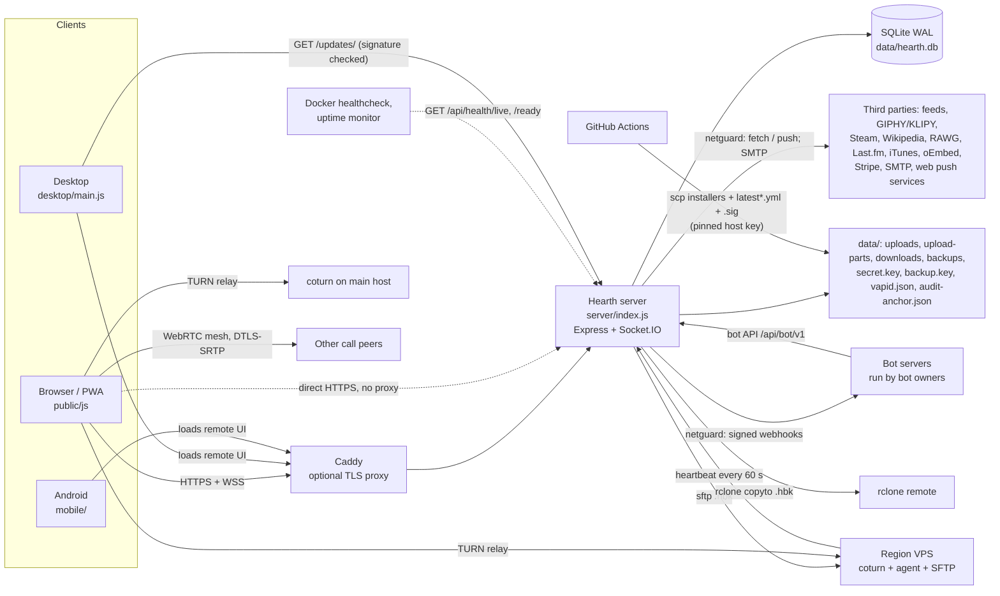
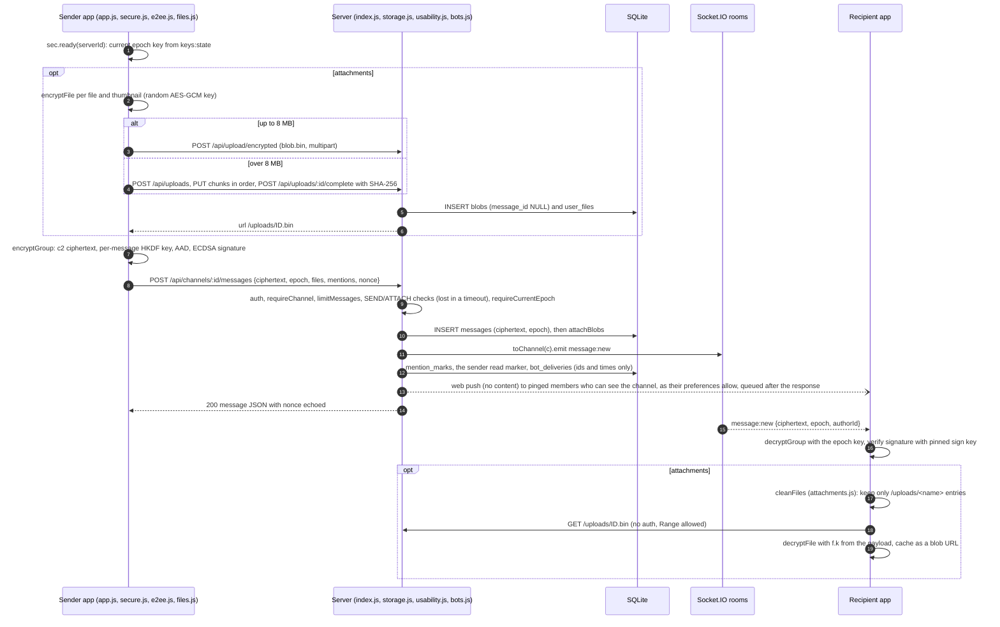

# Hearth architecture overview

Hearth 1.27.1 is a self-hosted chat app with end-to-end encrypted (E2EE) messages and files. One Node process runs
everything: the HTTP API, the bot API, Socket.IO, voice signaling, background jobs and backups. It stores data in one
SQLite file (schema 19). This overview describes the code after the 2026 security overhaul (schema 17, see
[ENGINEERING-REPORT.md](ENGINEERING-REPORT.md)) and the seven workstreams merged since: observability, storage, bots,
recovery, usability, voice reliability and quality. Paths are relative to `hearth/`, except `.github/`, which is at
the repository root. Line numbers appear only in section 7. Everything else is cited by file and function name.
Every HTTP route and socket event is listed in [ROUTES.md](ROUTES.md) (the bot API in [BOTS.md](BOTS.md)); what each
protection guarantees is in [SECURITY.md](../SECURITY.md). Section 13 lists the topic documents.

## 1. Components and entry points

| Component | Entry point | What it is |
|---|---|---|
| Server | `server/index.js` | Express 4 app plus an `api` router mounted at `/api`. Socket.IO 4 is set up in `setupSockets`. `log.js` (structured logger) and `jobs.js` (safe background jobs) load first, before the database. An async block at the bottom starts HTTP or HTTPS (`loadTls` makes a self-signed cert if `SSL_CERT` is unset). Feature modules get a shared context object: `accounts.js` (email, 2FA, recovery, reset), `newsbot.js` (feeds, trackers), `study.js` (Recall sync), `activity.js` (games and music), `regions.js` (relays), `money.js` (Ko-fi and Stripe supporter badge), `memberships.js` (Stripe Connect tiers), `storage.js` (resumable uploads, storage report and cleanup), `search.js` (message search), `bots.js` (bot accounts, installations, the bot API, webhooks, slash commands), `webhooks.js` (incoming Discord- and Slack-style webhook addresses per channel), `usability.js` (saved messages, read state for conversations and threads, the Threads list, notification preferences, timeouts, data export), `selfroles.js` (roles members pick themselves), `nicknames.js` (per-server nicknames), `presence.js` (status changes, automatic Away, custom statuses that clear themselves), `serveraudit.js` (each server's own audit log and its moderators' report inbox), `imports.js` (a new server from a pasted Discord template; the mapping is the pure `discordmap.js`), `scheduled.js` (scheduled messages: the sender's ciphertext held until its time, then posted like one sent then), `wordfilter.js` (word filters: each person's own list, sealed, and a server's suggested one; matching happens only in the apps), `joinhistory.js` ("New members can't read messages from before they joined": who sees which messages and the key change a join asks for), `alerts.js` (owner alerts), `alertchannels.js` (where else alerts go: ntfy, signed webhooks, Discord, Slack), `health.js` (health endpoints) and `metrics.js` (`/metrics` for Prometheus). Support code: `db.js` (schema, migrations, sealing, audit chain), `perms.js`, `channelorder.js` (what a channel or category reorder may change: what you can't see or manage keeps its place), `profile.js`, `page.js`, `backup.js`, and four guards added by the overhaul: `netguard.js` (outbound requests), `proxytrust.js` (which proxies may set the client address), `fetchlimit.js` (streamed size caps on `fetch()` answers) and `imagemeta.js` (strips picture metadata in a worker thread; `audiometa.js` does profile songs in a worker of their own). `mediasign.js` signs the picture-proxy links the server hands out, and `upgradecopies.js` prunes old pre-upgrade database copies. `cli.js` is an operator CLI for TURN settings, backups and restore, `check-files`, `doctor` (`doctor.js`) and `set-owner`. |
| Web client | `public/index.html` | Loads `/socket.io/socket.io.js` and `public/js/app.js` as ES modules. There is no build step. Main modules: `api.js` (REST calls with a bearer token), `conn.js` (when a closed live connection means "signed out" and when it only reconnects), `e2ee.js` (crypto primitives), `secure.js` (key manager), `binding.js` (where each message belongs, inside its encryption: its own id, reply, thread, time and edit count, and the checks readers apply to them), `attachments.js` (keeps only attachment entries on this server), `linkpreview.js` (which link gets a preview, and the checks readers apply to one inside a message), `files.js` (resumable uploads, downloads with progress, a cache of decrypted files), `search-query.js` (the search language, matched on the device), `voice.js` (the call engine), `call-diagnostics.js`, `relays.js`, `watch.js` (watch together), `bots.js` (bot settings, slash commands), `webhooks.js` (Channel settings → Webhooks), `discord-import.js` (Add a server → Import from Discord), `usability.js` (drafts, one notification per message across tabs, export zip), `viewport.js` (keeps the composer above an on-screen keyboard), `presence.js` (tells the server when this app goes idle, for automatic Away; "Clear after" times for a custom status), `scheduled.js` (Send later: the time picker, your scheduled messages and re-encrypting held ones from your own copy), `outside.js` (which pictures and videos would load from another site, and the Outside images choice), `wordfilter.js` (the word filter's matching, on the device only) and `wordfilter-app.js` (your sealed list, servers' suggested lists, what's hidden or blurred, their settings), `recall-host.js` plus `public/recall/` (study app in a sandboxed iframe), and `sw.js` (service worker, push, offline shell). The message list keeps at most 300 messages loaded (`HISTORY_WINDOW` in `app.js`). |
| Desktop | `desktop/main.js` | Electron app. The local `connect.html` picks a server. Then the `BrowserWindow` (`contextIsolation`, `sandbox`) loads the remote server origin. `preload.js` exposes `window.hearthDesktop`. `origin.js` does every exact-origin check, `permissions.js` decides which page permissions need the person's yes, `picker.html` is the app's own screen picker, and `update-verify.js` checks signed updates (Ed25519, key from `hearth.config.json` `updatePublicKey`). `detect.js` detects games and music, and `hotkeys.js` provides global push-to-talk. `build/sign-update.js` makes keys and signs `latest*.yml` in CI. |
| Android | `mobile/` | Capacitor 8 shell. `www/index.html` is the connect page, and then the WebView loads the remote server. `native/MainActivity.java` keeps navigation on that origin, prompts on certificate fingerprints, and runs the `HearthAndroid` bridge (notifications, file saving, push, calls, invite links). `native/BridgePolicy.java` lets only the local connect screen change the saved server, and only the server's page manage push and calls. Notifications while the app is closed come through UnifiedPush (`org.unifiedpush.android:connector`, pinned): `HearthPush.java` registers one push address per server origin, `HearthPushService.java` shows what the library decrypted, `HearthNotifications.java` owns the channels (`messages`, `calls`, `activity`, `ongoing_call`), and the plain-Java `PushPolicy`/`PushPayload` decide what may be shown and opened. `CallService.java` is a `microphone` foreground service during calls. `InviteLinks.java` takes only the code from `hearth://invite/…` and `https://<server>/invite/…`. `scripts/patch-android.js` adds all this to the generated project in CI. The page side is `public/js/android.js` and `public/js/android-push.js`. |
| Bots | external programs; `scripts/example-bot.js` | Programs that bot owners run on their own https servers. A bot is a `users` row with `is_bot = 1` (it can't sign in) plus a `bots` row. It calls `/api/bot/v1` with `Authorization: Bot hb_<id>.<secret>` and receives signed webhooks. `scripts/example-bot.js` is a starting point with no dependencies. |
| Relays / regions | `server/regions.js` | An admin adds a region (password re-confirmed) and gets a one-line install command for `/regions/install/:id?k=` (https only; plain http only for a loopback origin). It downloads the script to a `mktemp` file (`curl --proto =https`, pinned to the server's own key when it uses its self-signed certificate), checks it against the SHA-256 the command carries (the server builds the script when it makes the command and serves the same bytes), and only then runs it with `sudo bash`. The script installs coturn with the instance TURN secret (handed to `setup-turn.sh` in a root-only file, never on a command line), an upload-only SFTP account for backups, and an agent. A systemd timer runs the agent every minute to POST `/api/regions/:id/heartbeat`; the address it reports must be public. |
| TURN | `scripts/setup-turn.sh`, `deploy/turnserver.conf` | coturn in `use-auth-secret` mode with `denied-peer-ip` for private ranges and `no-tcp-relay`. `setup-turn.sh` also sets `max-bps` (`TURN_MAX_MBIT`, default 6) and `bps-capacity` (`TURN_CAPACITY_MBIT`). The sample `turnserver.conf` ships with `static-auth-secret` commented out and no bandwidth cap. The server issues credentials in `iceServersFor`. |
| Caddy | `deploy/Caddyfile` | Optional reverse proxy (compose profile `domain`). It terminates TLS and does `reverse_proxy hearth:3000`. |
| Hosting | `Dockerfile`, `docker-compose.yml`, `deploy/hearth.service`, `scripts/harden-vps.sh` | Docker, or systemd on a VPS. `docker-compose.yml` puts Caddy on a fixed network (`10.231.47.0/28`) and sets `TRUST_PROXY` to it unless `.env` names another proxy. |



## 2. Request and real-time flow

**Middleware order** (as registered in `server/index.js`):

1. `app.set('trust proxy', trustProxySetting(TRUST_PROXY))` (`proxytrust.js`). Unset means `loopback`: only a proxy on
   this machine may set the client address. A number is a hop count, `false` trusts nobody, and addresses or subnets
   name the proxies. `socketIp` runs the same walk (`clientIp`) for Socket.IO.
2. `log.requestLogger()` (`log.js`). It takes the incoming `X-Request-Id` if it matches `[A-Za-z0-9._:-]{1,64}`, or
   makes a random one, sets `req.id` and the `X-Request-Id` response header, and runs the rest of the request in an
   `AsyncLocalStorage` context so every log line carries `reqId`. It writes the access-log line on `finish` (§12).
3. `directGuard`. When `HTTPS=false` and `ALLOW_DIRECT_HTTP` is not `true`, requests from public peer addresses get a
   403. The same check is Socket.IO's `allowRequest`. When `X-Forwarded-For` arrives from an untrusted private
   address, the server logs a one-time hint with a safe `TRUST_PROXY` value (`ignoredXffHint`).
4. `express.json({ limit: '2mb' })`. It keeps the raw body for `/api/pay/*`, so webhook signatures can be checked, and skips `/api/webhooks/` (any capitalisation): incoming webhooks read their own bodies with `express.raw` (64 KB, 1 MB for `/github`) after the address is checked.
5. Security headers on every response: nosniff, `X-Frame-Options: DENY`, COOP, Permissions-Policy, and HSTS when the request is secure. `cspFor` sets the CSP on everything except `/uploads/` and `/media/`. `connect-src` is `'self'` plus the server's own `wss:` (and `ws:` on plain HTTP); `img-src` and `media-src` allow any `https:`. `/api/` responses get `no-store` and CORP.
6. File routes: `/uploads/:file` (Range requests, §6), `/manifest.webmanifest`, `/sw.js`, `/download`, `/terms`, `/updates/:file` (installers, `latest*.yml` and `latest*.yml.sig`), `/downloads/:file`.
7. The CSP middleware for `/recall`, then an in-memory brotli/gzip handler for text assets, `express.static(public/)` and `/vendor/argon2.js`.
8. `app.use('/api', api)`. Inside the router: a gzip wrapper on `res.json` for bodies of 4 KB or more (256 KB or more are compressed off the main thread), an IP-ban guard on `/auth/register`, `/auth/login`, `/auth/forgot` and `/auth/reset`, then the routes, including each feature module's. **There is no router-wide auth.** Each route lists the `auth` middleware itself, and staff routes add `staffOnly`, `adminOnly` or `ownerOnly`. `GET /api/health/live` and `/ready` need no auth. `bots.js` mounts the bot API as a sub-router at `/api/bot/v1` with its own `botAuth` (a bot token, never a session) and its own `{error, code}` error handler. `webhooks.js` mounts `/api/webhooks/:id/:token` (and `/slack`, `/github`) with no session: the address's secret is the credential, and errors use Discord's `{message, code}` shape.
9. App-level routes registered later in the file: `/media/gif` (index.js), `/media/news` and `/media/avatar` (newsbot.js), `/media/art` and `/media/game` (activity.js), `/regions/install/:id` (regions.js).
10. `api` 404 JSON handler, then the error handler, then the SPA fallback for GETs outside `/api`, `/uploads` and `/socket.io`. The error handler turns broken or oversized bodies into 400 `bad_json`, 413 `too_large` or 415, and returns `HttpError` messages (with `Retry-After` when set). For any other error it logs `http unhandled_error` with the route template and returns a generic message.

**Auth.** The client fetches its KDF salt from `GET /api/auth/params`. `deriveKeys` in `e2ee.js` runs Argon2id and then HKDF. The result is an `authKey`, which is sent, and a `wrapKey`, which never leaves the device. The client solves a proof-of-work captcha (`GET /api/captcha`, `public/js/captcha-worker.js`). `POST /api/auth/login` then runs these steps in order:
- the per-network limit;
- `verifyCaptcha` (before every shared counter, so junk without a solved check counts against nobody else; it also refuses a check easier than the current difficulty with `captcha_harder`);
- the account's limits: a known device (a signed `device` note) or known network has its own daily bucket; anything else counts toward the per-account limits and the instance-wide counter (`countInstanceWide`, which raises the difficulty when busy instead of refusing, unless the captcha is off);
- a bcrypt compare (against `DUMMY_HASH` when the user is unknown); bot accounts are refused;
- `require2fa` in `accounts.js`;
- `createSession`.

The session token is 32 random bytes, returned once. The DB stores only its SHA-256 (`sessions.token_hash`). The client keeps the token in `localStorage['hearth.token']` and sends `Authorization: Bearer`. No cookies are used. `rotateToken` replaces the token of the calling session in place (same `sessions.id`, so its row in Signed-in devices and `socket.data.sid` stay) and returns the new one: `POST /me/password`, `POST /me/2fa/enable` and `POST /me/sessions/revoke-others` with an `authKey` answer with `{ token }` (`auth-11`). Every caller checks the password first (`stepUp` for revoke-others, so also a fresh 2FA code; `2fa/setup` for enable): without one, revoke-others only signs out the other sessions and keeps this token, so a copied token can't swap it out and lock the original device out. Sockets of that session still on the old token (`socket.data.tokenHash`) get `session:revoked {reason: 'token_rotated'}` and are closed at once; the 60-second sweep closes any it missed. The session's push subscriptions (and pre-v17 ones without a session) are deleted, and `push_subs.token_hash` (set by `/push/subscribe` from the token that request used) must match the session's current `token_hash` in `pushSubLive`, so one made with the old token, even one still in flight, gets nothing; the app's own windows subscribe again when they reconnect (`loadBootstrap` → `enablePush`). The media token is signed over the session's `token_hash` (`mediaSig`), so one handed out with the old token stops working and the app gets a new one from `/bootstrap` when it reconnects. What the session has pending in `scheduled_messages` is held (`token_renewed`, `SCHED.tokenRenewed`): the server can't tell what the device scheduled from what a copy of its token did, and the app re-encrypts its own by itself from its vault-sealed copies (`fixHeld`), which a copy without the identity key can't make. In the app, `api.js` takes a new token from `setToken` or from the `storage` event of another tab (only while `hearth.userId` is still the same account), the socket asks for the token on every connect (`auth: (cb) => …`), a connected socket reconnects when the token changes, and `conn.js` treats `token_rotated` as "wait up to 15 s for the new token, then reconnect", or, when none comes, a sign-out with reason `token_rotated` (the sign-in screen says the sign-in was renewed on another device); a refused reconnect or a 401 at start-up first waits up to 5 s for a newer stored token before signing out. The desktop app and the Android wrapper keep no copy of the token (they load the same web app; native Android code never sees it).

The `auth` middleware calls `sessionFor`, which accepts a 64-hex token whose session is not revoked, not past `expires_at` (default 365 days) and not idle for more than 60 days. It then rejects deleted users (401), suspended users (403), non-staff from a banned IP (403) and non-staff during maintenance (503); `POST /auth/logout` is always let through. On success it sets `req.userId` and `req.session`, touches `last_used_at` at most once a minute, and records the IP.

**Incoming webhook auth** (`gate` in `webhooks.js`). The path's secret is hashed with its id and compared in constant time to `channel_webhooks.token_hash`; a wrong id and a wrong secret both get `404 Unknown Webhook`. IP bans (403) and maintenance (503) apply, and a webhook pauses (403, code 50001) while its own account is suspended, or while the person who made its current address is suspended, banned from the server or timed out there. The body must arrive within 15 s (408), and `receive` reads the webhook again once it has, so a re-key, deletion, pause or pings change made meanwhile applies. Managing webhooks needs a session and Manage Channels in the channel (and server-wide) or Manage Server; making, renaming and re-keying also need Send Messages there (a timeout removes it); changing someone else's needs a higher role than whoever made its current address; letting one ping, or re-keying one that may, also needs Mention Everyone there.

**Bot API auth** (`botAuth` in `bots.js`). `Authorization: Bot hb_<16 hex>.<43 base64url>` is matched against `bot_tokens.token_hash` (SHA-256, compared in constant time). A token anywhere in the URL is refused with 400 `token_in_url`, even when it is right. The bot must not be disabled, deleted or suspended, and maintenance returns 503. Every call then checks the installation's scopes and channel allow-list; a token made for one installation works only there.

`stepUp` re-checks the `authKey` (10 tries per 10 minutes, a right password gives its try back) and, with 2FA on, always wants a fresh code (`auth-6`; `require2fa` gives a right code its tries back, so a run of step-ups doesn't use up the limits sign-in shares). It guards: password, username, email and recovery-key changes; account deletion; `POST /me/keys/wrapped`; starting a data export; deleting or transferring a server; staff and ownership changes; deleting a backup, lowering backup retention, viewing the backup key; storage cleanup; turning alerts or alert emails off, or making their cooldown longer than an hour; turning an alert channel off, changing where it points or removing it; making or rotating a bot token, and making a new webhook secret; payment destinations (`PUT /admin/money`, the funding link in `PUT /admin/owner`, the memberships key and webhook secret); `PUT /admin/turn`; creating and reinstalling regions; marking a reset account's new keys as verified from Admin → Users (`POST /admin/users/:id/keys/verify`, crypto-2). Only `POST /me/export` and `POST /admin/storage/cleanup` pass `{ grace: true }`, which accepts a 2FA pass on this session (`sessions.mfa_at`) from the last 10 minutes instead. A request whose code was checked sets `mfa_at`; `POST /me/keys/wrapped` then also returns a `stepUpTicket` (32 random bytes, kept in memory as SHA-256 with the user and session id and the changes it is for, 5 minutes, one use), which `stepUp` accepts in place of the code on a route that names one of those changes (`{ ticket }`: `password`, `recovery`, `delete-account`), so the app's two-request changes (the locked key, then the re-locked copy or the change itself) need one code. `POST /auth/login` returns one for an old-format (PBKDF2) account with 2FA, good only for its automatic re-save (`POST /me/password` with `keepSessions`, ticket `upgrade`). A ticket shown to any route is used up. Routes check what they can before `stepUp` (an email's format, a username's format and availability, key material, owned servers before deleting the account, an alert cooldown, an alert channel's new address), so a refused request doesn't use up a code; an error after a code (or ticket) was used carries `codeUsed: true`, and the app's code field then asks for a new one. `POST /me/2fa/disable` and `POST /me/2fa/backup-codes` check a code themselves, always.

**Authorization.** `server/perms.js` defines 22 permission bits plus ADMINISTRATOR. `perms.base` gives server-level permissions and `perms.channel` applies channel overrides; only roles held by a current member count. A member in `member_timeouts` loses the `TALK` bits (send, react, attach, mention everyone, threads, speak, embed, invite, change nickname) until the timeout ends, and a channel override can't give them back. `perms.forServer` answers the same rules for many members at once (roles, held roles, timeouts and each channel's overrides read once), for `toChannel` and `emitServer`. The route helpers are `requireServer`, `requireChannel`, `requirePerm`, `requireOwner` and `requireDm`. Routes keyed by a channel, message, role or event ID load that row and check membership against its own `server_id`. Role assignment checks position and that the role's permissions (and its channel overrides) are a subset of the caller's. Override edits need Manage Roles in that channel and are refused when they touch, or take permissions away from, people at or above the editor. Channel edits need Manage Channels in that channel. Timeouts need Kick Members and a higher top role. Nicknames (`server/nicknames.js`) need Change Nickname (bit 20, in @everyone by default) or Manage Nicknames (bit 21) for your own, and Manage Nicknames plus a higher top role for anyone else's (never the owner's); nobody changes one while timed out. Voice moderation needs a higher top role and no timeout of your own: disconnect and move need Move Members in the voice channel the person is in (channel-scoped), server mute needs Mute Members server-wide (not channel-scoped: a mute holds in every voice channel). Server mutes (`voice_mutes`, never applied to the owner and dropped on a transfer) are folded into `recheckVoice` like a missing Speak permission. Bulk delete needs Manage Messages in the channel and keeps messages by people at or above the caller (and threads with replies by them); a ban's message cleanup deletes the banned person's own messages everywhere but takes a thread's other replies only where the caller could have bulk-deleted them. Installing a bot needs Manage Server. `removeMember` deletes the member's roles, member overrides and RSVPs and records them in `former_members`. Instance staff come from `staffRole` and `ownerId`: the `owner` setting (settled once), `ADMIN_USERS` names claimed by account id (`envAdminClaims`), then the `staffRoles` setting.

**Rate limiting.** `rateLimit(key, max, windowMs, cost)`, `countHit` and `limitNet` in `server/index.js` use an in-memory `Map` with fixed windows. Keys combine the user, the session, the network (IPv4 address or IPv6 /64) and a global key. The counters reset on restart and are not shared between processes. Examples:
- `limitMessages`: 30 per 10 s per user, 1500 per hour per user, 25 per 10 s per session, 120 per 10 s per network.
- One-request uploads (`limited`): 60 per minute per user, 600 per hour per user, 40 per minute per session, 150 per minute per network, and at most 4 in progress per user. Resumable uploads: starting one, 20 per minute and 200 per hour per user and 100 per minute per network, at most 4 unfinished per user; chunks, 600 per minute per user and per session and 1,200 per network.
- Login: 20 per 10 min per network, then (after the captcha) per-account and instance-wide counters. Registration: 5 per hour and 10 per day per network.
- Joining a server: 20 per hour per user, 60 per network. Profile writes: 30 per minute and 300 per hour per user, 120 per minute per network. Search: 60 per minute per user. `GET /api/ice`: 60 per hour per user.
- Bot API: 60 per 10 s and 5,000 per hour per bot; bad tokens 30 per minute per address. Incoming webhooks: 5 per 2 s and 1,000 per hour per webhook, 30 per minute per channel, 300 per minute per network, wrong addresses 30 per minute per network. Slash commands: 20 per 10 s per user and 60 per 10 s per bot. Health probes: 600 per minute per network.
- Event answers (`POST /api/events/:id/rsvp`): 15 per minute and 120 per hour per user, 60 per minute per network; an answer that changes nothing sends nothing, and the `events:update` it causes (every open app in the server fetches the events again) is coalesced per server: at once, then at most one per wait of 500 ms, doubling up to 5 s while answers keep coming. Event changes themselves go out at once.
- Link previews (`POST /api/link-previews`): 20 per minute per user and per session, 60 per minute per network, 100 real fetches per hour per user, at most 2 in flight per user and 8 in all (429 `busy`), and past 60 fetches a minute to one target host (from everyone, `countHit`) the answer is "busy" without fetching.

**Socket.IO.** Options: `pingInterval` 10 s, `pingTimeout` 8 s, `maxHttpBufferSize` 256 KB, `allowRequest` = `directGuard`.
- *Handshake* (`io.use`): `handshake.auth.token` goes through `sessionFor`. The user must not be deleted or suspended. The IP must not be banned and maintenance must be off (staff are exempt from both). At most 30 sockets per user, and 60 handshakes per minute per user (`too_many_connections`, `rate_limited`). The middleware stores `socket.data.sid`.
- *On connect*: each socket gets a bucket of 40 events (refilled 10 per second) and every event also spends from a per-user budget shared by all of that user's sockets (120, refilled 30 per second). A call's `voice:signal` events from the socket in the call have their own bucket (200, refilled 50 per second). Refused events are answered "Slow down."; strikes are forgiven 5 per second, and after more than 50 the socket gets a `flood` event and is disconnected. The socket joins `user:<uid>`, `admins` (staff only) and `server:<sid>` for each membership. Presence is broadcast.
- *Per event*: `guard(fn)` wraps every handler. It acks `{ok:true}` or `{error}`, and logs unexpected errors (`socket handler_error`) without the event's data. Each handler runs its own checks (`requireChannel`, `requireDm`, voice-room membership, blocks for typing). `voice:signal` data is capped at 64 KB. Typing is passed on at most once a second per user.
- Client-to-server events are `typing`, `voice:*`, `call:decline` and `watch:*`. Everything else goes over REST, and the server pushes the resulting events (`message:new`, `dm:message`, `keys:state`, `voice:state`, `voice:perms`, `voice:peer-joined`, `call:region`, `read:update`, `saved:update`, `notify:update`, `timeout:update`, `bot:interaction`, `admin:alert` and others).
- *Disconnect*: a socket that was in a call keeps the user's place for a grace window (§5).
- *Revocation*: `revokeSessions` disconnects the matching sockets with `session:revoked` and ends a call place kept for those sessions. Scheduled messages those sessions wrote are held until the person confirms them from a session still signed in (`server/scheduled.js`, `sessionsEnded`). A 60-second sweep closes sockets whose session has ended, or whose token the session has since replaced (`token_rotated`, see `rotateToken`). A replaced token isn't a sign-out: the session id stays, so its call place stays, and once the app reconnects with the new token its windows start out in use (presence goes by connection), so others see it Offline for a moment, then Online, and Away again only when the app reports it idle. Its pending scheduled messages are held until the app re-encrypts them from its own copies, which it does by itself (`token_renewed`, see `rotateToken`). On the client, `conn.js` treats only `session:revoked` or a refused reconnect (`unauthorized`) as a sign-out; any other server-side close reconnects.

**Sending a channel message.** On the client this starts in `sendTo` (`public/js/app.js`). On the server it is `POST /channels/:id/messages` (`server/index.js`).



`toChannel` emits to `server:<sid>`. For a restricted channel it emits only to the `user:<uid>` rooms of members who have VIEW (worked out with `perms.forServer`). Pushes go to mentioned and replied-to members, everyone on an allowed @everyone, and those who chose "All messages" (`notifyChannelMessage`). `usability.js` `pushAllowed` drops a push for Do Not Disturb (status or schedule), a muted or "none" conversation or server, and plain messages unless "All messages" was picked; `shapePush` replaces the title and body with the instance name and "New message" unless the person turned previews on. With several tabs open, only the first to claim a message shows its notification (`claimOnce`, a Web Lock plus `localStorage`). DMs follow the same pattern: `encryptDm` builds a `d2:` ciphertext, the client calls `POST /api/dms/:id/messages`, and the server emits `dm:message` to the two `user:` rooms. Bot events carry who, where and when, never text.

**Searching messages** (`server/search.js`). `GET /api/search/messages` takes only `scope` (`c:`, `d:`, `s:` or `all`), `from`, `before`, `after`, `cursor` and `limit` (1–200). Access is worked out again on every request; for `all` and `s:` it looks at no more than 100 conversations per page (those with the newest matches) through covering indexes. It returns ciphertext serialized exactly like the history routes. The words, phrases and `has:`/`is:` filters stay on the device (`search-query.js`), which decrypts each page and matches there, up to 1,000 messages per click.

## 3. Data model overview

`server/db.js` opens one `better-sqlite3` connection in WAL mode with `foreign_keys=ON`. All queries run synchronously on the event loop, and compiled statements are cached. The schema version is `PRAGMA user_version` = 18 (`SCHEMA_VERSION`). Tables use `CREATE TABLE IF NOT EXISTS` plus `addColumn`, and some data migrations are gated on the version. Users are soft-deleted (`deleted_at`).

**Migrations.** `db.js` first refuses a data folder that holds a `RESTORE-INCOMPLETE` marker (`HEARTH_RESTORE_INCOMPLETE`, §11). If the file's `user_version` is above `SCHEMA_VERSION`, it throws `HEARTH_DB_TOO_NEW` without touching the file. Before upgrading a database that has accounts, it writes one consistent copy with `VACUUM INTO` to `data/backups/hearth-before-v19-<ts>.db` (via a `.partial` name; skipped when a copy newer than the data already exists). After the upgrade commits, `upgradecopies.js` removes older `hearth-before-v<N>-<ts>.db` files beyond the newest `PRE_UPGRADE_KEEP` (default 3, `0` = keep all), never the copy this upgrade made or reused, and only plain files whose names match that exact pattern. Everything from `BEGIN IMMEDIATE` (after `PRAGMA foreign_keys = ON`) to the `user_version` bump runs as one transaction, so an interrupted upgrade changes nothing and runs again on the next start. The `// v17 (…)` and `// v18 (…)` blocks run inside it. The audit anchor file is written only after `COMMIT` (`anchorAfterCommit`). With `NODE_ENV=test`, `HEARTH_TEST_KILL_IN_MIGRATION=1` kills the process before the commit, for the upgrade drill.

| Area | Tables | Ciphertext / sealed / hashed | Plaintext metadata |
|---|---|---|---|
| Accounts | `users`, `user_key_history` | `enc_private_key`, `enc_private_key_recovery`, `enc_sign_private_key` (encrypted client-side). `auth_hash` = bcrypt(authKey). `totp_secret` sealed with `secret.key`. Backup codes are HMACs. | username, email, profile/page JSON, privacy, public and signing keys (kept after deletion), retired public keys (`user_key_history`), `last_ip`, `last_seen_at`, activity, supporter fields, `is_bot` |
| Sessions | `sessions`, `auth_tokens`, `user_ips`, `push_subs` | session token and reset token stored as SHA-256 | user agent, IPs, timestamps, `mfa_at`, `revoke_reason`; push endpoint, keys, `session_id`, `fails`, `retry_at`; reset tokens record the email they were sent to |
| Notifications | `notify_prefs`, `user_prefs` | none | per server, channel or DM: level, mute-until, @everyone suppression; Do Not Disturb schedule, time zone, push previews, read baseline |
| Structure | `servers`, `channels`, `members`, `roles`, `member_roles`, `channel_overrides`, `invites`, `bans`, `emojis`, `former_members`, `member_timeouts` | none | names, topics, themes, permissions, membership and nicknames (`members.nickname`, v19), who left when, call region and its version (`rtc_region_v`), timeouts (until, reason, by whom; kept across leave and rejoin), "New members can't read messages from before they joined" (`servers.hide_history`, a join's wait for a new key `servers.join_rotate_at`, and each such member's first key epoch `members.key_from`, v19) |
| Messages | `messages`, `dm_messages`, `dm_channels`, `reactions`, `poll_votes`, `poll_closed`, `saved_messages`, `read_states`, `mention_marks`, `pin_log`, `thread_activity` | `messages.ciphertext` (`c2:`), `dm_messages.ciphertext` (`d2:`). Legacy pre-E2EE, news-bot and bot bodies are in `messages.body`, sealed with `secret.key` (bot posts are marked `bot: true`). A saved message's note is `x1:` vault ciphertext. | author, channel/DM, `epoch`, `reply_to`, `thread_id`, timestamps, pins, reaction emoji, poll choice indexes, saved message ids, last-read ids (per conversation and per thread), who each message pings (thread pings with their thread), each thread's newest reply, who pinned or unpinned what |
| Group keys | `server_epochs`, `server_keys`, `server_key_reports` | `server_keys.wrapped` (`w1:`, ECIES per member, at most 600 characters). `key_check` is a truncated hash. | epoch numbers, who made each epoch and when, who wrapped for whom, who reported a key broken |
| Files | `blobs`, `user_files`, `upload_sessions`, `gif_library` | `.bin` contents on disk; unfinished uploads in `data/upload-parts/` | sizes, uploader, linked message; GIF-library uploads count in `user_files`; a `user_files` row of kind `reserved` holds room for an unfinished upload |
| Bots | `bots`, `bot_installations`, `bot_tokens`, `bot_commands`, `bot_deliveries`, `channel_webhooks` | tokens as SHA-256; the webhook signing secret sealed (`sealSecret`); an incoming webhook's secret as SHA-256 of `id.secret` | owner, webhook URL, requested and granted scopes, channel allow-lists, commands, delivery queue (event ids, authors, times, status, attempts); incoming webhooks' channel, name, bot account, whether they may ping, who made the current address, when made, re-keyed, last used and deleted (a deleted webhook whose posts remain stays as a tombstone; when none remain, a trigger wipes its account's username and name). A webhook post's own name and picture address are inside its sealed `messages.body`. |
| Recall | `study_items` | `data` (`x1:` vault ciphertext) | kind, size, timestamps |
| Word filters | `word_filters`, `servers.word_filter` (v19) | `word_filters.data` (`x1:` vault ciphertext: your list, its action and the servers whose list you turned off) | when your list last changed; a server's suggested list (words, hide or blur, when) in plain text, as every member sees it |
| Events / feeds | `server_events`, `event_rsvps`, `feeds`, `feed_seen`, `user_feeds`, `user_feed_items` | none | everything, including a repeating event's rule and the time zone it was planned in (`repeat`, `repeat_until`, `repeat_left`, `repeat_tz`, `repeat_anchor`) |
| Imports | `server_imports`, `import_map` | none | who imported what into which server and when, the template code, the report (counts, names of skipped roles and channels and why; never the template itself), and which template keys became which roles and channels |
| Moderation | `reports`, `staff_notes`, `admin_log`, `server_audit` | none | Report evidence is the plaintext the reporter submits, plus the target's IPs. `admin_log` is append-only (triggers) with an HMAC-SHA256 chain (see §12). `server_audit` (v19) is each server's own log: who did what to whom, where and when, as JSON detail (names, counts, permission bits), never message text; append-only triggers allow only the retention deletes and the server's cascade. `reports.server_*` (v19) is the server moderators' copy of the status. |
| Money | `payments`, `creator_accounts`, `membership_tiers`, `memberships`, `membership_cancellations` | none | Stripe IDs, amounts, statuses, cancellations still to confirm |
| Instance | `instance_settings`, `regions`, `game_catalog`, `profile_comments`, `job_health` | Sealed (`sealed:` prefix, `sealSecret`): the SMTP password, the GIPHY/KLIPY/Last.fm/RAWG keys, the Ko-fi token, the supporter Stripe signing secret, the memberships Stripe key and webhook secret, and in `alertChannels` each alert channel's address, topic and token and its webhook signing secret. | Other settings, including the TURN secret, `owner`, `envAdminClaims`, `e2eeSince`, `auditKeyedFrom`, `voiceChatLimits` (when the voice chats' upgrade step ran), `alerts` and `alertState`; each background job's last run, last error and failure count |

Hot lookups have indexes added in v17: members by user, channels by server, DMs and friend requests by either side, a member's server keys, reports by target, push subscriptions by session, and the covering indexes `search.js` uses. v18 adds partial indexes for pinned messages, a channel's top-level messages (`idx_messages_channel_top`), `created_at` on both message tables, and indexes for the new tables (numbers in [PERFORMANCE.md](PERFORMANCE.md)). v19 (1.29) adds `channel_webhooks` (incoming webhooks), `voice_mutes` (server mutes), `roles.self_assign`, the `server_events.repeat*` columns (repeating events), `server_audit` (each server's audit log, append-only by trigger), `thread_activity` with `t:` read markers (thread unreads), report columns for server inboxes, disappearing messages, Discord imports, `scheduled_messages` (Send later: ciphertext, the sender's sealed copy, key fingerprints and the disappearing timer it was encrypted for, `ttl`, with `idx_scheduled_due`, `idx_scheduled_user` and `idx_scheduled_server`), `users.away_after` and `users.status_expires_at` with the partial index `idx_users_status_expires` (automatic Away, custom statuses that clear themselves), `word_filters` plus `servers.word_filter` (word filters), and `servers.hide_history`, `servers.join_rotate_at` and `members.key_from` with the partial indexes `idx_members_key_from`, `idx_members_history_joined` and `idx_servers_join_rotate` (new members can't read back; they only ever hold rows for members who joined with it on, or servers with a join waiting), all created idempotently. `server_audit` comes with `idx_server_audit_seq` unique on `(server_id, seq)`, `idx_server_audit_server`, `idx_server_audit_created`, and `idx_server_audit_channel` for finding a deleted channel's `channel_delete` entry; the report columns are `reports.server_id`, `server_status`, `server_handled_by`, `server_handled_at` and `server_note`, with the partial index `idx_reports_server`. The `// v19 (disappearing messages)` block adds `channels.disappear_secs`, `dm_channels.disappear_secs`, `expires_at` on `messages`, `dm_messages` and `blobs`, the partial indexes `idx_messages_expires` / `idx_dm_messages_expires`, indexes by message on `saved_messages` and `pin_log`, and `disappear_log` (who changed a conversation's timer); `PRAGMA secure_delete = ON` is set on every start (see [FEATURES.md](FEATURES.md) §7). The `// v19 (discord import)` block adds `server_imports` and `import_map` (docs/IMPORT.md) the same way.

Server-side key files live in `data/`. `secret.key` (or the `AT_REST_KEY` env var) is the AES-256-GCM key for `seal`/`unseal`; it also keys the HMACs (media tokens, signed picture-proxy links, captcha challenges, fake KDF salts, 2FA backup codes, user ids in logs) and, through HKDF, the audit-log chain. The others are `backup.key` (or `BACKUP_KEY`), `vapid.json`, `audit-anchor.json` and `region-backup/id_ed25519`.

## 4. Encryption architecture and key ownership

All E2EE runs in the browser through WebCrypto (`public/js/e2ee.js`). `public/js/secure.js` manages the keys for each session.

| Key | Made by | Where it lives | Protection |
|---|---|---|---|
| Password master | Argon2id (64 MiB, 3 passes, 16-byte random salt). Legacy accounts use PBKDF2 and are upgraded at their next login. | never stored | - |
| `authKey` / `wrapKey` | HKDF(master, `hearth-auth-v2` / `hearth-wrap-v2`) | The server stores bcrypt(authKey). `wrapKey` stays in browser memory. | - |
| Identity key (ECDH P-256) | `createIdentity`, at registration or on a reset without recovery | `users.enc_private_key`, returned only by login, reset and `POST /me/keys/wrapped` (step-up), never by `/bootstrap`. The unwrapped key is stored non-extractable in IndexedDB `hearth/keys`. | AES-GCM under `wrapKey` |
| Signing key (ECDSA P-256) | `createSigningKey`, uploaded via `/me/sign-key` after `/me/sign-key/challenge` | `users.sign_public_key`, `enc_sign_private_key` | HKDF(ECDH(id, id)) "self key"; the upload proves possession of the identity key and the signing key |
| Server group key | 32 random bytes per epoch, generated by a member's client (`secure.js` `rotate`) | `server_keys` (one wrap per member), `server_epochs.key_check` | `wrapGroupKey`: ephemeral ECDH to the recipient, HKDF, AES-GCM. Context `hearth-gk\|server\|epoch\|recipient\|wrapper` is both HKDF info and AAD. Signed by the wrapper. Each member's app re-wraps the keys it holds to itself (`POST /servers/:id/keys/self`). |
| Channel message key | HKDF(group key, random 32-byte salt, `hearth-msg-v2\|channelId`) | not stored | Format `c2:<epoch>:<salt>:<iv>:<ct>:<sig>`. AAD `hearth-c2\|channelId\|epoch\|authorId`. ECDSA-signed. Plaintext padded (`padded`). Since 1.29.0 the payload also carries the message's own id, reply, thread, time and edit count (`binding.js`, below); the server's message id and columns are not in the AAD. |
| DM message key | HKDF(ECDH(me, peer), random salt, `hearth-dm-v2\|dmId`) | not stored | Format `d2:<salt>:<iv>:<ct>`. AAD binds the DM and the author. Not signed. |
| File key | random 256-bit key per file and per thumbnail (`encryptFile`) | inside the encrypted message payload (`f[].k`) | blob = iv‖ct, uploaded as `.bin` (one request or resumable chunks), not padded |
| Recovery key | 32 base32 characters (160 bits) from `newRecoveryCode` | Shown once to the user. The server holds only the rewrapped identity key (`PUT /me/recovery`, behind step-up). | HKDF(code, `recovery_salt`) + AES-GCM |
| Vault key (Recall, saved-message notes) | HKDF(ECDH(id, id)) (`vaultKey`) | not stored | `x1:` AES-GCM, AAD `hearth-vault\|kind\|id` (kind `saved` and the message id for notes) |
| At-rest key | `data/secret.key` | server | used for `seal()`: legacy messages, news-bot and bot posts, TOTP secrets, the sealed settings in §3 and bot webhook secrets; HKDF of it keys the audit chain |
| Backup key | `data/backup.key` or `BACKUP_KEY` | server | see section 11 |

**Group key lifecycle.** The server sends each member `keys:state` (from `keyState`, only to members online at that moment; others read it from `/bootstrap`): the current epoch, `needsRotation`, `keyCreatorId`/`keyCreatedAt`, the member's own wraps, the list of members who still need the key (`missing`) and the members held back until someone verifies them (`held`, below). `secure.js` `applyState` checks each wrap's signature against the wrapper's signing key and the `key_check`, then unwraps it. It refuses a current key wrapped by a non-member and never moves to a lower epoch within a session.
- `POST /servers/:id/keys/rotate` requires `epoch = current + 1`, a well-formed wrap for every current member except held ones (a wrap sent for one is dropped), and runs in a transaction. A held member can't rotate while anyone else is in the server (403 `keys_unverified`). A rotation nobody needs (or one by whoever caused the need, `causedRotation`) goes through `limitVoluntary`: non-managers wait until the current key is 10 minutes old and while fewer than 12 epochs were made in the server in the last hour; Manage Server holders have 30 an hour of their own. Refused attempts don't count.
- `POST /servers/:id/keys/share` adds wraps of the current epoch for members who lack it, never for held ones, and never from a held member (403 `keys_unverified`). The sharer must hold the current epoch, and shares are refused (409 `epoch`) while `needs_rotation` is set.
- `POST /servers/:id/keys/bad` deletes the caller's own wrap of the current epoch only. When the wrap came from the epoch's creator, `reportBroken` records a report; two reporters (or the only other member, or one with Manage Server) set `needs_rotation`. Reports count at most 12 per hour per member.
- `removeMember` (leave, kick, ban) sets `needs_rotation` and records `former_members`. `keyOnRejoin` sets it again when a former member (or someone holding old wraps) joins, so a returning account never gets the key made while it was away. Until some member's client rotates, sends and edits return 409. Other joiners receive the current epoch, unless the server has "New members can't read messages from before they joined" on (below).
- "New members can't read messages from before they joined" (`servers.hide_history`, v19, `server/joinhistory.js`; `PATCH /servers/:id { hideHistory }`, Manage Server, 10 changes an hour per person in each server, a `server_update` entry with `hideHistory` in the server audit log; not for groups). Off by default. Turning it on sets `needs_rotation` once. With it on, a join (`HIST.joined`, after the `members` insert) sets `members.key_from = key_epoch + 1` and asks for a new key: `needs_rotation` at once when the current key is at least `GAP` (60 s) old for each epoch made in the last hour (at least one), else `servers.join_rotate_at` is set to that time and a timer (`joinhistory.rotate`, armed for the soonest wait; `joinhistory.watch` every 60 s re-arms it, so a restart keeps it) sets `needs_rotation` then if anyone still waits. Joins meanwhile share it; any rotation clears it. Messages keep flowing under the old key in the meantime. A member with `key_from` never gets an older epoch: `keyState` and `sendKeyState` hand out only their rows from `key_from` on (and add `since: { at, epoch }`), `missing` leaves out members waiting for a newer key (they're in `waiting` instead), `keys/share` skips them, and `keys/self` doesn't touch their older rows. `causedRotation` counts a waiting member's own `keys/rotate` as voluntary (`limitVoluntary`) while a member who isn't waiting is online. History: `HIST.startOf` gives `{ at: joined_at, epoch: key_from, floor }`, and a message is from before when `created_at < at` or it's encrypted with `epoch < key_from`; a thread reply also when its thread's first message is (`HIST.visible` looks it up; `HIST.where(since, { threads: true })` adds an `EXISTS` on it for pins and exports). `pageRows` (channel, voice chat and thread pages; `hidden: true` on the page that reaches the start when something was left out), pins (`INDEXED BY idx_messages_pins`, or the extra bounds walk every message since the join), the pin history (a `LEFT JOIN` on the message), search (each channel's lower bound, then the full rule), saved messages, the Threads panel, unread and ping counts (`usability.js`, `lastCH`/`unreadCH`/`marksH`, and `threadMarksH` for thread pings), a thread's read marker, exports, `serializeMessage` quotes (`replyHidden: true`), `threadRootIn` with the replier (posting or scheduling into such a thread), disappearing-timer changes (`DIS.eventsBetween` `from`, the `/disappearing` log), report evidence in the moderators' inbox (`reportOut`, `evidenceHidden`), and `requireMessageChannel` (locate, thread, edit, reactions, pins, polls, reports and their evidence) all apply it. Live events: `emitChannelMessage` (`message:new`, `message:update`, bot posts and edits) skips members the message, or its thread's first message, is from before (`HIST.shutOut` follows `thread_id`), and sends the quote-less copy to those who only miss the quote; `toChannelAbout` does the same for reactions, pins, polls and thread counts (after a delete, a bulk delete or the disappearing sweep too); `notifyChannelMessage` leaves them out of pushes and mention marks. Partial indexes on `members` (`key_from`, and `joined_at` where `key_from` is set) keep these checks to an index probe on servers without such members.
- Group DMs are servers with `kind='group'` and use the same group keys.

**Identity trust.** Each device pins other users' keys on first sight, in `localStorage` (`checkPin` / `acceptPin`; `checkPins` does a whole member list with one read and one write). A changed key pauses DM sending and key sharing with that user. The safety number is a 60-digit SHA-512 over both users' keys. Account reset (`accounts.js`) works one of two ways. With the recovery key plus an ECDH proof (`resetKeyProof`), the identity key is kept. Without it, the old public keys go to `user_key_history`, a new identity is created, and the user's own `server_keys` rows are deleted (no rotation). If the account shares a server or group with anyone, `users.keys_reset_at` marks it (crypto-2). `heldIn` lists it as held in each server and group that has no `key_vouches` row for it and that reset (partial index `idx_users_keys_reset`); apps skip whoever the key state lists as held (`secure.js` `heldBack`/`isHeld`), and where it's held `requireNotHeld` refuses its invite creation and listing and group adds (invite codes are masked for it in that server's audit log), `keys/share` refuses it as a sharer, and `keys/rotate` refuses it unless it's alone; a join while the current key was made by a held member after their reset sets `needs_rotation` (`keyOnRejoin`). While marked at all, `requireKeysVerified` refuses group creation, giving staff roles and ownership transfer. `POST /users/:id/keys/verify`, called with the person's current public key by someone who isn't marked and shares a server or group with them where both joined before the reset, adds a `key_vouches` row for every server and group the caller is in now where the person is (or was until they left after the reset): keys the caller holds anyway. When `stillWaiting` (every server and group the person was in before the reset, plus those left since, without a row) is empty, the mark and the rows go. `POST /admin/users/:id/keys/verify` lets an instance admin clear it at once (not on themselves, not while marked). `GET /me/verifiers` lists, for a marked account, who could lift a hold and where. Each sends `keys:state` for the servers whose hold changed (after the user update, when the mark goes) and writes `keys_verified` / `keys_verified_by_admin` to the audit log. `GET /users/:id` and the `/bootstrap` users list carry those as `pastKeys`; a device trusts one only if it pinned it itself, for things written before it was retired, and labels anything else "Older key — not verified". Account deletion erases the private keys but keeps the public ones. At start-up the app refuses keys the server lists for the user that the password doesn't unlock.

**Where a message belongs** (`public/js/binding.js`, crypto-7). The AAD binds a message to its conversation, author and epoch, but the server keeps its id, `reply_to`, `thread_id` and `created_at` beside the ciphertext, and an edit overwrites the ciphertext. So every new payload (channel and DM, scheduled ones too) also carries `u` (16 random bytes, base64url, picked by the sender's app; the same through every edit, new for a forward), `r` (the replied-to message's server id or null), `th` (the thread's first message or null), `ts` (when it was sent: `Date.now() + S.clockOffset`; for a scheduled message, `sch: 1` and the time its sender picked, or the moment they pressed Send now) and `v` (0, plus one per edit; an edit keeps `u`, `r`, `th` and `ts`). `secure.js` hands them over as `dec.b` (`bindingOf`; older apps keep only the fields they know, so the new ones are ignored there). For a channel message that verified, or a DM that opened with a key this device trusts (`keyNote` none or `pinned`; not `new` or `listed`), `app.js` notes each one as it's decrypted (`noteMessage`) and draws one yellow flag, "The server may have moved, repeated or rolled back this message", when `checkBinding` finds: `r` not what the server says (one shown without a reply whose original isn't loaded reads "Original message is no longer available", since the server rightly drops a reply to a message deleted before it was posted, `replyIn`, until `GET /messages/:id/locate` finds that original: then it's flagged, `createOriginals`); `th` not what the server says (always: `deleteMessageTree`, `purgeChannelMessages` and the sweep take a thread's replies with its first message, and `threadRootIn` refuses a reply to a thread that's gone, so a thread reply outside its thread has no honest cause); `createdAt` more than 10 minutes from `ts` (a scheduled message may be up to a day late, `LATE_LIMIT_MS`, never early); the same author and `u` under two ids in a conversation this session (deleted and disappeared ids stop counting, `copies.drop`); or a `v` lower than the highest this device has seen (kept per account in `localStorage` `hearth.msgv.<id>`, edited messages only, at most 2000; when full, the author with the most entries loses their oldest). Messages without `u` (older apps, bots, webhooks, the news bot) are never flagged. `public/js/scheduled.js` takes `ts` only from the sender's own vault copy (`dueOf`), a time they just picked (**Reschedule**) or the clock when they press **Send now** (`POST /scheduled-messages/:id/send` takes the new ciphertext and posts that copy, or refuses and leaves the message as it was); never from the server's `sendAt`, `replyTo` or `threadId`. A held one is re-encrypted by itself only while its copy's time is ahead or under 10 minutes past and the server's `sendAt` isn't earlier than it; a copy from before these fields gets none. v1 DMs (no AAD) show "Older encryption format"; a device whose clock is more than a day from the server's (beyond the `clockOffset` clamp) is warned, since its `ts` would be off.

**Legacy plaintext.** Rows with no ciphertext are served as `legacy` and labelled "sender not verified". `instance_settings.e2eeSince` (set once) is sent in `/bootstrap`; each device remembers the earliest value it was told and hides legacy channel messages dated after it, except bot posts from the news bot or a bot account.

**What the server can and cannot read** (assuming it serves the shipped client JS):
- **Cannot read:** channel, group and DM message text (scheduled ones too, and the sender's own vault-sealed copy of each); attachment contents, file names and types; poll questions and options; link preview cards in messages (the payload's `l: [{ v: 1, url, title, desc, site, kind, img? }]`, built by the sender, covered by the channel signature like the rest, checked by readers in `secure.js` `cleanLinks`); Recall items; saved-message notes; your word filter, which servers' suggested lists you turned off, and whether any message matched either; voice and video media; passwords; recovery keys; private keys; group keys; search words. A data export (`POST /me/export`, step-up, a 30-minute token tied to the session) hands out ciphertext; the app decrypts it and builds the zip on the device.
- **Can read:** each conversation's disappearing-messages timer, who changed it and when, and each message's deadline; usernames, emails, profiles and profile pages, avatars and other public media, IPs, user agents, session metadata, membership, roles, nicknames, timeouts, a server's suggested word filter (every member sees it too), channel names and topics, who posted where and when, reply and thread structure, pins and pin history, reaction emoji, poll vote indexes, events, the @mention user IDs the client sends (also stored in `mention_marks`), which messages each person saved, read positions, notification preferences and quiet hours, attachment counts and exact sizes, presence (and whether each open app is idle, for automatic Away), how long a custom status should last, game and music activity, call participation, watch-together URLs, report evidence submitted by reporters, push endpoints, GIF picks (`/gifs/used`) and proxied GIF loads (the media token names the user and session), search metadata (scope, author, time window, paging), what people type after a slash command, which passes through the server to the bot (warned first, not stored), and the links people choose to preview (`POST /api/link-previews`), with who asked and when; the encrypted message that usually follows seconds later is noticeably bigger, so the server can tie the link to the conversation; scheduled messages (`server/scheduled.js`) before they go out: where each is going, when it's due, the disappearing timer it was encrypted for, its size, when it was written or edited and which session wrote it.
- **Can read with `secret.key`:** legacy pre-E2EE messages, news-bot and bot posts, TOTP secrets, bot webhook secrets and the sealed settings.
- All three clients run JavaScript served by the server, and the E2EE keys are derived in that JavaScript (SECURITY.md describes this).
- Private channels use the same server group key as the rest of the server. The server controls who receives their events (`toChannel`).
- Presence (`server/presence.js`): `presenceFor(row)` in `index.js` is what everyone sees: `offline` unless connected and not invisible; `idle` instead of `online` while every one of the person's sockets has said `presence:idle { idle: true }` (`allIdle`, `socket.data.idle`) and `users.away_after` isn't 0; otherwise the status they picked. A new socket starts in use; connecting, disconnecting, each report and `PATCH /me/status` compare it before and after and send a `user:presence` entry only on a change (so an Invisible or Do Not Disturb account's windows coming and going tell nobody anything). Apps report from `public/js/presence.js` (page input, or the desktop app's `powerMonitor.getSystemIdleTime()` through `hearthDesktop.idleSeconds`). `PUT /me/custom-status` takes `expiresIn` (1 minute to 8 days) and stores `users.status_expires_at`; `publicUser` blanks a status past it and the `status.expire` job clears it. `selfUser` adds `awayAfter`, `autoAway` and `customStatusExpiresAt`.
- Nicknames (`server/nicknames.js`, v19, `PUT`/`DELETE /servers/:id/members/:uid/nickname`) live in `members.nickname`, so leaving, a kick or a ban drops them with the row. `serverCommon` sends `nicknames: { userId: nickname }` with every member's copy of a server (none for group chats), and a change goes to the `server:<id>` room as `member:nick` instead of a whole `emitServer`. The app's `displayNameIn(server, u)` (`profile-ui.js`) picks the nickname wherever a name is drawn inside that server, and `nameEl` keeps the server on the element (`data-name-in`) so redraws keep it; DMs, friends and profiles call `displayName`. Names are cleaned like display names (32 characters, the word filter) and lose control, direction and default-ignorable characters (except joiners, variation selectors and flag tag sequences); a name with nothing visible left is refused, and the word filter checks a copy with every ignorable character removed. Each change is a `member_nickname` entry in the server audit log (`from`, `to`; your own marked `self`; setting your own is limited to 10 an hour per server, refused past that rather than left out of the log, while removing it always works); a moderator's (and instance staff's, with no actor) count as moderation for retention, your own don't. Once the person's account is deleted, the listing drops `from` and `to` (`erased: true`); the rows themselves are append-only. Push titles for server messages use the sender's nickname there. A member report made inside a server keeps the nickname the person had there (`context.targetNickname`) for staff, and staff resetting a profile clear its nicknames everywhere. Existing servers get Change Nickname added to @everyone once, when the database upgrades to v19.
- Word filters (`server/wordfilter.js`, `public/js/wordfilter.js`, `public/js/wordfilter-app.js`, v19). Matching is client-side only: `compile(list).find(readings(text))` reads the text as typed and as shown (`markdown.js` applied), folds both sides (NFKC, small capitals and black-boxed letters, lower case, marks off Latin/Greek/Cyrillic letters, default-ignorable and format characters removed, Cyrillic/Greek look-alikes read as Latin in every word, with a script check so a word wholly in one script stands for an entry in another only in context, spelled-out letters joined, runs of a letter capped at three; entries in spaceless scripts match inside runs) and compares word by word with a row-of-flags walk (no regular expressions from entries), each different word once, after a `Map` lookup by the entry's first word or, for entries starting with `*`, by stretches of the word as long as the letters they need; words over 256 characters are compared by their ends, and each message gets a fixed budget per list (over it, `TOO_COSTLY`, which counts as a match). Your list (`GET`/`PUT /me/word-filter`) is `sealVault(vaultKey, 'wordfilter', userId, { n, words, action, off, pad })`, padded to 8 KB; `n` goes up with every save and each device keeps the highest-numbered sealed copy it has seen (`localStorage`), so an older or missing answer from the server is ignored there; `PUT` takes `base` (an open editor sends the version it showed) and answers 409 `stale` when another device saved since; `wordfilter:changed` goes to `user:<id>`. A server's list (`GET`/`PUT /servers/:id/word-filter`, Manage Server) is JSON in `servers.word_filter`, sent in `serverCommon` as `wordFilter` and live as `server:wordfilter` to `server:<id>`, audited as `word_filter_update` (`added`, `removed`, `count`, `action`). In `app.js`, `messageEl` asks `WF.check(m)` (cached per decrypted payload and list version; never your own messages; a server's list only for that server's non-DM messages, unless it's in your `off` list; hide beats blur): `filteredEl` draws a hidden message's row and still fills the message out of sight with `loadWhenVisible` collecting its picture loads, which run when the row nears the screen, so downloads don't reveal a match; `fillMessage({ blur })` puts the content in an `inert` `.wf-blur-inner` under a Show button. `previewText`, the inbox (`snippetOf`), reply quotes, the reply bar and reminders (`quoteOf`), search results, pins, saved messages and thread cards show `previewLabel` instead of the text. A hidden message never heads a group (`hiddenByFilter` in `messageEl`), and its row names the author when it isn't grouped. Each row keeps what the filter did to it, its quote and its grouping in `data-wf` (`filterState`); a list change or Show redraws only rows where that changed, never the one being edited (`redrawFilterChanges`).
- Roles members pick themselves (`server/selfroles.js`, `POST`/`DELETE /servers/:id/me/roles/:rid`) write the same `member_roles` row a moderator's change does and end in the same `emitServer`, so permissions, private channels and calls update exactly as they do then; no key changes hands, since every member already holds the server key. Calls are rechecked at once, but the `emitServer` for picks is batched per server (400 ms, doubling up to 5 s while picks keep coming), since any member can now cause one and each sends the whole server to everyone online. A role can be marked only by someone who could give it to anyone, never with moderator powers or Mention @everyone (itself or through a channel override), never while it sits at or above a role with a power limited by role order (`perms.top`): Kick, Ban, Manage Roles, Manage Nicknames, Manage Messages (bulk delete, a ban's cleanup, the report inbox), Mute Members, Move Members or Administrator, with Manage Messages and Move Members counted in a channel override too, since that's where they're checked (a member override counts that member's highest role, leaving out roles members pick themselves), and never when it's sold as a membership; picking checks all of that again, and also refuses a role that would give the member, in a channel, something another of their roles denies them there (between roles, allow beats deny). That is worked out from the member's permissions before and after the pick (the row is written in a transaction and rolled back on refusal), so an allow in a channel they still can't see changes nothing, and a channel is only named if they can see it. It's checked only at pick time: a deny given later isn't checked against roles already picked. The one role-order check on a power outside that list, changing a webhook someone else made (Manage Channels or Manage Server), uses `perms.topAssigned`, which leaves pickable roles out on both sides, so they can sit above Manage Channels roles without moving anyone above or below them there. The app's moderator tools send `{ add, remove }` to `PUT /servers/:id/members/:uid/roles` (one role at a time) rather than the member's whole list, so they can't undo a member's own recent change; `{ roleIds }` still sets the whole list.

## 5. Voice and video

- **Mesh.** `public/js/voice.js` builds a full-mesh WebRTC call. A newcomer is the initiator toward every existing peer. Each peer connection has four fixed transceivers (mic, camera, screen, screen audio), switched with `replaceTrack`. Media is DTLS-SRTP between browsers. ICE candidates that arrive before or while an offer is verified are queued and applied in order.
- **Call engine.** One state machine (`TRANSITIONS`): `idle → joining → connecting → connected`, plus `degraded` (some connections down), `reconnecting` (lost the server), `switching` (region change), `failed` (with Retry) and `leaving → idle`. Any other transition is refused and logged; the UI reads only `state`. A 2-second `tick` notices a wake from sleep (a gap over 15 s); waking, the `online` event and the tab becoming visible run `healthCheck`. A connection that isn't up within 12 s, or goes `disconnected` or `failed`, gets up to two ICE restarts (1 s, then 2 s, with jitter), then one fresh connection, then a Retry button (`PEER_RECOVERY`). On `devicechange` or a revoked permission the app swaps a new microphone into lane 0 without renegotiation, or goes listen-only.
- **Signaling** goes through Socket.IO.
  - `voice:join` checks one of two cases. For a DM call, the user must be a participant and not blocked. For a channel, `requireChannel`, `type === 'voice'` and CONNECT must pass.
  - It returns the peers (socket ID and a `reconnecting` flag), `canSpeak`, `serverMuted`, `silenced` (who in the call may not talk; also sent to the call's room as `voice:silenced` on every change, never to people outside the call) and the call's `region` and `regionVersion`. It rings callees on the first join (`call:ring` plus web push). `call:decline` is accepted only from someone who was rung or could join.
  - `voice:signal` relays `data` (at most 64 KB) only to a socket in the same room, and the server sets `from`/`userId` itself.
  - SDP offers and answers are ECDSA-signed over `hearth-voice|room|from|to|type|sdp`. The receiver verifies them against the sender's TOFU-pinned signing key (`secure.js` `verifySdp`). ICE candidates are unsigned.
  - Permission changes are re-checked mid-call (`recheckVoice`, run by `emitServer` after role, override, membership, ownership and timeout changes): losing CONNECT or VIEW removes the user from the call; losing SPEAK sends `voice:perms` and keeps them shown muted.
- **Grace and resume.** On `disconnect` the server keeps the member's place for `VOICE_GRACE_MS` (default 18 s, clamped to 1–60 s), shown as `reconnecting` in `voice:state`; a timer then calls `leaveVoice`. The app sends `voice:join {resume:true}` when Socket.IO is back (`rejoin`: 0.5 s doubling to 10 s with jitter, 8 tries, failed after 60 s; `REJOIN`). The server resumes only for the same session (`socket.data.sid`), after the join checks run again. It moves the place to the new socket and sends `voice:peer-joined {resumed:true}`, and the others re-point their existing `RTCPeerConnection`; connections that stayed up are kept. `voice:leave` from that session, or `revokeSessions`, ends a kept place. Call state (`voiceChannels`, `userVoice`, `watchRooms`) is still in memory: after a restart a resume becomes a fresh join that doesn't ring.
- **Who is in the call.** The app keeps the server's list (`setListed`, from every `voice:state`) next to its own connections. A connection to someone the server has never listed shows a warning on the call stage and in diagnostics (`unlistedPeers`). One to someone the server stopped listing is closed after 20 s (`UNLISTED_GRACE`).
- **Diagnostics** (`public/js/call-diagnostics.js`, refreshed every 2 s): for each of this device's connections, `getStats` numbers summarized in `voice.js` (round trip, loss, jitter, available send rate, audio level, frame rate, resolution, path type, relay region), restarts, set-up time and a connection log, plus the call log, the last region-switch time and media gap. It never shows addresses or device ids.
- **ICE / TURN.** STUN defaults to Google's servers (`STUN_URLS`). `iceServersFor` adds the main relay (the `turnUrls` setting or `TURN_URL`) and every region seen in the last 3 minutes (`REG.liveRelays`).
  - With a TURN secret set, credentials follow the coturn REST scheme: username `<expiry>:<pseudonym>`, credential base64 HMAC-SHA1(secret, username). The pseudonym is `log.userHash(uid)`, the keyed hash the access log records as `uid`, so relays never see user ids; an admin can match relay logs to the access log and find the account with `node server/cli.js who <pseudonym>`. The expiry is rounded to a 6-hour boundary, 12–18 hours ahead, so a user has at most three logins alive and coturn's per-user quota applies per person. Each entry carries `expiresAt`; the app refreshes through `GET /api/ice` (60 per hour) before it runs out. The same credential works on every relay.
  - Without a secret, the static `TURN_USERNAME` / `TURN_CREDENTIAL` are used, and the server logs a warning at start-up. The list is delivered in `/api/bootstrap` (and `/api/ice`).
- **Regions.** `relays.js` `rankRelays` measures each relay and caches the result for 6 hours. `chooseIce` uses STUN plus the two fastest relays. `POST /api/calls/region` pins a call to one region (`channels.rtc_region` / `dm_channels.rtc_region`), which forces `iceTransportPolicy: 'relay'`. In a server channel this needs Manage Channels. In a DM or group, any participant can do it. Each change bumps `rtc_region_v` in the same `UPDATE … RETURNING`, and `call:region` carries that version. The app applies a change only if it isn't older than the one it has (`applyCallRegion`) and rebuilds its connections, showing `switching`, when the region they were built with (`S.callNet`) differs. A pinned region that is offline, or whose relay doesn't answer, falls back to automatic relays.
- **Watch together.** The server keeps the shared player state (at most 64 KB, links up to 2,048 characters, 25 queued items) and rebroadcasts it to `voice:<room>`, merging bursts. In host-only mode only the host skips; a "video ended" report from others advances the queue once most of the call has sent it. It fetches YouTube or Vimeo oEmbed titles. The client's player iframes are sandboxed.
- **What each party sees.**
  - A relay sees encrypted SRTP, packet sizes and timing, peer IPs, and the TURN username (an expiry and a keyed pseudonym of the person, not their user ID; it stays the same, so one person's logins can be linked over time).
  - A region VPS also holds the instance-wide TURN secret and stores encrypted `.hbk` backups.
  - The Hearth server sees who is in each call, the mute, video, screen and reconnecting flags, and all signaling, including the SDP and the ICE candidates with their IPs.
  - In a direct (non-relayed) connection, peers see each other's IPs.

## 6. Files and uploads

- **Storage.** Uploads go into a flat `data/uploads/`. File names are generated (`newId` + 6 random bytes + a safe extension). Encrypted blobs always get `.bin`. Unfinished resumable uploads wait in `data/upload-parts/<id>.part` (folder 0700, files 0600), which is never served and never backed up. Other folders are `data/cache/art` (activity picture cache, pruned to 400 MB), `data/downloads` (installers and the update feed) and `data/backups`.
- **One-request uploads.** Multipart through multer, behind `auth` and `limited(kind, …)`. `limited` applies the rate limits, refuses blocked accounts, allows at most 4 uploads in progress per user (429 `busy`), and caps the file at the smallest of the per-file limit, the quota left and the day's allowance left. Multer also gets `FORM_LIMITS`: 8 text fields of 16 KB, 10 parts (400 `form_limit`). Public pictures (`image` and `gif` kinds) then go through `imagemeta.js` in a worker thread, which strips EXIF/XMP/IPTC/comments/trailing data from JPEG, PNG and WebP (orientation kept) and comments, plain-text and application blocks other than looping and the colour profile (plus trailing data) from GIF, and refuses what it can't clean (400 `bad_image`). Profile songs (`song` kind) go through `audiometa.js` in a second worker of their own, so a big song never holds up a picture: ID3v2/ID3v1/APE/Lyrics3 from MP3, metadata chunks from WAV (and those tags after its RIFF data), and the `udta`/`meta` boxes of M4A (top level, `moov`, each track) and the purchase `pinf` box in a track's audio description turned into same-size `free` boxes; a WAV or M4A with more than 10,000 chunks or boxes is refused (400 `bad_audio`); OGG is stored as it is. A worker that stalls for `IMAGE_STRIP_LIMIT_MS` is replaced and the file it was on refused (503 `too_slow`). Finally `overLimit` re-checks quota and allowance synchronously before `recordFile`, so parallel uploads can't overrun them. The file is deleted again if the response status is 400 or higher. Route-level permission checks run after the upload.
- **Resumable uploads** (`server/storage.js`, used by the app for attachments over 8 MB, `CHUNKED_ABOVE`).
  - `POST /api/uploads {size}` checks the per-file limit, quota and allowance (`overLimit`), at most 4 unfinished uploads per user, and free disk minus a 64 MB margin (507 `disk_full`). With no `await` in between, it reserves the room as a `user_files` row of kind `reserved` (`upload-<id>`), so every quota check counts it.
  - `PUT /api/uploads/:id?offset=N` takes `application/octet-stream` chunks in order, at most `chunkSize` (4 MiB, `UPLOAD_CHUNK_BYTES`), one request at a time per upload (409 `busy`). A wrong offset gets 409 `offset_mismatch` with the server's byte count; bytes past the last confirmed size are cut off first. `GET /api/uploads/:id` says where to carry on.
  - `POST /api/uploads/:id/complete {sha256}` hashes the part file and compares in constant time. A match is renamed into `data/uploads/` as a new `.bin` and, in one transaction, the reservation is swapped for the real `user_files` row and an unlinked `blobs` row. A mismatch drops the upload. `DELETE` cancels it. Each upload belongs to the account that started it (anyone else gets 404); account deletion and "delete all their files" cancel unfinished uploads.
- **Kinds.**
  - `/upload/encrypted`: attachments, no type filter. It creates a `blobs` row with `message_id` NULL.
  - Image routes (avatar, banner, background, page background, server icon and media, emoji): filtered on extension plus the declared `image/*` type; metadata stripped.
  - `/me/song`: audio (MP3, M4A, OGG, WAV); tags stripped as above, except OGG's, in the songs' own worker.
  - `/gifs/library`: through `limited('gif')`, counted in `user_files`, refused when GIFs are off. Uploads from before v17 are counted once at start-up (`indexLibraryUploads`).
  - Two server-side downloads: emoji from GIPHY (rate limited, name checked first) and GIF "learn" (`/gifs/used`, only for GIFs this server returned in a search in the last 6 hours).
- **Linking and cleanup.** `attachBlobs` links blobs to a new message only if the sender uploaded them and they are not yet linked. An hourly job deletes blobs still unlinked after 24 hours. `removeMessageFiles` runs on message, channel and server deletes; deleting a server or group (or its last member leaving) also removes its emoji, icon, banner, background, reactions and poll votes. A daily sweep (`sweepOrphans`) removes leftovers whose message is gone. `storage.sweep_uploads` removes uploads idle for a day (`UPLOAD_SESSION_IDLE_MS`), uploads whose part file is missing, part files with no upload, and reservations with no upload.
- **Admin storage tools.** `GET /api/admin/storage/report` (admins, 30 per 10 min): use per person and per server, DMs, files not posted yet, unfinished uploads, free disk, and a dry run of orphans. A file counts as referenced if a live blob, the GIF library, any `/uploads/<name>` in any text column of any other table, or an opened server-sealed message points at it (`references`). `POST /api/admin/storage/cleanup` (step-up, 10 per hour, audit-logged as `storage_cleanup`) works the list out again with no `await` before deleting, and refuses (409) while any sealed message body can't be opened. `GET /api/me/storage/files` lists a person's 50 biggest files and unfinished uploads.
- **Serving.**
  - `GET /uploads/:file` needs no auth. It checks the name against a regex and takes the content type from an extension whitelist; anything else is sent as an `octet-stream` attachment. It sets a sandbox CSP. `sendFile` answers Range requests (206, and 416 with `Content-Range: bytes */<size>`). `.bin` blobs are `private, no-cache` (a cheap 304, so a deleted file stops loading at once); other uploads are `private, max-age=31536000, immutable`.
  - `/media/gif`, `/media/art`, `/media/news` and `/media/avatar` are proxies. They need a 7-day media token `uid.sid.exp.sig` (`mediaToken`, sent in bootstrap; the HMAC also covers the session's current `token_hash`) that `checkMediaToken` accepts only while that session is live, still on the token it was handed out with (`rotateToken` ends it), and the account isn't suspended or deleted.
  - `/media/art`, `/media/news` and `/media/avatar` also need a link signed for that one address (`mediasign.js`: `u`, `e` = end time, `s` = HMAC over the kind, end time and normalized address, keyed from `secret.key`). The server makes them when it hands a picture to an app (`embed.imageSrc` and `webhook.avatarSrc` in `serializeMessage`, `imageSrc` on tracker items, `music.artSrc` in `activityFor`), valid 24 to 30 hours; the app only appends `&t=<mediaToken>`. Feed and tracker previews carry no `imageSrc`. `webhook.avatarSrc` is made only for an avatar on a known avatar host (`avatarHost` in `mediasign.js`: Discord, GitHub, Gravatar, `WEBHOOK_AVATAR_HOSTS`), and `/media/avatar` checks every hop against that list. A person's own feed still chooses the pictures in its items, so `/media/news` can be pointed at any public picture that way. `/media/gif` has no per-address signature: GIF links are inside end-to-end encrypted messages the server can't read, so the exact host list in `gifmedia.js` is what keeps it closed.
  - `/media/game/:id` is public for catalogued games.
- **Client side.** `public/js/attachments.js` (`cleanFiles`, `isUploadUrl`, `safeDownloadHref`) drops decrypted attachment entries that don't point at `/uploads/<name>` on this server. The client (`public/js/media.js`) resizes and re-encodes chat images before encrypting them. The real attachment list is inside the ciphertext, so `ATTACH_FILES` is enforced only on the declared `files` list. `files.js` uploads with progress, retries a dropped chunk upload with back-off (`uploadResumable`), downloads with progress and carries on with a Range request after a cut (`download`), and keeps decrypted copies as `blob:` URLs in a 256 MB least-recently-used cache that never revokes one still on screen and is released on sign-out (`makeUrlCache`). Pictures open in a gallery (`openViewer` in `app.js`); videos and songs play inline from a `blob:` URL, and encrypted ones over 20 MB download only when pressed.

## 7. Background jobs and timers

All of these run inside the single server process. Their state is in memory or SQLite, and nothing coordinates them across processes. Recurring work goes through `server/jobs.js`: `jobs.every(name, ms, fn, {firstDelay})`, `jobs.after(name, ms, fn)` and `jobs.job(name, fn)` (a wrapped function for debounce timers). A wrapped run catches and logs errors with the job's name, records health (§12), and skips a run while the previous one is still going. Rows marked *plain timer* use `setTimeout`/`setInterval` directly. Line numbers are as of schema 18.

| Job | Location | Interval | What it does |
|---|---|---|---|
| `ratelimit.sweep` | `server/index.js:116` | 60 s | Drops expired rate-limit buckets. |
| `uploads.unlinked_cleanup` | `server/index.js:830` | 1 h | Deletes `.bin` blobs never attached to a message after 24 h. |
| `uploads.orphan_sweep` | `server/index.js:845` | first after 2 min (`ORPHAN_SWEEP_DELAY_MS`), then daily | Removes blobs, reactions, poll votes and mention marks whose message is gone. |
| `sessions.purge` | `server/index.js:1090` | 1 h | Deletes sessions revoked, expired or idled out more than 30 days ago. |
| `serveraudit.prune` | `server/serveraudit.js` | first after 10 min (`AUDIT_PRUNE_DELAY_MS`), then 1 h | Deletes server audit entries over a year old, beyond a server's newest 10,000 once they're a week old, beyond its newest 50,000 unless they're moderation (`SERVER_AUDIT_KEPT` in `db.js`), and beyond its newest 200,000 whatever they are (logged as `hard_cap`). The triggers in `db.js` refuse any other delete. |
| `serveraudit.notify` | `server/serveraudit.js` | 2 s per server | Tells open Audit log tabs (`audit:<serverId>` room) about new entries, after checking each watcher may still read them. |
| Push queue | `server/index.js:1208` (`pumpPush`), `1266` (`pushTo`) | on demand | Sends after the response to people with no open socket whose preferences allow it: 16 at once, 2 per user, 8 per push host; failing endpoints back off from 1 minute to 1 hour and are dropped after 8 failures. |
| `presence.flush` | `server/index.js:1732` | 1 s debounce | Batches presence broadcasts (to every socket). |
| `status.expire` | `server/presence.js` | 15 s (`STATUS_SWEEP_MS`) | Clears custom statuses whose `users.status_expires_at` has passed (up to 500 a run, through the partial index `idx_users_status_expires`) and sends `user:update` to the people who can see them and to their own apps. |
| `users.flush_updates` | `server/index.js:1765` | 1 s debounce | Sends `user:update` to the people who share a server, friendship or DM with the user. |
| `captcha.sweep` | `server/index.js:3896` | 60 s | Clears used-captcha and failure maps. |
| `pages.view_sweep` | `server/index.js:4478` | 10 min | Clears the profile view-count map. |
| `events.reminders` | `server/index.js:4698` | 60 s | First moves repeating events whose time has ended on to their next time (`rollRepeating`, also run before listing, editing or answering events). Then, 15 min before an event: `event:starting` socket event and web push to members' RSVPs marked going or maybe. |
| `backup.daily` | `server/index.js:5057` | hourly check, first after `BACKUP_FIRST_CHECK_MS` (1 h) | If the last backup is more than 23.5 h old: plain DB copy, then encrypted backup (section 11). Raises an alert and fails the job on error. |
| `watch.emit` | `server/index.js:5251` | 250 ms throttle | Sends merged watch-together state, at most 4 times a second per call. |
| `sockets.session_sweep` | `server/index.js:5302` | 60 s | Disconnects sockets of dead sessions and touches `last_used_at` for live ones. |
| Socket flood refill (*plain timer*) | `server/index.js:5347` | 1 s per socket | Refills the event buckets and forgives strikes. |
| `voice.grace_end` | `server/index.js:5613` | `VOICE_GRACE_MS` per dropped call member (one-off, run as a safe job) | Ends a kept call place that wasn't resumed. |
| Start-up tasks | `server/index.js:5628`–`5629`, `5634`, `5635` | once; leftovers again after 11 min | Indexes old uploads and GIF-library uploads once (inline), then `backup.cleanup_leftovers` removes backup leftovers untouched for 10 minutes. |
| Shutdown (*plain timer*) | `server/index.js:5659`, `5666` | on SIGTERM/SIGINT | Saves job records, emits `server:restarting`, closes after 250 ms (WAL checkpoint and close), hard exit at 4 s. |
| Picture-cleaning worker (*plain timer*) | `server/imagemeta.js:349` | per picture, 15 s watchdog | Replaces a stalled worker and refuses the picture it was on. |
| `accounts.token_purge` | `server/accounts.js:148` | 1 h | Deletes expired `auth_tokens`. |
| `activity.art_cache_prune` | `server/activity.js:137` | 30 s after start, then 1 h | Keeps `data/cache/art` under 80% of the cap. |
| `activity.broadcast` | `server/activity.js:283` | debounce | Batches `user:activity` events. |
| `activity.expire` | `server/activity.js:335` | 30 s | Clears stale game and music status. |
| `activity.lastfm` | `server/activity.js:500` | 10 s | "Now playing" for opted-in online users, each user at most every 30 s or more. |
| `newsbot.feeds`, `newsbot.trackers` | `server/newsbot.js:290`, `291` | 60 s (first run at 20 s) | `tick`: server feeds due every 10 min, 20 per tick. `userTick`: personal trackers due every 30 min, 30 per tick. Feeds are parsed in a worker with a 5 s limit (`FEED_PARSE_LIMIT_MS`). |
| `money.supporter_expiry` | `server/money.js:82` | 1 h (first run at 20 s) | Removes the supporter flag once `supporter_until` has passed. |
| `memberships.reconcile`, `memberships.retry_cancellations` | `server/memberships.js:468`, `469` | 1 h (cancellations also 5 s after start) | Re-reads overdue Stripe subscriptions (up to 50) and retries queued cancellations of deleted servers' memberships. |
| `storage.sweep_uploads` | `server/storage.js:266` | 10 min (`UPLOAD_SWEEP_MS`), first after 1 s | Removes idle or broken resumable uploads, stray part files and orphan reservations. |
| `bots.deliveries` | `server/bots.js:243` | 5 s (first at 1 s) | Safety net for the delivery pump; the pump also wakes itself for the next retry and after each send, through the same safe job (`pumpSafely`, `bots.js:195`). |
| `bots.prune_deliveries` | `server/bots.js:245` | 1 h | Keeps delivered events 3 days and dead letters 30 days, at most 500 per bot. |
| Slash-command timeout (*plain timer*) | `server/bots.js:658`, `620` | 10 s per command (`BOT_INTERACTION_TIMEOUT_MS`) | Tells the person the bot didn't answer; forgets the interaction 60 s later. |
| `health.sample` | `server/health.js:57` | 60 s (first at 15 s) | Records the minute's p99 and max event-loop lag. |
| `alerts.check` | `server/health.js:190` | 60 s (first at 90 s) | Raises or clears disk-space and region-down alerts. |
| `usability.end_timeouts` | `server/usability.js:395` | 60 s (first at 5 s), plus a one-off run per timeout as it ends (`usability.js:377`) | Deletes ended timeouts and sends `timeout:update` and `server:update`. |
| `usability.sweep_stale` | `server/usability.js:396` | daily (first at 90 s) | Deletes read markers, preferences and disappearing-timer history of deleted channels, DMs and servers. |
| `messages.expire` | `server/disappear.js` | a precise timer for the next deadline, plus every 60 s (`DISAPPEAR_SWEEP_MS`), plus once at start-up before listening | Deletes disappearing messages whose time has passed, 500 per table per transaction, with their files, reactions, votes, mention marks, saved entries and pin history; announces them like any delete; resets the WAL afterwards (at most every `DISAPPEAR_CHECKPOINT_MS`). |
| Export token sweep (*plain timer*) | `server/usability.js:445` | 60 s | Forgets expired data-export tokens. |
| `linkpreview.cache_sweep` | `server/linkpreview.js` (`setupLinkPreviews`) | 60 s | Drops expired link-preview answers from the per-account, in-memory cache. |
| `scheduled.send` | `server/scheduled.js` (`arm`, `run`) | one timer, armed for the soonest due scheduled message, at most 60 s away | Posts due scheduled messages (50 a run) through `postChannelMessage` / `postDmMessage` after checking access, permissions, timeouts, blocks and keys again; marks the rest failed or held and tells the sender. Paused during maintenance (retried every 15 s). |
| `scheduled.watch` | `server/scheduled.js` | 60 s (first at 2 s) | Re-arms the timer if a run ever stopped before doing so. |
| `scheduled.prune` | `server/scheduled.js` | 1 h (first at 60 s) | Deletes failed scheduled messages a week after their time and held ones 30 days after, with their files. |
| `joinhistory.rotate` | `server/joinhistory.js` (`arm`, `fire`) | one timer, armed for the soonest `servers.join_rotate_at`, at most 60 s away | Marks a server's key for replacing (`needs_rotation`) when a join's wait for a new key is over and someone still waits, and sends `keys:state`. |
| `joinhistory.watch` | `server/joinhistory.js` | 60 s (first at 2 s) | Re-arms that timer (after a restart too). |

Outside the server process:
- Region agent: a systemd timer runs it every 60 s on each region VPS. The timer is defined in the install script in `server/regions.js`.
- Docker `HEALTHCHECK`: every 30 s, on `/api/health/live`.
- Client side: message reminders kept in `localStorage`, checked every 20 s (`public/js/features.js`); a service-worker update check every 30 min and a relay-login check every 10 min (`public/js/app.js`); the call engine's 2-second `tick` during a call.
- Desktop: an update check 15 s after start and then every 4 h (`desktop/main.js`).

## 8. Outbound requests

Every place the server process makes a network request. `netguard.request` (in `server/netguard.js`) resolves the host once, refuses the request if **any** address is private, loopback, link-local, CGNAT, multicast, reserved or special-purpose (IPv4 inside IPv6 included), or one of this server's own addresses on a port other than 80/443, or listed in `OUTBOUND_BLOCK`; then connects to exactly the checked address (no rebinding), follows redirects by hand re-checking each hop, applies one deadline to the whole request, caps the answer while it streams (counting unpacked bytes), and stops unpacking the moment it refuses. Public names are resolved with Node's own DNS client; system lookups (local names) run at most two at a time.

| Caller | File / function | Target | Guard |
|---|---|---|---|
| Server feeds, personal trackers, YouTube handle lookup, `/media/news`, `/media/avatar` | `server/newsbot.js` `safeGet` / `assertPublic` | Google News, Reddit, Steam, GitHub, YouTube, or any http(s) URL (`rss` kind) | `netguard.request`: 4 redirects, 3 MB (8 MB for images), 12 s for the whole request, parsing in a worker. `FEED_ALLOW_PRIVATE=1` is for tests only. |
| Bot webhooks | `server/bots.js` `post` (from the delivery pump and slash commands) | the bot's webhook URL, checked when saved (`checkWebhookUrl` → `netguard.checkPublicUrl`) | `netguard.request`: https only, public addresses (`BOT_WEBHOOK_ALLOW_PRIVATE=1` lifts that), no redirects, 5 s (`BOT_WEBHOOK_TIMEOUT_MS`), 64 KB answer, not unpacked. Signed `X-Hearth-Signature: v1=` HMAC-SHA256 over `<timestamp>.<body>` with the sealed webhook secret. 4 at once per bot (`BOT_MAX_CONCURRENCY`), 64 in all; 6 attempts with back-off from 15 s (doubling, ±25%, at most 1 h), then a dead letter. A slash command is sent once, never queued. |
| Game/music search and lookups | `server/activity.js` `getJson` | Steam store, Wikipedia, RAWG, Last.fm, iTunes; Spotify, YouTube and SoundCloud oEmbed | fixed hosts (env-overridable bases), 8 s timeout |
| Music link pages | `server/activity.js` `getText` via `safeFetch` | music.apple.com, bandcamp.com | `netguard.request` + https host allow-list on every hop, 1 MB truncating cap |
| Art proxy and cache | `server/activity.js` `fetchImage` via `safeFetch` | `ART_HOSTS`: the sources' own picture hosts (Steam, Wikimedia, RAWG, Last.fm, Apple, Spotify, YouTube, SoundCloud, Deezer, TIDAL, Bandcamp; no shared hosting suffixes) (+ `ART_PROXY_EXTRA_HOSTS`, which may be local); `/media/art` only for addresses the server signed | `netguard.request` + host allow-list on every hop, 3 redirects, 15 s, streamed 6 MB cap |
| GIF search | `server/index.js` `gifFetch` | `api.giphy.com` / `api.klipy.com` (`GIPHY_API_BASE`, `KLIPY_API_BASE`) | 8 s timeout |
| GIF media proxy | `server/index.js` `/media/gif` → `fetchGifMedia` | `MEDIA_HOSTS` in `server/gifmedia.js` (exact names, https on port 443; + `GIF_PROXY_EXTRA_HOSTS`) | every address fetched, the first and each of up to 3 redirects, is rebuilt by `gifMediaUrl` from the allowed host and only the request's path and query; session-bound media token, 15 s, 20 MB, streamed |
| Emoji from GIPHY | `server/index.js` `/servers/:id/emojis/from-giphy` → `fetchGifMedia` | `MEDIA_HOSTS` (+ `GIF_PROXY_EXTRA_HOSTS`) | same, `readLimited` 2 MB |
| GIF "learn" | `server/index.js` `/gifs/used` → `fetchGifMedia` | `MEDIA_HOSTS` (+ `GIF_PROXY_EXTRA_HOSTS`) | same, `readLimited` to the library's per-file cap |
| Watch-together title | `server/index.js` `watchTitle` | youtube.com / vimeo.com oEmbed | 4 s timeout |
| Link previews | `server/linkpreview.js` `generic` / `fetchImage` / `oembed` (`POST /api/link-previews`, only when a person asks) | any https page on port 443 with a real host name (never an IP literal, a reserved name or this server's own names) and one picture; YouTube oEmbed and `i.ytimg.com`, `publish.twitter.com/oembed` (env-overridable bases) | `netguard.request` with a hop check (https, port 443, host rules) on every redirect: page 4 redirects, 512 KiB truncated (unpacked); picture 3 redirects, 2 MiB, type and size read from its bytes; oEmbed 64 KiB, its own host only; 10 s for everything; `<head>` parsed in a worker (2 s, `LINK_PREVIEW_PARSE_LIMIT_MS`). No cookies or Referer; fixed User-Agent and instance-wide `Accept-Language`. Rate limits per account, session, network and target host; 2 in flight per account, 8 in all. `LINK_PREVIEW_ALLOW_PRIVATE` is for tests only. |
| Stripe API | `server/memberships.js` `stripe()` | `api.stripe.com` (`STRIPE_API_BASE`) | 15 s timeout |
| Web push | `server/index.js` `sendPush` → `netguard.request` (body built by `web-push`) | endpoint from the user's browser or the Android app's UnifiedPush push app (`/push/subscribe`) | https only, public addresses (`PUSH_ALLOW_PRIVATE=1` lifts that; `PUSH_PRIVATE_HOSTS` lets named `host:port`s through), only `PUSH_HOSTS` when set (checked at subscribe and on every send), no redirects, 10 s, 64 KB answer; keys must be a P-256 point and a 16-byte secret; 429 waits for `Retry-After` (1 min–1 h) without counting a failure, other non-2xx answers back off and drop after 8; payloads padded to 256-byte steps (≤ 3072); 10 subscriptions per user (`replaces` swaps a device's old address), tied to the session that made them |
| Email (account mail and owner alerts) | `server/accounts.js` `sendMail` → nodemailer | the configured SMTP host | 15 s connect and greeting timeouts |
| Alert channels | `server/alertchannels.js` `send` → `netguard.request` (from `alerts.raise`, and the Test button) | ntfy servers, webhook, Discord- and Slack-style addresses an instance admin saved (Admin → Health) | https only and public addresses, except hosts named in `ALERT_PRIVATE_HOSTS` (`name` or `name:port`; those may also use http); checked at save and on every delivery; no redirects; `ALERT_CHANNEL_TIMEOUT_MS` (8 s); 16 KB of the answer read; webhooks signed with bots.js `sign` |
| Off-site backup | `server/backup.js` `uploadOffsite` → `rclone` child process | `BACKUP_RCLONE_REMOTE` | 6 h timeout |
| Region backup | `server/regions.js` `sftpPut` → `sftp` child process | region IP reported by its heartbeat (must be public) | `StrictHostKeyChecking=yes`, host key pinned per region |

Inbound webhooks (`/api/pay/kofi`, `/api/pay/stripe`, `/api/pay/memberships`), bot API calls, health probes and region heartbeats arrive at the server and make no outbound calls. `server/fetchlimit.js` (`readLimited`) gives the plain-`fetch()` callers a streamed size cap. Outside the server process, `node server/cli.js doctor --relays` opens a TCP connection to each region's TURN port (3 s).

## 9. Packaging and updates

**Server.**
- The `Dockerfile` has two stages on `node:22.23-bookworm-slim`. It runs `npm ci --omit=dev`, removes npm from the runtime image, installs `openssh-client` for region backups, and sets a `HEALTHCHECK` on `/api/health/live` (https first unless `HTTPS=false`, then the other scheme).
- `deploy/docker-entrypoint.sh` drops root to uid 1000.
- `docker-compose.yml` defines three services. `hearth-perms` is a one-shot chown. `hearth` runs read-only with `cap_drop: ALL`, port 3000 and `TRUST_PROXY` defaulting to the Caddy network. `caddy` is under the `domain` profile, on `10.231.47.0/28`.
- The alternative is systemd with `deploy/hearth.service` (`Restart=on-failure`, which also restarts after an uncaught exception, §12).

**Server updates** are manual. `scripts/make-update-zip.sh [folder]` builds `hearth-update-<v>.zip` from the last commit plus a `.sha256` (default folder `hearth/dist`) and, with the publisher's key, a `.sig` (`scripts/update-key.js`: Ed25519 over `hearth-server-update-v1\n<sha256 hex>\n`). `scripts/hearth-update.sh` (run as root on the server: `sudo hearth-update <zip>`, the copy installed in `/usr/local/bin`, with the zip, its `.sha256` and `.sig` uploaded next to each other) does the following:
1. Takes the zip path (required) and copies it into a private `mktemp -d` folder; everything after reads that copy. If `<zip>.sha256` is next to it, a mismatch stops everything; otherwise it prints the SHA-256 to compare. If a key is pinned in `/etc/hearth-update.pub` (or the installed Hearth has an `update-signing.pub` that only root can change, which is then pinned), `<zip>.sig` must verify (`openssl pkeyutl -rawin`, OpenSSL 3.0+, or Node's `crypto.verify` where OpenSSL is older; a server with neither pins nothing and stays on checksums) and the version may not be older (`--allow-unsigned` / `--allow-downgrade` override, loudly); only then is anything inside the zip read. After a healthy update, the `update-signing.pub` the zip carried becomes the pinned key, so a key change needs an update signed by the old key. Because the operator runs the installed updater, the updater inside the zip never checks itself: it only replaces the installed one after a healthy update. (`hearth-update --verify <zip>` runs the same checks without installing anything.) The updater replaces `/usr/local/bin/hearth-update` by renaming a new 755 file over it, never by writing into it, since the running copy may be that file. `make-update-zip.sh` only makes a release that changes `update-signing.pub` when `--new-key` names the new key's private half.
2. Detects how Hearth runs: Docker, systemd, pm2 or plain. In plain mode it restarts Hearth (and installs libraries) as the owner of `data/`, never root, unless root itself started it (a warning then).
3. Backs up the code and `data/` (without uploads, upload-parts, backups and downloads) to `/root/hearth-backups`, keeping 5. No fixed `/tmp` names are used.
4. Builds in a staging folder (`npm ci`).
5. Rsyncs the new files, skipping `data/`, `.env`, the compose file and the Caddyfile. For older Docker installs it adds `TRUST_PROXY=<the proxy network's subnet>` to `.env`.
6. Restarts Hearth and checks `/api/config`, rolling back automatically on failure. The database upgrade itself runs in one transaction after a `hearth-before-v19-*` copy (§3).

**Web client.** The server serves the client directly. `/sw.js` is versioned by a hash of the `public/` files. On reconnect the client compares `/api/config` `version` and reloads if it changed.

**Desktop.**
- electron-builder targets Windows NSIS, macOS dmg, and Linux AppImage and deb.
- `electron-updater` uses the generic provider with its feed set to `<chosen server>/updates/`, served from `data/downloads`. `autoDownload` is on, `autoInstallOnAppQuit` is off, and installing always waits for a native confirmation dialog.
- With `updatePublicKey` set (baked in CI by `build/sign-update.js bake` from the `UPDATE_PUBLIC_KEY` variable; the private `UPDATE_SIGNING_KEY` only reaches the `sign-updates` job), `update-verify.js` accepts an update only when `latest*.yml.sig` is a valid Ed25519 signature over that file and its name, the version is newer, and the installer's SHA-512 is one the signed file lists (checked again before it runs). Without a key the dialog says the update can't be verified.
- Updating is disabled on macOS and in unpackaged builds.
- `desktop/build/configure-signing.js` picks the Windows signing method: Azure, pfx, SignPath or none. `after-signing.js` rewrites the sha512 in `latest.yml`; the `sign-updates` job signs the `.yml` files after that.
- Navigation, IPC and redirects are checked with exact origins (`origin.js`); a start page that redirects elsewhere opens in the browser and shows the connect screen. Mic, camera and clipboard-read need a native yes per server; screen capture goes through `picker.html`, and a legacy `chromeMediaSource:'desktop'` capture is ended by restarting the renderer about 3 s after the pick. `beforeunload` is ignored.

**Android.** The app UI is remote, so it changes whenever the server updates. CI builds the APK with `npm ci`, copies every `native/*.java`, and runs `mobile/scripts/patch-android.js` (the UnifiedPush library at an exact version, the push and call services, invite link filters, the status bar icon and unit tests), then `testReleaseUnitTest` and a check of the merged manifest. The signing key comes only from the `ANDROID_KEYSTORE_*` secrets; without them the APK is built unsigned, named `-UNSIGNED.apk` and kept apart (artifact `hearth-android-UNSIGNED`), and is never released or published. Release builds signed with that key can be uploaded to Google Play internal testing. Users get the APK from `data/downloads` (the `/download` page) or a GitHub release.

## 10. CI/CD workflows

- **`.github/workflows/hearth-security.yml`**
  - *Triggers:* push to any branch or PR touching `hearth/**` or `.github/**`, a weekly cron, and manual runs.
  - *Settings:* `contents: read`, actions pinned to SHAs, `persist-credentials: false`.
  - *Jobs:* `tests` (`npm ci`, `npm test`); `audit` (`npm audit --omit=dev --audit-level=high`, which fails for the server and only reports for desktop); `secrets` (gitleaks, binary checksum verified); `image` (`docker build`, then Trivy image and config scans); `codeql` (JavaScript, with `security-events: write`); `upgrade-drill` (full history checkout, `npm ci`, `bash scripts/upgrade-drill.sh c55a9dc HEAD`, then `node scripts/recovery-drill.js`). Playwright and Electron aren't installed there, so the browser and Electron tests skip themselves in CI.
- **`.github/workflows/hearth-apps.yml`**
  - *Triggers:* push to any branch touching `hearth/desktop/**`, `hearth/mobile/**` or the workflow file; `app-v*` tags; manual runs with an optional `server` input (or the `HEARTH_SERVER` repo variable; empty falls back to the committed config).
  - *Settings:* workflow-wide `contents: read`; only `release` has `contents: write`. Every action is pinned to a commit, checkouts use `persist-credentials: false`, desktop and Android install with `npm ci`, and `@capacitor/assets` is a pinned devDependency.
  - *Jobs:* `desktop` (Windows, macOS and Linux matrix, with Windows signing and SignPath for release builds; it bakes in the `UPDATE_PUBLIC_KEY` variable); `sign-updates` (tags and the default branch: signs `latest*.yml` with `UPDATE_SIGNING_KEY`, installing nothing from npm); `android` (builds the APK, signed only with the `ANDROID_KEYSTORE_*` secrets, otherwise as an `-UNSIGNED.apk` that is never published); `play-upload` (optional Google Play upload of a signed bundle, tags and the default branch only); `release` (tags only, creates a GitHub release).
  - `sign-updates`, `play-upload`, `release` and `publish-to-vps` run in the `production` environment, where the signing and deploy secrets and the owner's protection rules live, and only for tags and the default branch. `sign-updates` refuses to sign unless `UPDATE_PUBLIC_KEY` is the signing key's public half. `release` and `publish-to-vps` download only the final artifacts by name (`hearth-desktop-*`, which includes the update signatures, and the signed `hearth-android`), never SignPath's unsigned inputs, an unsigned APK or the Play bundle, and stop if a file named as unsigned or a `.aab` is there. The Windows and Android signing secrets are still repository secrets used by the build jobs.
  - `publish-to-vps` runs for `app-v*` tags and the default branch only. It uses the runner's own `ssh`/`scp`: `VPS_HOST_FINGERPRINT` is required and turned into a `known_hosts` entry from `ssh-keyscan` output, and the installers, `latest*.yml` and `.sig` files are copied with `StrictHostKeyChecking=yes`; it then keeps the two newest of each.
- **`hearth/.github/workflows/desktop.yml`** does not run in this repository, because GitHub reads only the root `.github/`. It is kept for standalone use (`desktop-v*` tags) and follows the same pinning and permission rules.
- **`.github/dependabot.yml`**: weekly updates for npm (server, desktop, mobile), GitHub Actions, Docker and docker-compose.
- **Tests:** `npm test` runs `node --test --test-concurrency=1 test/*.test.js`. `test/helpers.js` spawns real server instances in temp data folders and solves robot checks with the app's own solver. `test/recovery-upgrade.test.js` upgrades a committed v16 fixture (`test/fixtures/upgrade-v16-c55a9dc.hfx.gz`). Browser suites need Playwright and Chromium and run outside CI: `npm run test:e2e` (`test/e2e`, several people in the real app), `npm run test:voice` (`test/e2e-voice`, two browsers in a call), `npm run test:a11y` (`test/a11y`) and `npm run test:visual` (`test/visual`, baselines made on the checking machine). Benchmarks, also outside `npm test`: `scripts/bench.js` (server, seeded dataset), `scripts/bench-client.mjs` (`npm run bench:client`), `scripts/bench-search.js` and `test/data-bench.js`.
- No workflow deploys the server itself.

## 11. Backups and restore

```text
jobs.every('backup.daily'), hourly check (server/index.js)
  ├─ makeBackup('auto')     db.backup() → data/backups/hearth-auto-<ts>.db   (plain SQLite, local, keep N)
  └─ makeEncryptedBackup()  backup.js createBackup → verifyBackup → uploadOffsite (rclone) → regions copyBackup (sftp) → prune
```

- **Encrypted backup** (`server/backup.js` `createBackup`):
  1. `db.backup()` takes a consistent snapshot into `data/backups/.tmp/` (created with mode 0700), never into `data/backups/encrypted/`.
  2. `referencedFiles` reads which upload files the database refers to (`blobs`, `user_files` except `reserved`, `gif_library`) before the folder is listed.
  3. The snapshot, `secret.key`, `vapid.json` and every file in `uploads/` are streamed into `encrypted/hearth-<ts>.hbk.part`. An upload deleted while the backup streams is left out instead of failing it.
  4. Encryption is AES-256-GCM in 1 MiB chunks. The key is HKDF-SHA256(backup key, 32-byte random salt). Each nonce is a 7-byte random prefix, a u32 counter and a last-chunk flag. The header is the AAD.
  5. The `.part` file is renamed to `.hbk` and the snapshot is deleted. A failure leaves no `.part`. Referenced files that weren't on disk are returned as `missing`: the backup is kept, and the gap is logged, audit-logged (`backup_files_missing`) and saved in its status.
  6. `verifyBackup` decrypts into `data/backups/.verify-*`, runs `PRAGMA integrity_check` and counts rows.
  7. Copies go to `BACKUP_RCLONE_REMOTE`, if set, and to each live region with backup space. A region keeps `REGION_BACKUP_KEEP` copies (default 14).
  8. Retention keeps the newest `keep` backups and the newest backup of each of the last `keep` days; each one removed is logged as `backup_pruned`. Status goes into the `backupStatus` setting. Failures are logged, audit-logged and raised as alerts (`backup_failed`, `backup_verify_failed`, `backup_offsite_failed`).
- **Leftovers:** `cleanStale` removes `.part` files and `.tmp` snapshots at shutdown, at start-up (if untouched for 10 minutes, checked again 11 minutes later) and before each new backup, so a CLI backup running across a restart isn't broken.
- **Not inside an `.hbk`:** `backup.key`, the TLS cert and key, the region SSH key, `data/downloads`, `data/upload-parts` (unfinished uploads), `audit-anchor.json` (a restore into a new folder starts a new anchor, logged as `audit_anchor_reset`).
- **Policy:** the `autoBackup` setting (default on, keep 7). Lowering `keep` or turning it off needs step-up.
- **Manual (owner only):** `POST /api/admin/backups` (6 per hour), plus verify, download (`.hbk` only) and delete (step-up). `POST /api/admin/backups/key` shows the key after step-up, unless `BACKUP_KEY` is set in the environment.
- **Restore** (`restoreBackup`, `node server/cli.js restore FILE NEW_DATA_DIR [KEY] [--sign-out-everyone]`):
  - The target must be empty. A `RESTORE-INCOMPLETE` marker is written first and removed only as the last step, and `db.js` refuses to start in a folder that has it. On any failure everything unpacked is removed and the marker stays, with the reason.
  - A backup whose database version is newer than this code is refused (`HEARTH_BACKUP_TOO_NEW`, exit 2). The restored database must pass `integrity_check`, and `uploadReport` compares it with `uploads/` (missing files give exit 3). `--sign-out-everyone` revokes every session in the copy (`revoke_reason = 'restored'`).
- **CLI:** `node server/cli.js backup | verify-backup FILE [KEY] | restore … | check-files | doctor | set-owner USERNAME`. `check-files` compares the live database with `data/uploads/`. `verify-backup` warns when a backup is newer than this code. Exit codes (the doctor's are in §12): 0 done, 1 failed, 2 restore refused, 3 done with files missing.
- **Drills:** `scripts/recovery-drill.js` runs the app's own crypto against throwaway servers to show what each recovery path restores. `scripts/upgrade-drill.sh` (with `scripts/upgrade-drill.js`) fills an older release through its API, upgrades it in place, kills one upgrade half-way, and checks sign-in, keys, files, sealed secrets and the audit log. Both run in CI (§10); `npm test` runs the drill's steps (`test/recovery-drill.test.js`) and a fast upgrade check from a fixture.
- **Other copies:**
  - `db.js` copies `hearth.db` to `data/backups/hearth-before-v19-<ts>.db` before migrating an older schema; after the upgrade commits, only the newest `PRE_UPGRADE_KEEP` (default 3) such copies are kept. They are plain SQLite files, not encrypted.
  - `hearth-update.sh` keeps 5 code-and-data snapshots in `/root/hearth-backups` for `--rollback`.
  - The Docker image has no rclone. The docs say to run rclone on the host over `data/backups/encrypted/`, with `--include '*.hbk'`.

## 12. Logging and monitoring

- **Logger** (`server/log.js`). It loads before `db.js` and has no dependencies on the rest of the server. Each event is one line: JSON by default, or a readable line when stdout is a terminal or `LOG_FORMAT=pretty`. Every line has `ts`, `level`, `component` and `op`. Lines written during a request carry `reqId`, and lines from a job carry `job` (both from `AsyncLocalStorage`). Errors add `error` (`category`, `name`, `code`, `message`, `stack`) and `errorCategory` (`db_busy`, `disk_full`, `network`, `timeout`, `bug`…). Levels run from debug to fatal (`LOG_LEVEL`, default info); warn and above go to stderr, fatal synchronously. Only `cli.js` still writes with `console.*`.
- **Redaction** happens inside the logger. Fields named like tokens, passwords, keys, signatures, message bodies or ciphertext become `[redacted]`. Free text loses Bearer and Basic credentials, `key=value` secrets, URL query strings, hex runs of 40 or more and base64 runs of 80 or more. IP addresses are cut to /24 or /48 unless `LOG_FULL_IP=true`. User ids appear as `uid`, a 12-hex HMAC keyed from the at-rest key (`userHash`).
- **Access log.** One `http request` line per response: method, route template (`routeOf`, never the real URL), status, `durationMs`, `outcome`, `uid` and the cut IP. `LOG_ACCESS` is `on`, `errors` or `off`. Successful GET and HEAD lines are sampled (`LOG_ACCESS_SAMPLE`, default 0.2). A request over `LOG_SLOW_MS` (default 1000) is always written, at warn, as `slow_request`.
- **Process.** `installProcessHandlers` logs an unhandled rejection and carries on. An uncaught exception is logged at fatal, job records are saved, and the process exits with status 1 for systemd or Docker to restart. Docker keeps output in the json-file driver, rotated at 3 × 10 MB; systemd sends it to the journal; `hearth-update.sh --logs` shows the last 80 lines. Caddy's access log is commented out by default; when enabled, it strips query strings.
- **Job health** (`server/jobs.js`). Each job keeps its last run, last success, last error and its category, failures in a row, totals and skipped runs. A job is `fail` after 3 failures in a row (`FAIL_AFTER`), and `degraded` while failing or late (no run for 3 periods plus 60 s). Records are saved to `job_health` at most once a minute per job, at once when a job starts or stops failing, and all at shutdown.
- **Health endpoints** (`server/health.js`).
  - `GET /api/health/live` (public) answers `{status:'ok'}`. `GET /api/health/ready` (public) answers 503 with codes (`db`, `schema`, `data_dir`, `disk_full`, `maintenance`) when not ready; `disk_low` only degrades it.
  - `GET /api/admin/health` (admins, 120 per minute) reports: database and schema; whether the data folder takes writes (a probe file, at most every 30 s); maintenance; disk (degraded under 10% or 1 GB free, failing under 3% or 200 MB); every job with its status; the news-bot worker; regions; backup freshness and the last restore test (degraded after 26 h, failing after 50 h or a failed test); event-loop lag p99 (degraded over 200 ms, failing over 1 s); memory; sockets; and the alert counters. The overall status is the worst part.
  - `GET /api/admin/stats` (staff) includes the 14-day activity series and `health()`. Region load comes from the heartbeats (Admin → Regions). New reports reach staff live as `admin:report`.
- **Alerts** (`server/alerts.js`).
  - Sources: error-level log lines (`log.onError`; 10 in 10 minutes, `ALERT_ERRORS`); `secEvent` sign-in failures, failed captchas and blocked addresses (50 in 10 minutes, `ALERT_AUTH_FAILS`); a job failing 3 times in a row (`ALERT_JOB_FAILURES`, cleared when it recovers); backup, restore-test and off-site failures; and the `alerts.check` job (low or full disk, a region with no heartbeat).
  - Delivery: `admin:alert` to the `admins` room and, unless email is off, an email to the owner's confirmed address through `accounts.js` `notify` (when mail is set up), and every switched-on alert channel (below). Each key is sent at most once per cooldown (default 60 minutes, `ALERT_COOLDOWN_MIN`), and at most 12 alerts go out per hour (`raise(…, { outsideCap: true })`, used only for the failing-channels alert, skips that count and is held to once an hour instead); held-back ones are counted in the next. State is saved in the `alertState` setting, so a restart doesn't resend. `PUT /api/admin/alerts` sets on/off, email and cooldown (turning either off, or a cooldown over 60 minutes that's longer than the current one, needs step-up; audit-logged). `POST /api/admin/alerts/test` sends a test (3 per hour). `ALERTS=off` changes the default.
  - Alert channels (`server/alertchannels.js`, set up by `health.js`, handed to `alerts.useChannels`): up to 10 of kind `ntfy` (JSON publish, optional Bearer token), `webhook` (JSON signed with bots.js `sign`: `X-Hearth-Timestamp`, `X-Hearth-Signature: v1=…`), `discord` (`{content}`, `allowed_mentions` empty) or `slack` (`{text}`, escaped). Stored in the `alertChannels` setting; each channel's address, topic and token are one `sealSecret` value, the webhook signing secret another (returned once, by the POST). Answers carry only `where`, a masked form. `raise` hands each sent alert (title, detail, held, key, severity) to `deliverAll`, which doesn't wait; each outcome (`last`, `lastOkAt`, `failures`) is written back. `failures` counts real alerts only (a Test that fails is recorded in `last` but not counted; one that succeeds resets it). After each round, if any switched-on channel has 3 or more, one alert under the shared key `alert_channels` names them (outside the hourly cap, at most hourly, never about its own delivery); none failing clears it. An ntfy channel moved to another origin doesn't keep its topic or token (the request must give the topic again); a pasted topic address is split only without a trailing slash. `where` masks paths, ntfy server paths, and a host's first label of 12+ characters. Routes (instance admins): `GET /api/admin/alerts/channels`; `POST` (30 changes an hour per admin, shared with PUT and DELETE); `PUT /:id` with `name`, `enabled`, `url`, `topic`, `token` (step-up to turn one off or change `url`/`topic`/`token`); `DELETE /:id` (step-up); `POST /:id/test` (20 an hour per admin; that channel only, on or off). All audit-logged (`alert_channel_added`, `_changed`, `_removed`, `_test`) with the masked form; changes emit `admin:alert-channels` to the `admins` room, which (like `admin:alert`) makes an open Health tab redraw its own content in place (`adminView`'s `_refreshHealth`), keeping the scroll position and the focused button. `GET /api/admin/health` lists them under `alerts.channels` and adds `alertChannels` (degraded with `channel_failing`).
- **Metrics** (`server/metrics.js`). `countRequests()` is the second app middleware (after the request logger): it counts answers by status class on `finish` and error-level log lines (`log.onError`). `health.js` registers `GET /metrics` (not under `/api`): a plain 404 unless `METRICS_TOKEN` has 16+ characters; then `Authorization: Bearer` compared as SHA-256 digests with `timingSafeEqual`, 600 a minute per network, and 20 wrong tokens per network in 10 minutes before anything from there is refused (checked before comparing). The body is Prometheus text 0.0.4 from `metricsNow()`: process, lag (the `health.sample` minute), requests, unexpected errors, sockets, per-job times and counts (`job` label = the job's fixed name; times absent until set), backups, disk, and two totals (`users` without bots, `messages` and `dm_messages`) cached for a minute. No other labels.
- **Doctor** (`server/doctor.js`, `node server/cli.js doctor`). It is read-only and safe while Hearth runs. It opens the database read-only (from an in-memory copy when Hearth isn't running) and never prints a secret. It checks the Hearth and Node versions, the data folder, the key files and their permissions, the database and schema, disk, TLS, `TRUST_PROXY`, `PUBLIC_URL`, the reverse proxy, `ADMIN_USERS`, SMTP, TURN, regions, the backup key and backup freshness, and the `job_health` records. `--integrity` runs `quick_check`, `--relays` tries each region's TURN port, `--json` prints JSON, and `--fix-permissions` sets key files to 600 and the data folder to 700. Exit status: 0 all passed, 1 warnings, 2 failures.
- **Security log.** `secEvent` keeps an in-memory ring of the last 500 events: failed logins, captcha failures, blocked IPs, step-up and 2FA failures, 2FA changes, resets, capped reset requests and username changes. Each one is also a `security` log line (with the IP cut) and counts toward the sign-in alert. `GET /api/admin/security` shows recent events and the top failing IPs. The ring is lost on restart.
- **Server audit logs** (`server/serveraudit.js`, v19). `serverAudit(server, actorId, action, targetId, detail, channelId)` in `index.js` (and passed to `usability.js`, `webhooks.js`, `bots.js`, `selfroles.js`, `memberships.js`) appends to `server_audit` with the server's next `seq`; failures are logged, never thrown (the action already happened). Group chats are skipped. Channels are stored as `{ id, name, private }` (`chanRef`, `private` from `perms.restricted`). `GET /api/servers/:id/audit` (View Audit Log, bit 19; 60 per minute) pages by id (`before`, `after`, `limit` ≤ 100) and filters by `action` (a comma list of known actions), `actor`, `target` and `user` (either). `username` filters by a username the server looks up (people who are no longer members). Each reader's view (`viewer`) shows a channel's name only if they can see it now; a deleted channel's name only if its `channel_delete` entry (written just before, with its permissions then) says it was public, or to Administrators. It cuts an entry about a hidden channel down to counts and kinds and masks invite codes for readers without Manage Server, but never leaves an entry out: a gap in the numbering would itself say something happened. That's why moderators handling reports isn't logged (the person reported may hold View Audit Log); `reports.server_handled_by`/`_at`/`server_note` keep that. A `users` map gives names; `next` is the `before` for the following page. Open tabs join `audit:<serverId>` with `audit:watch` (at most 5 per connection) and get `audit:new`, at most every 2 seconds per server; `?after=` fetches have their own allowance (40 a minute). `invite_create`, and `invite_revoke` of your own invite, go through `recordCapped`: at most 10 an hour per person, server and kind (in memory). `POST /servers/:id/invites` with `reuse: true` (the app's dialog) returns an unused invite with the same settings the caller made there in the last 10 minutes instead of a new one. Many of these actions still also go to `admin_log`. Report inbox: `POST /api/reports` sets `server_id`/`server_status = 'open'` for a message in a non-group server channel, or a member report with a `serverId` both people share, unless the reporter sent `toServer: false` or the category is `child_safety`; `GET /api/servers/:id/reports` and `PATCH /api/servers/:id/reports/:rid` (60 per minute each) show and update it for moderators who can see it (`seesReport`: Manage Messages in the channel, or Kick or Ban and able to see it; the target below them; never about themselves). Moderators never get `reporter_id`, IPs or other reports, and of the evidence only rows written by the reported person (leaving out just the reporter's would identify them by the gap). For a report whose channel is gone, non-Administrators need that channel to have been public when deleted (the same `channel_delete` check as the log). `GET /api/admin/reports` shows `serverInbox` only while the server exists. `server:report` goes to those moderators online.
- **Audit log.** The `admin_log` table, written through `auditAppend` (`db.js`), is append-only through triggers. Entries from `auditKeyedFrom` on are chained with HMAC-SHA256 under a key derived from `secret.key`; older entries keep their plain SHA-256 links. The newest entry's id and hash are written, with their own MAC, to `data/audit-anchor.json` after every append (after the commit during an upgrade). `auditVerify` reports edits, deletions (the tail included), NULLed hashes, a changed or missing anchor and a deleted switch-over marker; problems found while appending are logged as `audit_log_gap`. `GET /api/admin/log` and `/api/admin/log/verify` show it to staff ("signed entries since <date>"). Backup results, missing files, storage cleanup, alert settings, timeouts, data exports, bot installs and token changes, payment, membership, GIF, music, relay and region settings are recorded there too.
- External uptime monitors and proxies probe `/api/health/live` and `/api/health/ready`; [OPERATIONS.md](OPERATIONS.md) has Docker, Caddy and monitor examples.

## 13. Where to read more

- [OPERATIONS.md](OPERATIONS.md): logs, request ids, background jobs, health endpoints, the doctor and alerts.
- [STORAGE.md](STORAGE.md): uploads, resumable protocol, Range downloads, media in the app, retention and cleanup.
- [BOTS.md](BOTS.md): scopes, tokens, the bot API, webhook events and signatures, slash commands.
- [RECOVERY.md](RECOVERY.md): account recovery, backups, restore, upgrades and rollback, the drills.
- [FEATURES.md](FEATURES.md): saved messages, pins, unread tracking, notification preferences, drafts, export, timeouts.
- [VOICE.md](VOICE.md): the call state machine, recovery, regions, devices, diagnostics and the voice security analysis.
- [PERFORMANCE.md](PERFORMANCE.md): server and client measurements, the v18 indexes, batched permissions.
- [ACCESSIBILITY.md](ACCESSIBILITY.md): accessibility, responsive layout and the browser checks.
- [ENGINEERING-REPORT.md](ENGINEERING-REPORT.md): the security overhaul and what each fix changed.
- [ROUTES.md](ROUTES.md): every HTTP route (the bot API is in BOTS.md) and socket event, with the audit's notes.
- Also: [SECURITY.md](../SECURITY.md) (guarantees; limits in §4), [RUNNING-HEARTH.md](RUNNING-HEARTH.md) (capacity, regions, costs) and [SIGNING.md](SIGNING.md) (signing the apps).
