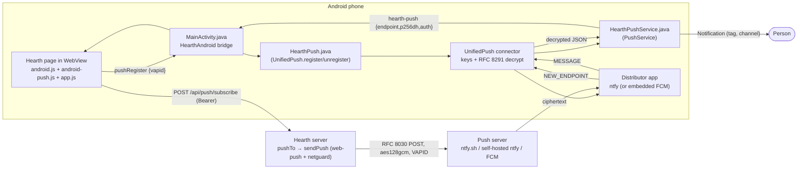

# Android notifications when the app is closed: UnifiedPush delivering Hearth's Web Push

Status: design, ready to build. Target: Hearth 1.29 (server) + the next `app-v*` Android build.
Pick #1 in `docs/NEXT.md`. All paths are relative to `hearth/` unless they start with `.github/`.
Line numbers are approximate (Hearth 1.28.2) and only help you find the function.

---

## 0. Summary

Today the Android app (`mobile/native/MainActivity.java` + `public/js/android.js`) shows notifications only while
its WebView is alive. When the person swipes it away the Socket.IO connection closes. The server then *does* send
a Web Push (`pushTo` → `queuePush` → `sendPush` in `server/index.js`). But the Android WebView has no Push API, so
the app has no endpoint to give the server and the push goes nowhere.

UnifiedPush gives an Android app a standard Web Push endpoint (RFC 8030) from a "distributor" app, usually ntfy.
The app's connector library generates the RFC 8291 keys and decrypts the `aes128gcm` messages. Hearth's server
already encrypts with RFC 8291 and signs with RFC 8292 VAPID for every endpoint. So the server barely changes:

1. **Native (Java):** add the `org.unifiedpush.android:connector` library. Add a `HearthPushService` that turns
   decrypted payloads into notifications without message text. Add a small manager (`HearthPush`) that registers
   or unregisters per server origin and passes the endpoint and keys to the page through the existing
   `HearthAndroid` bridge.
2. **Page (JS):** in the Android app, `app.push.enable/disable/status` go through the bridge instead of
   `PushManager`, then POST the same `{endpoint, keys}` to the existing `/api/push/subscribe`. The session token
   never leaves the WebView.
3. **Server:**
   - strict key validation, plus a `replaces` field so an endpoint change doesn't leave a dead row;
   - optional push-host allow-lists through `netguard` (`PUSH_HOSTS`, `PUSH_PRIVATE_HOSTS`);
   - correct handling of 429, 5xx and 507 answers;
   - payloads padded to 256-byte steps and stamped with `at`;
   - calls open `#call/<room>`.
4. **CI:** compile against the pinned connector, run pure-Java unit tests (javac in `npm test`, JUnit in Gradle),
   check the merged manifest, and run Node tests against a fake ntfy that decrypts what it gets.

There is no database schema change in phase 1.

---

## 1. What exists today (read from the code)

### Server push pipeline (`server/index.js`)

- VAPID keys: `webpush.generateVAPIDKeys()` into `data/vapid.json` (or `VAPID_PUBLIC_KEY`/`VAPID_PRIVATE_KEY`).
  `webpush.setVapidDetails(VAPID_SUBJECT || 'mailto:admin@example.com', …)`, around line 1167.
- `pushTo(userIds, payload, what)` (~1287):
  - skips anyone with an open socket (`onlineSockets`), with status `dnd`, or suspended or deleted;
  - applies `USE.pushAllowed` (mutes, levels, quiet hours) and `USE.shapePush` (`server/usability.js` ~282);
  - by default `shapePush` returns `{title: brandName, body: generic, tag, url}`. With previews "names" it returns
    the full payload, which also has `generic`.
- `queuePush` keeps one job per device per `tag`. `pumpPush` sends 16 at a time overall, 2 per user and 8 per
  push host.
- `sendPush` (~1251):
  - re-checks the subscription, the session (`pushSubLive`) and the user;
  - calls `webpush.generateRequestDetails(sub, JSON.stringify(payload), {TTL: 6*3600, urgency: 'high'})`. That
    gives `aes128gcm` by default, `Authorization: vapid t=…, k=…`, `TTL` and `Urgency` (see
    `node_modules/web-push/src/web-push-lib.js`);
  - sends through `netguard.request` (https only, public addresses unless `PUSH_ALLOW_PRIVATE=1`, no redirects,
    10 s, 64 KB answer);
  - 404/410 drop the subscription. **Every other status counts as success and resets `fails`**, including 429
    and 5xx. TIMEOUT/NETWORK go to `pushFailed`, which backs off 1 min → 1 h and drops after 8 failures.
- Routes (~1302):
  - `GET /api/push/key` returns the VAPID public key;
  - `POST /api/push/subscribe {subscription:{endpoint,keys:{p256dh,auth}}}`:
    - auth, `pushsub-any` limit of 60/h, and for a new endpoint `pushsub` 10/h plus
      `netguard.checkPublicUrl`;
    - upsert by endpoint with `session_id = req.session.id`;
    - keeps the newest 10 per user.
  - `POST /api/push/unsubscribe {endpoint}`.
- `revokeSessions` (~1080) deletes `push_subs` rows of revoked sessions. `GET /api/config` exposes
  `pushEnabled: !!vapid`.

### Payloads sent today

| Source | Tag | url | generic |
|---|---|---|---|
| Channel messages (`notifyChannelMessage`, ~2515) | `c:<channelId>` | `/#m/<messageId>` | `New message` |
| DMs (~2780) | `d:<dmId>` | `/#m/<id>` | `New message` |
| Calls (`voice:join`, ~5501) | `call:<room>` (room is `dm:<dmId>` or a channel id) | `/` | `Incoming call` |
| Events (~4736) | `event:<id>` | `/` | `An event is starting soon` |
| Trackers (~3776) | `updates-<feedId>` | `/#updates` | `New updates` |

### Database (`server/db.js`)

`push_subs(endpoint PK, user_id, keys JSON {p256dh, auth}, ua, created_at, session_id, fails, retry_at)`. Schema 18.

### Browser path

- `public/sw.js` `push` handler: `showNotification(title, {body, tag, renotify, data:{url}})`.
- `notificationclick` focuses or opens the window and posts `{type:'open', url}`. `app.js` `setupServiceWorker`
  (~5824) sets `location.hash`, and `openLinkFromHash` (~2956) handles `#m/`, `#c/`, `#updates` and `#study`.
- `app.js`:
  - `pushStatus`/`enablePush`/`disablePush` (~5832–5858) use `PushManager`;
  - `app.push.supported()` (~136) needs `PushManager`, which the Android WebView doesn't have;
  - `signOutHere` (~391) calls `disablePush()`;
  - the boot path (~873) re-subscribes when `localStorage['hearth.push'] === 'on'`.
- `public/js/settings.js` `appsTab` (~1709) shows `androidNotifyRow()` in the Android app ("not after you swipe it
  away") and `pushToggleRow()` everywhere else.

### Android app

- `mobile/native/MainActivity.java`:
  - creates channel `messages` (IMPORTANCE_HIGH);
  - bridge messages `hello`, `setServer`, `changeServer`, `notify`, `cancel`, `askNotify` and `save*`;
  - `notify()` posts with `(tag, id 1)` and the small icon `getApplicationInfo().icon`;
  - `handleNotificationTap` dispatches `hearth-notification-click` with the tag. On a cold start this does
    nothing useful: the page and its `Notification` objects are gone.
- `mobile/native/BridgePolicy.java`: only the local connect screen may send `setServer`; everything else is allowed
  from the local or the server origin.
- `public/js/android.js` shims `window.Notification` and downloads.
- CI (`.github/workflows/hearth-apps.yml`, job `android`):
  - `npx cap add android`;
  - `cp native/*.java android/app/src/main/java/app/hearth/mobile/`;
  - `sed`s permissions into the generated manifest and appends `androidx.webkit` plus the signing config to
    `android/app/build.gradle`;
  - `./gradlew assembleRelease`.
- There is **no committed `android/` folder**. Everything native is patched in at build time.

---

## 2. Goals and non-goals

### Goals

1. When the Hearth Android app is swiped away, killed by the system or not started since boot, the person still
   gets notifications for:
   - DMs;
   - mentions, replies and @everyone;
   - group messages, and "All messages" channels;
   - incoming DM and group calls (ringing);
   - event reminders and tracker updates.

   These are exactly the cases where the server already pushes today.
2. Notifications never contain message text. They show exactly what `shapePush` decides: by default the instance
   name and "New message" or "Incoming call". The lock screen's public version is always generic, even with
   previews set to "names".
3. Works without Google by default: any UnifiedPush distributor (ntfy app with ntfy.sh, or a self-hosted ntfy).
   An **opt-in build flag** bundles the embedded FCM distributor for people without a distributor.
4. Tapping opens the right place: the message, the call's conversation (with a join prompt if the call is still
   on), or the Updates page.
5. Notifications stop when the session ends:
   - sign-out, revocation, password change or account deletion (already true on the server, because subscriptions
     are tied to the session);
   - the native registration is removed on sign-out and on server switch.
6. Operators can restrict which push services the server talks to, and can let a named LAN push service through
   without opening all private ranges.
7. CI proves the Android build compiles against the pinned library and that Hearth's own Java logic is correct,
   all without a device.

### Non-goals

- Showing message text, or decrypting messages natively. The E2EE keys are non-extractable in the WebView's
  IndexedDB (`secure.js`/`e2ee.js`), and moving them to native code is a separate, much bigger design.
- Actions in the notification (reply, mark as read, decline a call). They would need the session token in native
  code. Declining still happens in the app.
- A full-screen incoming-call UI (`USE_FULL_SCREEN_INTENT`, `ConnectionService`). Keeping calls alive in the
  background is NEXT.md pick 12.
- Hiding notifications that were read on another device *while the app is closed*. This is an optional phase 2
  (§16.2).
- iOS, and push in the desktop (Electron) app.
- Shipping or running a distributor ourselves. A self-hosted ntfy is documented, not bundled.

---

## 3. External facts this design relies on (with sources)

### 3.1 UnifiedPush Android connector

- **Version and coordinates.** Maven Central lists `org.unifiedpush.android:connector`. The latest is **3.3.5**,
  updated 2026-08-22.
  - Its runtime dependencies are `com.google.crypto.tink:tink:1.23.0` and `org.jetbrains.kotlin:kotlin-stdlib:2.2.10`.
  - Sources: https://repo1.maven.org/maven2/org/unifiedpush/android/connector/maven-metadata.xml and
    https://repo1.maven.org/maven2/org/unifiedpush/android/connector/3.3.5/connector-3.3.5.module
- **API.** Read from the GitHub mirror of the source; the mirror's main branch is at 3.0.10, so check the 3.3.5
  `-sources.jar` before coding. The CI compile will catch any drift.
  - `object UnifiedPush`. Every public function is `@JvmStatic` and **none is `@JvmOverloads`**, so Java must pass
    every argument:
    - `register(Context, String instance, String messageForDistributor, String vapid)`, which throws
      `VapidNotValidException` when the key isn't an uncompressed base64url P-256 key;
    - `unregister(Context, String instance)` (`onUnregistered` is not called afterwards);
    - `tryUseCurrentOrDefaultDistributor(Context, (Boolean) -> Unit)`. It needs an `Activity` unless a distributor
      is already acknowledged. In Java the callback is `kotlin.jvm.functions.Function1<Boolean, kotlin.Unit>`;
    - `getDistributors(Context): List<String>`, `saveDistributor(Context, String)`,
      `getAckDistributor(Context): String?`, `removeDistributor(Context)`.
  - `register` returns silently when no distributor is saved.
  - Source: https://raw.githubusercontent.com/UnifiedPush/android-connector/main/connector/src/main/java/org/unifiedpush/android/connector/UnifiedPush.kt
- **`abstract class PushService`** (package `org.unifiedpush.android.connector`):
  - `onNewEndpoint(PushEndpoint, String instance)`;
  - `onMessage(PushMessage, String instance)`;
  - `onRegistrationFailed(FailedReason, String instance)`;
  - `onUnregistered(String instance)`.

  It must be declared `exported="false"` with the action `org.unifiedpush.android.connector.PUSH_EVENT`. Newer
  versions add `onTempUnavailable` with a default no-op implementation.
  - Source: https://raw.githubusercontent.com/UnifiedPush/android-connector/main/connector/src/main/java/org/unifiedpush/android/connector/PushService.kt
  - Source: https://unifiedpush.org/kdoc/connector/org.unifiedpush.android.connector/-push-service/on-temp-unavailable.html
- **Data classes** (package `org.unifiedpush.android.connector.data`):
  - `PushEndpoint` has `url` and `pubKeySet: PublicKeySet?`; recent docs also mention `temporary`, an endpoint
    from a fallback distributor;
  - `PublicKeySet` has `pubKey` ("P-256 public key, uncompressed, base64url without padding") and `auth`
    (base64url without padding). This is exactly the browser `subscription.toJSON().keys` format the server already
    stores;
  - `PushMessage` has `content: ByteArray` and `decrypted: Boolean`.
  - Sources: https://raw.githubusercontent.com/UnifiedPush/android-connector/main/connector/src/main/java/org/unifiedpush/android/connector/data/PublicKeySet.kt and https://raw.githubusercontent.com/UnifiedPush/android-connector/main/connector/src/main/java/org/unifiedpush/android/connector/data/PushMessage.kt
- **The library handles keys and decryption.**
  - `WebPushKeys` makes a `secp256r1` key pair and a 16-byte auth secret.
  - `DefaultKeyManager` stores private keys AES-GCM-encrypted in SharedPreferences under an Android Keystore key
    on SDK ≥ 23. Capacitor 8's `minSdkVersion` is 24, so that branch always applies.
  - Decryption uses a vendored, fixed copy of Tink's Web Push decrypter,
    `com.google.crypto.tink.apps.fixed_webpush.WebPushHybridDecrypt`.
  - **Hearth writes no cryptography.**
  - Sources: https://raw.githubusercontent.com/UnifiedPush/android-connector/main/connector/src/main/java/org/unifiedpush/android/connector/keys/DefaultKeyManager.kt, https://raw.githubusercontent.com/UnifiedPush/android-connector/main/connector/src/main/java/org/unifiedpush/android/connector/keys/WebPushKeys.kt, https://github.com/UnifiedPush/android-connector/tree/main/connector/src/main/java, https://fuchsia.googlesource.com/third_party/tink/+/refs/tags/v1.3.0-rc2/apps/webpush/ (Tink's Web Push app implements RFC 8291).
- **Manifest the library merges in:**
  - `WAKE_LOCK`;
  - `<queries>` for the distributor actions `LINK`, `REGISTER` and `UNREGISTER`;
  - exported receiver `internal.MessagingReceiverImpl` for the actions `MESSAGE`, `UNREGISTERED`, `NEW_ENDPOINT`
    and `REGISTRATION_FAILED`;
  - exported `internal.RaiseToForegroundService`;
  - `internal.LinkActivity`.

  The app itself declares only its `PushService` subclass.
  - Source: https://raw.githubusercontent.com/UnifiedPush/android-connector/main/connector/src/main/AndroidManifest.xml

### 3.2 UnifiedPush Android spec (AND_3.0.0)

- Messages "MUST be an encrypted content that follows [RFC8291]". The encrypted size is 1 to **4096 bytes**, so
  the cleartext is at most 3993.
- The endpoint follows RFC 8030, is at most 1000 bytes, and has ≥ 20 random bytes.
- The VAPID key is sent at REGISTER. A push server that needs it fails registration with `VAPID_REQUIRED`.
- Failure reasons: `INTERNAL_ERROR`, `NETWORK`, `ACTION_REQUIRED`, `VAPID_REQUIRED`.
- The distributor SHOULD honour RFC 8030 `Urgency` and MUST raise the app to foreground importance for 5 s per
  message.
- A connector ignores requests carrying a token it doesn't know.
- Source: https://raw.githubusercontent.com/UnifiedPush/specifications/main/specifications/android.md

### 3.3 Distributors

- **ntfy app plus ntfy.sh (default) or a self-hosted ntfy.**
  - UnifiedPush topics start with `up`. A private server with `auth-default-access: deny-all` must allow anonymous
    write: `ntfy access '*' 'up*' write-only`.
  - ntfy.sh limits: **250 messages a day**, 4,096-byte messages.
  - Server defaults: a 60-request burst, refilling one every 5 s, and **`cache-duration` 12 h**, so a message can
    arrive hours late.
  - With `visitor-subscriber-rate-limiting: true`, UnifiedPush messages count against the subscriber, and
    publishing to a topic with no subscriber returns **HTTP 507**.
  - `visitor-request-limit-exempt-hosts` exempts a publisher.
  - ntfy server 2.1.0 treats non-Basic/Bearer `Authorization` headers (our `vapid …`) as absent. 2.12.0 stopped
    treating UnifiedPush bodies as attachments.
  - ntfy Android added distributor selection in 1.18.0. 1.21.1 implemented the spec's "raise to foreground".
  - The latest ntfy server is 2.29.0 (2026-10-07).
  - Sources: https://raw.githubusercontent.com/binwiederhier/ntfy/main/docs/config.md, https://raw.githubusercontent.com/binwiederhier/ntfy/main/docs/publish.md, https://raw.githubusercontent.com/binwiederhier/ntfy/main/docs/releases.md, https://unifiedpush.org/users/distributors/ntfy/
- **Embedded FCM distributor.**
  - `org.unifiedpush.android:embedded-fcm-distributor`, latest **3.1.0** (2026-06-23). It depends only on
    kotlin-stdlib and kotlinx-coroutines, with no Firebase SDK.
  - It registers with Google Play services (`com.google.android.gms`, intent `com.google.iid.TOKEN_REQUEST`), using
    **the app's VAPID key as the sender**. It needs **no Firebase project or `google-services.json`**.
  - The endpoint is `https://fcm.googleapis.com/fcm/send/<token>`, and FCM accepts RFC 8291 Web Push signed with
    VAPID.
  - With a VAPID key from the app, no gateway is used. Without one it falls back to UnifiedPush's hosted gateway
    `fcm.distributor.unifiedpush.org`. Hearth always passes VAPID, so the gateway is never used.
  - It is declared as a non-exported receiver subclass of `EmbeddedDistributorReceiver`, with the actions
    `…distributor.feature.BYTES_MESSAGE`, `…distributor.REGISTER` and `…distributor.UNREGISTER`.
  - Sources: https://repo1.maven.org/maven2/org/unifiedpush/android/embedded-fcm-distributor/maven-metadata.xml, https://repo1.maven.org/maven2/org/unifiedpush/android/embedded-fcm-distributor/3.1.0/embedded-fcm-distributor-3.1.0.pom, https://raw.githubusercontent.com/UnifiedPush/android-embedded_fcm_distributor/main/embedded_fcm_distributor/src/main/java/org/unifiedpush/android/embedded_fcm_distributor/Constants.kt, https://raw.githubusercontent.com/UnifiedPush/android-embedded_fcm_distributor/main/embedded_fcm_distributor/src/main/java/org/unifiedpush/android/embedded_fcm_distributor/Utils.kt, https://raw.githubusercontent.com/UnifiedPush/android-embedded_fcm_distributor/main/embedded_fcm_distributor/src/main/java/org/unifiedpush/android/embedded_fcm_distributor/EmbeddedDistributorReceiver.kt, https://raw.githubusercontent.com/UnifiedPush/android-embedded_fcm_distributor/main/embedded_fcm_distributor/src/main/java/org/unifiedpush/android/embedded_fcm_distributor/DefaultGateway.kt

### 3.4 Protocols

- **RFC 8030** (Web Push): endpoint, `TTL`, `Urgency`, `Topic`. https://www.rfc-editor.org/rfc/rfc8030
- **RFC 8291** (message encryption): ECDH P-256 plus a 16-byte auth secret, using the `aes128gcm` content coding of
  RFC 8188. Appendix A has a complete worked example (keys, salt, ciphertext). https://www.rfc-editor.org/rfc/rfc8291, https://www.rfc-editor.org/rfc/rfc8188
- **RFC 8292** (VAPID): `Authorization: vapid t=<JWT>, k=<key>`. `aud` is the endpoint origin and `exp` is at most
  24 h ahead. A push service may answer 403 to a bad token. https://www.rfc-editor.org/rfc/rfc8292

### 3.5 Capacitor 8 Android template

- `minSdkVersion` 24, `compileSdkVersion`/`targetSdkVersion` 36.
- `google()` and `mavenCentral()` are in `allprojects.repositories`.
- The app module already has `testImplementation "junit:junit:$junitVersion"`.
- Release builds have `minifyEnabled false`.
- Sources: https://raw.githubusercontent.com/ionic-team/capacitor/main/android-template/variables.gradle, https://raw.githubusercontent.com/ionic-team/capacitor/main/android-template/build.gradle, https://raw.githubusercontent.com/ionic-team/capacitor/main/android-template/app/build.gradle

---

## 4. Architecture



### Registration

```mermaid
sequenceDiagram
  participant P as Page (app.js/android-push.js)
  participant N as MainActivity / HearthPush
  participant C as Connector + distributor
  participant S as Hearth server
  P->>S: GET /api/push/key
  P->>N: {type:'pushRegister', vapid}
  N->>C: tryUseCurrentOrDefaultDistributor(activity)
  alt none saved and the deep link fails
    N->>N: getDistributors(): 0 → state noDistributor; 1 → save; ≥2 → chooser dialog
  end
  N->>C: UnifiedPush.register(ctx, instanceFor(origin), "Hearth · host", vapid)
  C-->>N: PushService.onNewEndpoint(endpoint{url, pubKeySet})
  N->>N: save to prefs; state = registered
  N-->>P: event hearth-push {state:'registered', endpoint, p256dh, auth, temporary}
  P->>S: POST /api/push/subscribe {subscription:{endpoint, keys}, replaces?}
  S->>S: validate keys, PUSH_HOSTS, netguard.checkPublicUrl; upsert with session_id
```

### Delivery and tap

```mermaid
sequenceDiagram
  participant S as Hearth server
  participant PS as Push server (ntfy/FCM)
  participant C as Connector
  participant SV as HearthPushService
  participant A as MainActivity
  participant P as Page
  S->>PS: POST endpoint (aes128gcm, TTL, Urgency: high, Authorization: vapid)
  PS->>C: ciphertext (via distributor app)
  C->>SV: onMessage(PushMessage{content, decrypted}, instance)
  SV->>SV: drop unless decrypted && instance == current; parse; skip if foreground
  SV->>SV: notify(tag, 1) on its channel, contentIntent extra hearthOpen=safeOpenPath(url)
  Note over SV,A: person taps
  A->>A: handleNotificationTap: pendingOpen = path
  A-->>P: hello reply {open} (cold start) or event hearth-open (warm)
  P->>P: location.hash = '#m/…' → openLinkFromHash
```

**Key decision: the page, not native code, talks to the Hearth server.** Native code never sees the Bearer token
(`localStorage['hearth.token']` in the WebView). If the distributor gives a new endpoint while the app is closed,
native code stores it, and the page POSTs it, with `replaces`, the next time it opens. Until then the old endpoint
fails (404/410 → dropped, or 507 → failures; see §6.4). This trade-off is accepted. It keeps the security property
"a session token alone lives in one place".

---

## 5. How this fits the E2EE and threat model (honest)

### What stays true

- **No message text, ever.** The server never has plaintext (`messages.ciphertext`/`dm_messages.ciphertext`).
  Payloads are built from metadata the server already knows. `shapePush` hides names by default.
- **Push services and distributors see only RFC 8291 ciphertext.** This covers ntfy.sh, a self-hosted ntfy, Google
  FCM and the ntfy app itself.
  - Only the Hearth server (which holds `p256dh` and `auth` in `push_subs.keys`) and the phone (which holds the
    private key in Keystore-wrapped storage) can produce or read a payload.
  - The connector reports `decrypted=false` for anything else. Hearth drops those.
- **Forged or injected pushes are dropped.** Anyone who learns an ntfy topic URL can POST to it: ntfy topics are
  capabilities and ntfy ignores VAPID. They cannot make a payload that decrypts without `auth`. FCM endpoints
  additionally require a VAPID signature from the server's private key.
- **Notifications stop with the session.** `pushSubLive` and `revokeSessions` already enforce this server-side. The
  app also unregisters natively on sign-out.
- **Tap targets are in-app only.** A notification can open only `/`, `/#m/<id>`, `/#c/<id>`, `/#d/<id>`,
  `/#call/<room>`, `/#updates`, `/#study` or `/#scheduled` (your scheduled messages, added with Send later). These
  are validated in Java (`PushPolicy.safeOpenPath`) and again in JS. A crafted payload can't make the app load
  another site, and the WebView's own navigation guard
  (`HearthClient.shouldOverrideUrlLoading`) still applies.

### What is new or weaker (put these in SECURITY.md §4)

1. **A new party learns metadata.** The push server learns:
   - the Hearth server's IP (and, through VAPID, its public key);
   - the phone's IP (its connection to ntfy) or its Google account and device (FCM);
   - when each notification is sent, its size bucket (we pad to 256-byte steps, so name lengths don't show), and
     the `Urgency`.

   **ntfy.sh links "this phone gets notifications from this Hearth server"**, and so does Google with the embedded
   FCM build. Self-hosting ntfy next to Hearth removes the third party.
2. **Delivery is best effort.** A distributor can delay, drop or replay notifications. A replay shows the same
   notification again under the same tag, so it replaces itself. A distributor can't read or forge them. ntfy
   caches messages for 12 h, so a call push can arrive late. The app turns a call push older than 2 minutes into
   "Missed call" and never rings for it.
3. **A database thief can forge notifications.** `push_subs.keys` holds `p256dh` and `auth`. With a stolen
   database, someone can craft pushes that decrypt on the phone. For ntfy endpoints that is enough, because no
   VAPID check happens.
   - Text is limited to title ≤ 120 and body ≤ 240 characters after cleaning.
   - Taps go only to in-app addresses.
   - This is already true for browser push today.
   - Possible hardening later: an ECDSA signature with the VAPID private key (`data/vapid.json`, not in the
     database) that the app checks against the VAPID key it registered with. See §15.
4. **A malicious Hearth server** can put any title or body in a notification. It already controls the page, so
   nothing new.
5. **The chosen distributor app** (ntfy) learns timing and the endpoint. It never gets `auth`, because the page sends
   the keys straight to Hearth.
6. **A malicious distributor can't redirect Hearth's outbound requests inside the network.** The page posts
   whatever endpoint the distributor returned. `/push/subscribe` still runs `netguard.checkPublicUrl`, plus
   `PUSH_HOSTS` if it is set. So a hostile distributor still can't point the server at internal addresses.
7. **Exported components from the library.** `MessagingReceiverImpl` (exported receiver) and
   `RaiseToForegroundService` (exported service) come from the connector, as the spec requires.
   - Other apps can send intents, but the connector ignores unknown tokens, and forged messages fail decryption.
   - Binding the foreground service only gives Hearth foreground importance for a few seconds.

---

## 6. Server changes

### 6.1 Data model

**Phase 1: none.** `push_subs` already has everything: endpoint, keys, session, fails, retry_at. No
`SCHEMA_VERSION` bump. Old servers and old code are unaffected.

Phase 2 (optional, §16.2) would add `push_subs.platform TEXT NOT NULL DEFAULT 'web'` (`'web' | 'unifiedpush'`)
through `addColumn` inside the migration transaction in `server/db.js`, before the `user_version` line near the end,
again without a version bump (older code ignores the column).

### 6.2 Configuration (env; add to `.env.example` and the README table)

| Variable | Default | Meaning |
|---|---|---|
| `PUSH_HOSTS` | empty = any public https host (today's behaviour) | Comma-separated host names, exact or `*.suffix`, that the server will subscribe and send to. Example for a locked-down instance: `fcm.googleapis.com,*.push.services.mozilla.com,*.notify.windows.com,web.push.apple.com,ntfy.example.com` (check the browser hosts your people use). |
| `PUSH_PRIVATE_HOSTS` | empty | Host names whose addresses may be private (a self-hosted ntfy on the LAN or a Docker network), without turning on `PUSH_ALLOW_PRIVATE=1` for everything. Exact names only. |
| `PUSH_NTFY_URL` | empty | The operator's own ntfy, for example `https://ntfy.example.com`. Sent to apps in `/api/config` as `pushNtfy`, so Settings can tell people to set it as the ntfy app's server. Must be https or it is ignored, with a warning at start-up. |

Implementation in `server/index.js`, next to `PUSH_ALLOW_PRIVATE` (~1181):

```js
const hostList = (v) => String(v || '').split(',').map((s) => s.trim().toLowerCase()).filter(Boolean);
const PUSH_HOSTS = hostList(process.env.PUSH_HOSTS);
const PUSH_PRIVATE_HOSTS = new Set(hostList(process.env.PUSH_PRIVATE_HOSTS));
const hostMatch = (host, pat) => (pat.startsWith('*.') ? host.endsWith(pat.slice(1)) && host.length > pat.length - 1 : host === pat);
const pushHostAllowed = (u) => !PUSH_HOSTS.length || PUSH_HOSTS.some((p) => hostMatch(u.hostname.toLowerCase(), p));
const pushPrivateOk = (u) => PUSH_ALLOW_PRIVATE || PUSH_PRIVATE_HOSTS.has(u.hostname.toLowerCase());
const PUSH_NTFY_URL = (() => { try { const u = new URL(process.env.PUSH_NTFY_URL || ''); return u.protocol === 'https:' ? u.origin : null; } catch { return null; } })();
```

`netguard.checkPublicUrl` and `netguard.request` already accept `allowPrivate` as a function of the URL
(`allowedPrivate` in `server/netguard.js` ~187). `request` also accepts `allowUrl` (~351) and throws `NOT_ALLOWED`.
Note that `resolvePublic` skips the own-address check when `allowPrivate` is true, which is why
`PUSH_PRIVATE_HOSTS` is exact names only.

### 6.3 Routes

No new routes.

**`POST /api/push/subscribe`** (auth). The body gets one new optional field:

```json
{ "subscription": { "endpoint": "https://ntfy.sh/upAbC…?up=1", "keys": { "p256dh": "<87 b64url>", "auth": "<22 b64url>" } },
  "replaces": "https://ntfy.sh/upOld…?up=1" }
```

Validation, in this order (new parts in **bold**):

1. `vapid` is set, otherwise 400 (unchanged).
2. `endpoint` is a string ≤ 1000 (unchanged).
3. **Keys are a valid P-256 point and a 16-byte secret.** `p256dh` and `auth` are strings matching
   `^[A-Za-z0-9_-]+={0,2}$`. `Buffer.from(p256dh,'base64url')` is 65 bytes starting with `0x04` and lies on the
   curve: check with
   `crypto.createPublicKey({ key: { kty:'EC', crv:'P-256', x: b64u(pub.subarray(1,33)), y: b64u(pub.subarray(33)) }, format:'jwk' })`
   inside a try. `Buffer.from(auth,'base64url')` is exactly 16 bytes. Otherwise 400 `Bad subscription.`.
   Browsers and the connector both produce exactly this.
4. **`replaces` is absent, null, or a string ≤ 1000.** Otherwise 400 `Bad subscription.`.
5. **The endpoint parses as https and passes `pushHostAllowed`** (`netguard.parseUrl(endpoint, {protocols:['https:']})`).
   Otherwise 400 `This server doesn't send notifications through that push service.` Checked for every request,
   including known endpoints, so tightening `PUSH_HOSTS` takes effect at once.
6. `rateLimit('pushsub-any:'+uid, 60, 1h)` (unchanged).
7. For a new endpoint, `rateLimit('pushsub:'+uid, 10, 1h)` and
   `netguard.checkPublicUrl(endpoint, {protocols:['https:'], allowPrivate: pushPrivateOk})` (changed from the plain
   boolean).
8. In **one transaction**:
   - **if `replaces` is set and differs from `endpoint`, `DELETE FROM push_subs WHERE endpoint = ? AND user_id = ?`
     (the caller's own row only)**;
   - the existing upsert;
   - the existing keep-newest-10.

   The delete runs first, so the replaced row never pushes another device out of the 10.

**`POST /api/push/unsubscribe`**: unchanged.

**`GET /api/config`**: add `pushNtfy: PUSH_NTFY_URL`. Keep `pushEnabled` for older clients.

**Socket events: none new.**

### 6.4 Sending (`sendPush`, `pushFailed`; ~1251–1280)

- Call `netguard.request` with `allowPrivate: pushPrivateOk` and `allowUrl: pushHostAllowed`. In the catch, add
  `'NOT_ALLOWED'` to the codes that drop the subscription (`['PRIVATE','BAD_URL','BAD_PROTOCOL','NOT_ALLOWED']`).
- Classify the answer:
  - `2xx`: success; reset `fails` if set (as today).
  - `404`, `410`: drop (as today).
  - **`429`**: set `retry_at = now + clamp(retryAfterMs(r.headers['retry-after']) || 5 min, 60 s, 1 h)` and **do not**
    increment `fails`. A rate-limited ntfy.sh must not get the phone dropped.
  - **`413`**: log a warning (`push too_large`, with host); keep the subscription. It can't normally happen
    because of §6.5.
  - **any other status ≥ 300** (3xx because `maxRedirects: 0`, 400/401/403 such as an ntfy deny-all ACL or an FCM
    VAPID mismatch, 5xx, ntfy's **507** "no subscriber"): `pushFailed(endpoint)`. That backs off 1, 2, 4… min up to
    1 h and drops after `PUSH_MAX_FAILS` (8).
- Add a rate-limited operator log line, at most one per host per hour:
  `log.warn('push', 'refused', { host, status })`. The host only, never the endpoint (log redaction strips query
  strings anyway). An operator who forgot `ntfy access '*' 'up*' write-only` then sees it.
- `retryAfterMs(h)`: `Number(h)` seconds if finite, else `Date.parse(h) - now()`, else null.

### 6.5 Payload contract (plaintext JSON inside the RFC 8291 ciphertext)

```text
{ "title": string ≤ 200 code points,
  "body":  string ≤ 300 code points,
  "tag":   "c:<id>" | "d:<id>" | "call:<room>" | "event:<id>" | "updates-<feedId>",
  "url":   "/" | "/#m/<id>" | "/#call/<room>" | "/#updates",
  "at":    number (ms since epoch, when the server decided to notify),
  "generic"?: string (only with previews "names"),
  "_":     string of spaces (padding) }
```

1. **`at`.** In `pushTo`, stamp `payload = { ...payload, at: now() }` before `shapePush`. Change
   `shapePush` (`server/usability.js` ~282) so it carries it through:
   `return { title: brandName(), body: payload.generic || 'New activity', tag: payload.tag, url: payload.url, at: payload.at };`
2. **Calls.** In `voice:join` (~5501), change `url: '/'` to `url: '/#call/' + c.id`. `c.id` is the room: `dm:<dmId>`
   or a channel id.
3. **Cap and pad, in `sendPush`, before encryption.** Add `pushBody(payload)`:
   - cut `title` to 200 and `body` to 300 code points (`[...s].slice(0, n).join('')`);
   - `JSON.stringify` it, then add `"_": " ".repeat(k)` so the UTF-8 length is a multiple of **256**, with a hard
     ceiling of 3072 bytes;
   - pass the string to `generateRequestDetails`.

   This keeps every payload far below the UnifiedPush cleartext limit of 3993 bytes and hides name lengths from
   the push service.
4. **TTL stays `6*3600` for everything and `Urgency` stays `high`.** A short TTL only for calls would tell the push
   service which pushes are calls. Staleness is handled on the device using `at`.

### 6.6 Browser service worker (`public/sw.js`)

The `push` handler: if `data.tag` starts with `call:` and `data.at` is more than 120 s ago, show `body: 'Missed call'`
with `tag: 'missed-' + data.tag`. Something must still be shown, because Chrome requires `userVisibleOnly`.
Otherwise the handler is unchanged. Unknown fields (`at`, `_`) are ignored. `notificationclick` is unchanged: it
posts the url, and `app.js` routes `#call/…` (§8.4).

---

## 7. Android native changes

New and changed files under `mobile/native/`. CI copies `native/*.java` into
`android/app/src/main/java/app/hearth/mobile/`. Subfolders are **not** matched by that glob, which we use for tests
and the optional FCM class.

### 7.1 `PushPolicy.java` (new, pure Java, no Android imports; tested with javac and JUnit)

```java
package app.hearth.mobile;
final class PushPolicy {
    static final int MAX_PAYLOAD_BYTES = 4096;   // UnifiedPush AND_3: an encrypted message is at most 4096 bytes
    static final long CALL_FRESH_MS = 120_000;   // a ring older than this is shown as a missed call
    static final long CLOCK_SKEW_MS = 300_000;
    // "/" or one of the app's own hash links; ids are newId(): [a-z0-9]
    private static final java.util.regex.Pattern OPEN = java.util.regex.Pattern.compile(
        "^/(#(?:m|c|d)/[a-z0-9]{1,64}|#call/(?:dm:)?[a-z0-9]{1,64}|#updates|#study)?$");
    private static final java.util.regex.Pattern TAG = java.util.regex.Pattern.compile("^[A-Za-z0-9:_-]{1,100}$");
    private static final java.util.regex.Pattern VAPID = java.util.regex.Pattern.compile("^[A-Za-z0-9_-]{87}$");

    static String instanceFor(String origin);          // "o" + first 16 hex of SHA-256(origin UTF-8); "" if origin empty
    static String safeOpenPath(String url);            // url if OPEN matches, else "/"
    static boolean validTag(String tag);
    static boolean validVapid(String key);             // 65-byte uncompressed point, base64url, no padding = 87 chars
    static String channelFor(String tag);              // "call:" → "calls"; "c:"/"d:" → "messages"; else "activity"
    static boolean freshCall(long at, long now);       // at > 0 && now - at <= CALL_FRESH_MS && at - now <= CLOCK_SKEW_MS
    static String clean(String s, int maxCodePoints);  // drop U+0000–U+001F, U+007F, U+200E/F, U+202A–U+202E, U+2066–U+2069; trim; cut with "…"
}
```

### 7.2 `PushPayload.java` (new, pure Java)

- `static PushPayload parse(byte[] utf8)` returns null when:
  - the input is null, empty or longer than `MAX_PAYLOAD_BYTES`;
  - it is not a JSON object;
  - `tag` is missing or invalid.
- Fields: `title`, `body`, `tag`, `url` (passed through `safeOpenPath`), `generic`, and `at` (long; 0 if missing or
  not a number).
- Use a **minimal internal flat-JSON reader**: top-level string and number values only, with the escapes
  `\" \\ \/ \b \f \n \r \t \uXXXX`.
  - **Unknown keys are skipped whatever their value**: nested objects and arrays by bracket matching that respects
    strings, plus `true`/`false`/`null`. This keeps future server fields from breaking old apps.
  - Duplicate keys: last wins.
- Why not `org.json`: it is stubbed in `android.jar` for local JVM tests and missing from a plain javac classpath.

### 7.3 `HearthNotifications.java` (new; Android)

- `static final String EXTRA_OPEN = "hearthOpen";`
- `static void ensureChannels(Context)`, idempotent, API 26 and up:
  - `messages`: "Messages", IMPORTANCE_HIGH, description "New messages and mentions". **Same id as today**, so
    people's existing channel settings carry over.
  - `calls`: "Calls", IMPORTANCE_HIGH, sound `RingtoneManager.getDefaultUri(TYPE_RINGTONE)` with `AudioAttributes`
    `USAGE_NOTIFICATION_RINGTONE` / `CONTENT_TYPE_SONIFICATION`, vibration on. A channel's sound can't change after
    creation, so get it right in the first release.
  - `activity`: "Events and updates", IMPORTANCE_DEFAULT.
- `static boolean allowed(Context)`: `NotificationManagerCompat.areNotificationsEnabled()`, and on API 33+
  `POST_NOTIFICATIONS` granted.
- `static void showPush(Context c, PushPayload p)`:
  - `call = p.tag.startsWith("call:")`, `fresh = !call || PushPolicy.freshCall(p.at, now)`.
  - Channel: `call && fresh` → `calls`; `call && !fresh` → `activity`; otherwise `PushPolicy.channelFor(p.tag)`.
  - Title: `clean(p.title, 120)`, or the app label if empty. Body: `call && !fresh` → "Missed call"; otherwise
    `clean(p.body, 240)`, or "New activity" if empty.
  - **Public version for the lock screen** (`setVisibility(VISIBILITY_PRIVATE)` + `setPublicVersion(...)`): title is
    the app label, text is `clean(p.generic, 60)`, or `p.body` when there's no `generic` (hidden-previews payloads
    are already generic), or "New activity". "Hide sensitive content" then never shows names.
  - Content intent: `Intent(c, MainActivity.class)`, flags `NEW_TASK | SINGLE_TOP | CLEAR_TOP`, extra
    `EXTRA_OPEN = PushPolicy.safeOpenPath(p.url)`; `PendingIntent.getActivity(c, tag.hashCode(), …, UPDATE_CURRENT | IMMUTABLE)`.
  - Category: `CALL` for a fresh call, `MESSAGE` for messages, `EVENT` for the rest. Set `setWhen(p.at > 0 ? p.at : now)`,
    `setShowWhen(true)` and `setAutoCancel(true)`. Priority is `MAX` for a fresh call, else `HIGH`.
  - Fresh call: `setTimeoutAfter(45_000)` (the in-app ring also stops at 45 s, `onRing` in `app.js`), and after
    `build()`, `n.flags |= Notification.FLAG_INSISTENT` so it rings until answered or timed out.
  - Small icon: `c.getResources().getIdentifier("ic_stat_hearth", "drawable", c.getPackageName())`, falling back to
    `getApplicationInfo().icon`.
  - `NotificationManagerCompat.from(c).notify(call && !fresh ? "missed-" + p.tag : p.tag, 1, n)`. That is the same
    `(tag, 1)` scheme as `MainActivity.notify`, so a push and an in-app notification for one conversation replace
    each other.
- Resource `mobile/native/res/drawable/ic_stat_hearth.xml`: a monochrome vector, for example Material Symbols
  "local_fire_department" (Apache-2.0) exported with Android Studio's Vector Asset tool. CI copies it to
  `android/app/src/main/res/drawable/`. The current colour launcher icon renders as a white blob in the status bar.

### 7.4 `HearthPushService.java` (new; Android)

```java
package app.hearth.mobile;

import androidx.annotation.NonNull;
import org.unifiedpush.android.connector.FailedReason;
import org.unifiedpush.android.connector.PushService;
import org.unifiedpush.android.connector.data.PushEndpoint;
import org.unifiedpush.android.connector.data.PushMessage;

/** Notifications from Hearth while the app is closed. Content never includes message text (the server never has it). */
public class HearthPushService extends PushService {
    @Override public void onNewEndpoint(@NonNull PushEndpoint endpoint, @NonNull String instance) { HearthPush.onEndpoint(this, instance, endpoint); }
    @Override public void onMessage(@NonNull PushMessage message, @NonNull String instance) {
        if (!message.getDecrypted()) return;                              // plaintext or someone else's: never shown
        if (!instance.equals(HearthPush.currentInstance(this))) return;   // a previous server's registration
        PushPayload p = PushPayload.parse(message.getContent());
        if (p == null) return;
        if (MainActivity.isForeground()) return;                          // the open app shows its own
        HearthNotifications.showPush(this, p);
    }
    @Override public void onRegistrationFailed(@NonNull FailedReason reason, @NonNull String instance) { HearthPush.onFailed(this, instance, reason.name()); }
    @Override public void onUnregistered(@NonNull String instance) { HearthPush.onUnregistered(this, instance); }
}
```

Kotlin `val decrypted` and `val content` become `getDecrypted()` and `getContent()` in Java. If 3.3.5 adds more
abstract methods, the CI compile fails. Implement them as no-ops. Optionally override `onTempUnavailable(instance)` to
set state `temporarilyUnavailable`; it is informational only.

### 7.5 `HearthPush.java` (new; Android, uses the connector)

State lives in the existing SharedPreferences `"hearth"`, under the keys:

- `push.instance`, `push.vapid`, `push.endpoint`, `push.p256dh`, `push.auth`;
- `push.temporary` (bool);
- `push.state` (`none | pending | registered | failed | noDistributor`), `push.reason`.

Methods:

- `static String currentInstance(Context)`: `PushPolicy.instanceFor(prefs.getString("server",""))`. The instance
  depends on the server origin, so two servers never share an endpoint.
- `static JSONObject state(Context, boolean withKeys)`. It returns:
  - `state`, `reason`, `endpoint`, plus `p256dh`/`auth` only if `withKeys`, `temporary` and `vapid`;
  - `distributor`: `UnifiedPush.getAckDistributor(ctx)`, or `""`;
  - `distributorName`: from `PackageManager`; when it equals our own package (embedded FCM), the name is
    "Google push (built into this app)";
  - `distributors`: a count;
  - `embedded`: whether the FCM flavour is built in, i.e. a class lookup for `app.hearth.mobile.EmbeddedDistributor`
    succeeds.

  If the state is `registered` but `getAckDistributor` is null (the distributor was uninstalled), report `none` with
  reason `DISTRIBUTOR_GONE`.
- `static void register(Activity a, String vapid, boolean forceChoose)`:
  1. If `!PushPolicy.validVapid(vapid)`, fail with `VAPID_INVALID`. If `!HearthNotifications.allowed(a)`, set state
     `blocked` and stop.
  2. Save `push.instance` and `push.vapid`, and set state `pending`.
  3. If `forceChoose`, call `UnifiedPush.removeDistributor(a)` first.
  4. `UnifiedPush.tryUseCurrentOrDefaultDistributor(a, ok -> { …; return kotlin.Unit.INSTANCE; })`:
     - `ok`: `doRegister`.
     - Otherwise, `list = UnifiedPush.getDistributors(a)`:
       - empty: state `noDistributor`;
       - exactly one, and not our own package: `saveDistributor` and then `doRegister`;
       - otherwise (several, or only our embedded FCM): a native `AlertDialog` chooser.
         - Entries are labelled by `PackageManager.getApplicationLabel`.
         - The embedded entry gets the subtitle "Google sees when you get a notification, not what it says".
         - Pick: `saveDistributor` then `doRegister`. Cancel: state `none`, reason `CANCELLED`.
         - Only one dialog at a time.
  5. `doRegister`: `UnifiedPush.register(a, instance, "Hearth · " + host(origin), vapid)` inside a try. On
     `VapidNotValidException`, fail with `VAPID_INVALID`; on any other exception, `INTERNAL_ERROR`.
- `static void unregister(Context c, String instance)`: if the instance isn't empty, `UnifiedPush.unregister(c, instance)`
  inside a try, then clear the `push.*` keys and set state `none`.
- `static void onEndpoint(Context c, String instance, PushEndpoint e)`:
  1. Ignore it unless `instance.equals(currentInstance(c))`.
  2. If `e.getPubKeySet() == null`, fail with `NO_KEYS`.
  3. Otherwise save `url`, `pubKey`, `auth` and `temporary` (`e.getTemporary()` if the method exists in 3.3.5, else
     false). Set state `registered`.
  4. Call `MainActivity.pushChanged(state(c, true))`.
- `onFailed` saves state `failed` with the reason and calls `pushChanged`. `onUnregistered` clears the endpoint,
  sets state `none` with reason `UNREGISTERED`, and calls `pushChanged`.

### 7.6 `MainActivity.java` (changed)

- Fields:
  - `private static volatile boolean foreground;`
  - `private static WeakReference<MainActivity> live = new WeakReference<>(null);`
  - `private String pendingOpen;`
  - `private boolean pageReady;`
- `onCreate`:
  - replace the inline `NotificationChannel` creation with `HearthNotifications.ensureChannels(this)`;
  - set `live = new WeakReference<>(this)`.

  Override `onDestroy` (clear `live` if it points to this), `public void onResume()` (`foreground = true`) and
  `public void onPause()` (`foreground = false`). Keep `super` calls; `public` is fine whether `BridgeActivity`
  declares these public or protected.
- `static boolean isForeground()`. `static void pushChanged(JSONObject st)`: if `live.get()` isn't null, it calls
  `toPage("hearth-push", st.toString())`.
- **Centralise server changes.** Add `private void setServerOrigin(String o)`:
  - if `o` differs from `serverOrigin()`, call `HearthPush.unregister(this, PushPolicy.instanceFor(serverOrigin()))`;
  - then `prefs.edit().putString("server", o).apply(); listen();`.

  Use it in **both** places that write `"server"` today: `HearthClient.shouldOverrideUrlLoading` (leaving the
  connect screen) and the `setServer` case.
- `HearthClient`: override `onPageStarted(view, url, favicon)` to call `super` and set `pageReady = false`.
- `onMessage` gets the source origin `from`. Add these cases after the existing `BridgePolicy.allowed` check
  (BridgePolicy limits `push*` to the server origin):
  - `"hello"`:
    - set `pageReady = from.equals(serverOrigin())`;
    - reply `info(pageReady)`. When the request comes from the server origin, `info` adds `push` (from
      `HearthPush.state(this, true)`) and `open: pendingOpen` (then clears it);
    - the connect screen gets neither.
  - `"pushState"`: reply `{"type":"pushState", …HearthPush.state(this, true)}`.
  - `"pushRegister"`: `HearthPush.register(this, m.optString("vapid"), false)`, then reply `pushState`.
  - `"pushPick"`: `HearthPush.register(this, m.optString("vapid"), true)`.
  - `"pushUnregister"`: `HearthPush.unregister(this, HearthPush.currentInstance(this))`, then reply `pushState`.
- `handleNotificationTap(intent)`:
  - read `HearthNotifications.EXTRA_OPEN` first. If present, remove the extra and set
    `pendingOpen = PushPolicy.safeOpenPath(v)`;
  - if `pageReady`, run `toPage("hearth-open", JSONObject.quote(pendingOpen))` and clear it. Otherwise it is
    delivered in the next `hello` reply;
  - return without firing `hearth-notification-click`;
  - the existing `hearthTag` path stays for in-app notifications.
- Leave `notify()` (in-app notifications) as it is. It still uses channel `messages`.

### 7.7 `BridgePolicy.java` (changed)

```java
if ("setServer".equals(type)) return local;
if (type.startsWith("push")) return server;   // only the server's own page manages push for that server
return local || server;
```

### 7.8 Optional: embedded FCM flavour

`mobile/native/fcm/EmbeddedDistributor.java`, copied only when the build flag is on:

```java
package app.hearth.mobile;
public class EmbeddedDistributor extends org.unifiedpush.android.embedded_fcm_distributor.EmbeddedDistributorReceiver { }
```

It needs no gateway override, because Hearth always passes VAPID. Manifest:

```xml
<receiver android:enabled="true" android:name=".EmbeddedDistributor" android:exported="false">
  <intent-filter>
    <action android:name="org.unifiedpush.android.distributor.feature.BYTES_MESSAGE"/>
    <action android:name="org.unifiedpush.android.distributor.REGISTER"/>
    <action android:name="org.unifiedpush.android.distributor.UNREGISTER"/>
  </intent-filter>
</receiver>
```

Gradle: `implementation "org.unifiedpush.android:embedded-fcm-distributor:3.1.0"`. It works only on devices with
Google Play services. It is **off by default**, and enabled with the repository variable `HEARTH_EMBEDDED_FCM=1`.

### 7.9 Build patching (new `mobile/scripts/patch-android.js`; CommonJS, no dependencies)

It exports pure functions (tested by `npm test`) and has a CLI used by CI:

- `patchManifest(xml, { embeddedFcm })`: inserts before `</application>`:

  ```xml
  <service android:name=".HearthPushService" android:exported="false">
    <intent-filter><action android:name="org.unifiedpush.android.connector.PUSH_EVENT"/></intent-filter>
  </service>
  ```

  plus the receiver in §7.8 when `embeddedFcm`. It throws if `</application>` is missing or the service is already
  present (idempotence guard).
- `gradleAdditions({ embeddedFcm })` returns:

  ```groovy
  // ---- added by the Hearth build: UnifiedPush (exact versions; bump by hand, see mobile/README.md)
  dependencies {
      implementation "org.unifiedpush.android:connector:3.3.5"
      // only with HEARTH_EMBEDDED_FCM=1:
      implementation "org.unifiedpush.android:embedded-fcm-distributor:3.1.0"
  }
  ```

- CLI `node scripts/patch-android.js android`. It:
  - patches `android/app/src/main/AndroidManifest.xml`;
  - appends to `android/app/build.gradle`;
  - copies `native/res/**` to `android/app/src/main/res/`;
  - copies `native/test/*.java` to `android/app/src/test/java/app/hearth/mobile/`;
  - copies `native/fcm/*.java` when `HEARTH_EMBEDDED_FCM === '1'`;
  - offers `--check-merged <file>`, which asserts the merged manifest has `.HearthPushService` with
    `exported="false"` and `PUSH_EVENT`, and has `MessagingReceiverImpl`.

Workflow changes (`.github/workflows/hearth-apps.yml`, job `android`):

1. Add `HEARTH_EMBEDDED_FCM: ${{ vars.HEARTH_EMBEDDED_FCM }}` to the step `env:`. The infra test forbids `${{ }}`
   inside `run:`.
2. In **Create the Android project**, after `cp native/*.java …`, add `node scripts/patch-android.js android`. Keep the
   `cp` line: `test/client-hardening.test.js` asserts it.
3. In **Build the APK**, run `./gradlew --no-daemon assembleRelease testReleaseUnitTest ${BUNDLE:+"$BUNDLE"}`.
4. Add a new step **Check the merged manifest** (working-directory `hearth/mobile`):

   ```bash
   m=$(grep -rl HearthPushService android/app/build/intermediates --include AndroidManifest.xml | grep -i release | head -1)
   node scripts/patch-android.js --check-merged "$m"
   ```

---

## 8. Web client changes

### 8.1 New module `public/js/android-push.js` (pure, testable in Node)

```js
// Push for the Hearth Android app: the app gets a Web Push endpoint from a UnifiedPush distributor (ntfy, …)
// and hands it to this page, which subscribes it with the server like a browser would.
export const OPEN_RE = /^\/(#(?:m|c|d)\/[a-z0-9]{1,64}|#call\/(?:dm:)?[a-z0-9]{1,64}|#updates|#study)?$/;
export const safeOpenHash = (path) => { const m = OPEN_RE.exec(String(path || '')); return m && m[1] ? m[1] : ''; };
export function createAndroidPush({ send, initial, timeoutMs = 30000 }) {
  // state(): Promise<state>  — {type:'pushState'} round trip (3 s timeout → last known)
  // register(vapid, {choose}): Promise<state>  — sends pushRegister/pushPick; resolves on 'registered',
  //   rejects with an Error whose .code is the state/reason ('noDistributor','blocked','failed:NETWORK', 'timeout')
  // unregister(): Promise<void> — pushUnregister; resolves on 'none' or after 2 s
  // onChange(cb): cb(state) for every hearth-push event (endpoint changed, unregistered, failed)
  // _reply(msg) / _event(detail): wired by android.js
}
export const reasonText = { /* code → sentence, see §9.5 */ };
```

### 8.2 `public/js/android.js` (changed)

- `export const androidApp = { on: !!A, version: '', notify: 'default', push: null, ready: Promise }`. `ready`
  resolves when the `info` reply arrives, or after 1500 ms.
- In `A.onmessage`:
  - on `info`: set `version` and `notify`; if `m.push` exists (new APK), set
    `androidApp.push = createAndroidPush({ send, initial: m.push })`; if `m.open`, set
    `location.hash = safeOpenHash(m.open)` when that isn't empty; then resolve `ready`;
  - on `pushState`: `androidApp.push && androidApp.push._reply(m)`.
- Listen for `hearth-push` (→ `androidApp.push._event(detail)`) and `hearth-open` (→ set `location.hash` as above).
- `androidApp.cancel = (tag) => send({ type: 'cancel', tag })` (the existing native case).
- Clean up on start: if `m.push.state === 'registered'` and there is no `localStorage['hearth.token']` (signed out
  while the app was killed), call `androidApp.push.unregister()`.

### 8.3 `public/js/app.js` (changed)

- `app.push.supported` (~136):
  `() => (androidApp.push ? !!(S.config && S.config.pushEnabled) : 'serviceWorker' in navigator && 'PushManager' in window && 'Notification' in window && S.config && S.config.pushEnabled)`.
- `pushStatus()` (~5832): when `androidApp.push`, await `androidApp.ready`, then map the native state:
  - `registered` and `localStorage['hearth.push'] === 'on'` → `'on'`;
  - `blocked`, or `Notification.permission === 'denied'` → `'blocked'`;
  - `noDistributor` → `'nodistributor'`;
  - `failed` → `'failed'`;
  - anything else → `'off'`.
- `enablePush({ quiet })` (~5838): Android branch `enableAndroidPush({ quiet })`:
  1. If `Notification.permission !== 'granted'`: return if `quiet`, else `await Notification.requestPermission()`
     (the existing `AppNotification` shim → `askNotify`). If still not granted, throw "Notifications are turned off
     for Hearth in Android settings."
  2. `const { publicKey } = await api('GET', '/push/key')`.
  3. `let st = await androidApp.push.state()`. If `st.state !== 'registered' || st.vapid !== publicKey`:
     - if `quiet` and `!st.distributor`, return (never pop a chooser at start-up);
     - otherwise `st = await androidApp.push.register(publicKey)`.
  4. `const prev = localStorage.getItem('hearth.push.endpoint')`. Then
     `await api('POST', '/push/subscribe', { subscription: { endpoint: st.endpoint, keys: { p256dh: st.p256dh, auth: st.auth } }, replaces: prev && prev !== st.endpoint ? prev : undefined })`.
  5. Set `localStorage['hearth.push.endpoint'] = st.endpoint` and `localStorage['hearth.push'] = 'on'`.
- `disablePush({ signOut = false } = {})` (~5853): Android branch:
  1. POST `/push/unsubscribe {endpoint: localStorage['hearth.push.endpoint']}`, catching errors.
  2. `await androidApp.push.unregister()`.
  3. Remove `hearth.push.endpoint`.
  4. Set `hearth.push` to `'off'`, or remove the key when `signOut`. After a sign-out the next person isn't "off by
     choice" and can be offered push.
- `signOutHere` (~391): change the condition to
  `if (androidApp.push || (localStorage.getItem('hearth.push') === 'on' && 'serviceWorker' in navigator)) await Promise.race([disablePush({ signOut: true }).catch(() => {}), new Promise((r) => setTimeout(r, 3000))]);`.
  Server-side, `/auth/logout` → `revokeSessions` already drops the row even if this times out.
- Boot (~873): keep `if (localStorage.getItem('hearth.push') === 'on') enablePush({ quiet: true })`. Add:
  - **live changes:** `androidApp.push?.onChange((st) => { if (localStorage.getItem('hearth.push') === 'on') enablePush({ quiet: true }).catch(() => {}); })`;
  - **a one-time offer:** if `androidApp.push`, `localStorage.getItem('hearth.push') === null` and
    `Notification.permission !== 'denied'`, show an `update-bar`-style bar "Get notifications when Hearth is
    closed?" with **Turn on** (`enablePush()`) and **Not now** (sets `'off'`).
- `openLinkFromHash` (~2956): add
  ```js
  m = hsh.match(/^#call\/((?:dm:)?[a-z0-9]{1,64})$/i);
  if (m) return openCallFromLink(m[1]);
  m = hsh.match(/^#d\/([a-z0-9]{1,64})$/i);
  if (m) return openDm(m[1]);
  ```
  and a new function:
  ```js
  function openCallFromLink(room) {
    if (room.startsWith('dm:')) openDm(room.slice(3));
    else { const s = serverOfChannel(room); if (!s) return toast('You don’t have access to that call.'); const c = textChannel(s); if (c) openChannel(c.id, s.id); }
    const inRoom = S.voice[room] || [];
    if (inRoom.length && !(voice && voice.channelId === room)) onRing({ room, from: inRoom[0].userId, video: false });
  }
  ```
  `onRing` already ignores DND, duplicates and calls you are in. `S.voice` comes from bootstrap (`S.voice = b.voice`,
  ~852) and `voice:state`.

### 8.4 `public/js/usability.js` (changed)

In `closeNotifications(tag)` (~65), add `if (androidApp.on && androidApp.cancel) androidApp.cancel(tag);`. A push
notification the native service posted (same `(tag, 1)`) is then removed when the conversation is read (`read:update`,
`markRead`) while the app is open. Import `androidApp` from `./android.js`.

### 8.5 `public/js/settings.js` (changed)

- `appsTab` (~1746):
  - `androidApp.on && !androidApp.push` → the existing `androidNotifyRow()`. This is an old APK: add the line
    "Update the Hearth app to get notifications after you swipe it away.";
  - otherwise → `section('Notifications', pushToggleRow(app), androidApp.push ? androidPushAppRow(app) : null, hint)`.
- `pushToggleRow` (~1668): new note texts:
  - `nodistributor`: "To get notifications when Hearth is closed, install a push app such as ntfy (F-Droid or
    Google Play), then turn this on. ntfy only passes on encrypted notifications; it can't read them."
  - `failed`: `reasonText[reason]`.
  - `on` (Android): "You'll get notifications even after you swipe Hearth away. They say 'New message', never what
    it says."
- New `androidPushAppRow(app)`:
  - "Push app: <distributorName> · [Change]". Change calls `register(publicKey, {choose:true})` and then
    re-subscribes;
  - when `S.config.pushNtfy` is set: "This server runs its own ntfy. In the ntfy app: Settings → Default server →
    `<pushNtfy>`, then turn notifications off and on here.";
  - when `embedded` and the distributor is our own package: "Using Google's push service: Google sees when you get a
    notification, not what it says."

### 8.6 `public/js/whatsnew.js`

Add an item: "Android: notifications now arrive even after you swipe Hearth away (needs a push app such as ntfy,
see Settings → Apps & devices). They never contain what a message says."

---

## 9. What notifications look like

### 9.1 Channels (Android Settings → Apps → Hearth → Notifications)

| Channel id | Name | Importance | Used for |
|---|---|---|---|
| `messages` (existing) | Messages | High | `c:` and `d:` tags: DMs, mentions, replies, @everyone, group and "All messages" |
| `calls` | Calls | High, ringtone, insistent, 45 s timeout | fresh `call:` pushes |
| `activity` | Events and updates | Default | `event:`, `updates-`, missed calls |

### 9.2 Content

| Kind | Previews hidden (default) | Previews "names" |
|---|---|---|
| DM | **<Instance name>** / New message | **Alex** / Sent you a message |
| Mention | **<Instance name>** / New message | **Alex mentioned you** / #general · Server |
| Call | **<Instance name>** / Incoming call (rings ≤ 45 s) | **Alex** / is calling you |
| Stale call (> 2 min) | **<Instance name>** / Missed call | **Alex** / Missed call |
| Event | **<Instance name>** / An event is starting soon | **Starting soon: Game night** / Server |
| Tracker | **<Instance name>** / New updates | **3 new — Feed** / item title |

- The lock screen's public version is always **<app label>** / generic text.
- No avatars: fetching one would need network and auth from native code.
- The time comes from `at`.

### 9.3 Grouping and replacement

One notification per `tag` (one per conversation). A newer push replaces the older one: the server merges queued
pushes per tag (`queuePush`), and the device replaces by tag. Android groups automatically from four notifications on.

### 9.4 Tap

| Tag | Opens |
|---|---|
| Channel message | the message (`#m/<id>` → `jumpToMessageId`) |
| DM | the message |
| Call | the DM or the group's text channel, plus a ring card if the call is still on |
| Tracker | Updates |
| Event | the app |

### 9.5 Error and reason texts (`reasonText`)

| Reason | Text |
|---|---|
| `NETWORK` | "The push app couldn't reach its server. Check your connection and try again." |
| `ACTION_REQUIRED` | "Open your push app (for example ntfy) and finish its setup, then try again." |
| `VAPID_REQUIRED`, `VAPID_INVALID` | "That push app can't be used with Hearth. Pick another one." |
| `INTERNAL_ERROR`, `NO_KEYS` | "Something went wrong setting up notifications. Try again." |
| `DISTRIBUTOR_GONE` | "Your push app was removed. Install one and turn notifications on again." |
| `CANCELLED` | (no toast) |
| `timeout` | "The push app didn't answer. Open it once, then try again." |

---

## 10. Edge cases

1. **No distributor installed.** State `noDistributor`, and Settings explains how to install ntfy. With the FCM
   flavour, the chooser offers "Google push (built into this app)" with the privacy line. It is never picked
   silently.
2. **Several distributors.** The `unifiedpush://link` deep link lets the default one answer
   (`tryUseCurrentOrDefaultDistributor`); otherwise the native chooser appears. "Change" in Settings forces the
   chooser (`removeDistributor`, pick, register → new endpoint → subscribe with `replaces`).
3. **Distributor uninstalled, logged out or unregistered.** `onUnregistered`, or `getAckDistributor() == null` at
   status time, gives state `none` with a reason. The server's old row fails (404/410/507) and is dropped. Settings
   asks to turn it on again.
4. **Endpoint changes while the app is closed**, including a `temporary` fallback endpoint. Native code stores it.
   The next page load subscribes it with `replaces`. Pushes in between may be lost.
5. **Notification permission revoked later.** `HearthNotifications.allowed` is false, so nothing is posted, and status
   shows `blocked` with the existing Android-settings hint.
6. **Server switch** (Settings → Switch server, or a `setServer` from the connect screen).
   `MainActivity.setServerOrigin` unregisters the old instance. The old server's rows remain until that session
   expires (60 idle days) or a send fails. ntfy may keep answering 200 for a topic nobody subscribes to; the device
   ignores it either way, because the connector forgot the token.
7. **Sign-out, revocation, password change, account deletion, suspension.**
   - Server-side the subscription goes with the session (`revokeSessions`, `pushSubLive`; account deletion deletes
     `push_subs`).
   - Client-side, `signOutHere` (also reached on a 401 or `session:revoked`) unregisters natively.
   - If the app was killed mid-sign-out, `android.js` cleans up on the next start.
8. **The app is open** when a push arrives (a reconnect race): `MainActivity.isForeground()`, so it's skipped. **In
   the background with a live socket:** the server sends no push (`onlineSockets`), and the in-app `Notification`
   shim shows it.
9. **Frozen-process gap.** Android's cached-app freezer can freeze a backgrounded app with its socket still open. The
   server thinks it is online for up to `pingInterval` + `pingTimeout` (about 18 s), so a message in that window
   gets neither path. This exists today. Possible follow-up: the page tells the server when it is hidden (§15).
10. **Late delivery** (ntfy's 12 h cache, a phone offline). Calls older than 2 minutes become "Missed call" (device
    side, using `at`, with 5 minutes of allowed clock skew). Messages show with their real time.
11. **Replays and duplicates.** The same tag replaces itself; harmless.
12. **Injected plaintext, wrong keys, bad JSON, oversize, unknown fields.** The first four are dropped. Unknown fields
    are skipped.
13. **ntfy.sh limits.**
    - 250 messages a day. Depending on ntfy.sh's subscriber-based rate limiting this may count against the Hearth
      server's IP.
    - A 429 now pauses that device for `Retry-After` (clamped to 1 min–1 h) without dropping it.
    - Busy instances should self-host ntfy (OPERATIONS recipe).
14. **Self-hosted ntfy with `deny-all` and no `up*` write rule.** 403 is counted as a failure and dropped after 8. The
    operator log shows `push refused host=… status=403`.
15. **Self-hosted ntfy on a private address.** Set `PUSH_PRIVATE_HOSTS=ntfy.lan`. On the same machine, serve ntfy on
    443 through Caddy: netguard refuses this server's own addresses on other ports (`ownAddress`).
16. **ntfy with a self-signed certificate.** The server's TLS check fails. Use a real certificate, or
    `NODE_EXTRA_CA_CERTS`.
17. **VAPID key rotated** (new `vapid.json` or env). The page compares `st.vapid` with `/push/key` and re-registers.
    FCM endpoints bound to the old key would otherwise get 403.
18. **Two accounts one after another on one phone.** After sign-out the native registration is removed. If a
    distributor ever hands back the same endpoint, `/push/subscribe`'s upsert moves the row to the new account (the
    existing `ON CONFLICT … SET user_id = excluded.user_id`).
19. **The 10-device cap.** `replaces` keeps a phone at one row through endpoint changes.
20. **DND, quiet hours, mutes, levels.** Unchanged and server-side (`pushAllowed`).
21. **The page can't load** (server down) after a tap. The connect screen shows the error. `pendingOpen` stays in
    memory and is lost if the activity is recreated, which is acceptable.
22. **Group calls** ring every member with the app closed. A member who declines elsewhere still sees the ring
    until the 45 s timeout (there is no cancel push in phase 1).
23. **Doze and battery.** ntfy needs its "instant delivery" or battery-optimisation exemption for real-time
    delivery. The server sends `Urgency: high`, which distributors SHOULD honour. Mention this in Settings help and
    `mobile/README.md`.
24. **`lockServer` builds:** the same flow with one fixed origin.
25. **Old WebView without `WEB_MESSAGE_LISTENER`.** `listen()` returns early, there is no bridge, `androidApp.on` is
    false, and the page behaves like a browser without push. Unchanged.

---

## 11. Migration and compatibility

| Server | Android app | Result |
|---|---|---|
| old (≤ 1.28.x) | old | As today. |
| new | old APK | `hello` reply has no `push`, so `androidApp.push` is null and Settings shows the old row with "update the app". New server fields (`at`, `_`, `#call/` url) are ignored by old pages and `sw.js` versions. An old `openLinkFromHash` clears an unknown hash and just opens the app. |
| old server | new APK | The old page never sends `push*` messages, so native code stays idle. In-app notifications work as before. `MainActivity` still answers `hello` (the extra `push` and `open` fields are ignored by old `android.js`). |
| new | new | Full feature. |

- **Browsers and the PWA:** unchanged apart from the extra fields and stale-call handling in `sw.js`. Strict key
  validation matches what every browser sends.
- **Desktop:** unaffected.
- **Database:** no schema change, so rollback to 1.28.x is safe. Existing `push_subs` rows keep working.
- **Notification channel `messages`:** same id, so user settings carry over. `calls` and `activity` are new.
- **Bumping the APK version** is automatic (`versionCode` from the workflow).
- **First release:** people must open the updated app once and turn notifications on (or accept the one-time
  offer). Nothing turns on silently.

---

## 12. Tests to write

All Node tests run under `npm test` (`node --test --test-concurrency=1 test/*.test.js`). The javac ones skip without
a JDK, like `infra-7` today; GitHub's ubuntu runners have one.

### 12.1 New file `test/android-push.test.js` (server)

Setup is copied from `test/usability.test.js` (lines 49–87):

- a local https "ntfy" with a self-signed CA through `NODE_EXTRA_CA_CERTS`;
- it decrypts every body with `http_ece` `{version:'aes128gcm', privateKey: ecdh, authSecret}`;
- it answers per path: `/ok/*` 200, `/gone/*` 410, `/slow429/*` 429 with `Retry-After: 120`, `/err/*` 500,
  `/nosub/*` 507;
- keys are made exactly like the connector: `crypto.createECDH('prime256v1')`, the public key `base64url`
  (no padding, 87 chars), and a 16-byte auth secret (22 chars);
- start the server with `PUSH_ALLOW_PRIVATE: '1'` (and a second server for the host lists).

Tests:

1. `android-push-1: a UnifiedPush endpoint with connector-style keys subscribes and gets a decryptable payload with no message text, under the 4096-byte limit`. Asserts:
   - status 200;
   - one push after a mention;
   - the decrypted keys are a subset of `title, body, tag, url, at, generic, _`;
   - the body is `New message`;
   - no channel or sender name by default;
   - the encrypted length is ≤ 4096 and the plaintext ≤ 3072.
2. `android-push-2: subscribe refuses keys that are not a P-256 point and a 16-byte secret`. Cases:
   - a 64-byte key;
   - 65 bytes without `0x04`;
   - a point off the curve (`0x04` + 64 × `0x01`);
   - a 15-byte or 17-byte auth secret;
   - non-base64url characters.

   All give 400 and store nothing.
3. `android-push-3: "replaces" removes the caller's old endpoint in the same step, never someone else's`:
   - A subscribes E1, then E2 with `replaces: E1`: only E2 remains;
   - B's E3 with `replaces` from A's account is untouched;
   - the cap of 10 isn't consumed by the replaced row.
4. `android-push-4: PUSH_HOSTS limits which push services can be subscribed and sent to`:
   - with `PUSH_HOSTS=*.allowed.test`, subscribing `https://other.test/x` gives 400 with the message;
   - a row inserted with SQL for a disallowed host is dropped at send time and never contacted (watch the
     server's `connection` event, as in `outbound-hardening.test.js` ~449).
5. `android-push-5: PUSH_PRIVATE_HOSTS lets a named LAN push service through and nothing else private`:
   - use `netguard.setResolver`-style fake DNS through the test env, or an IP-literal host name list;
   - `ntfy.lan → 10.0.0.5` is accepted when listed;
   - `other.lan → 10.0.0.6` is refused.
6. `android-push-6: a push service answering 429 sits out for Retry-After and is kept; 5xx and 507 count as failures and are dropped after 8`:
   - after a 429, `fails` is 0 and `retry_at` is ≈ now+120 s;
   - after a 500, `fails` is 1 and `retry_at` is ≈ now+60 s;
   - set `fails = 7`, then a 507 deletes the row.
7. `android-push-7: payloads are padded to 256-byte steps, capped, and stamped with the time`:
   - with previews `names` and a 300-character server name, `Buffer.byteLength(plaintext) % 256 === 0`;
   - title ≤ 200 code points, body ≤ 300;
   - `at` is within ±5 s of the send time.
8. `android-push-8: a call push opens the call (#call/<room>) and says only "Incoming call" by default`:
   - start a DM call with a socket `voice:join` (see `calls.test.js`) while the callee has no socket;
   - assert `tag === 'call:dm:<id>'`, `url === '/#call/dm:<id>'` and `body === 'Incoming call'`.
9. `android-push-9: logging out stops pushes to the phone's UnifiedPush endpoint`: subscribe, `POST /auth/logout`,
   then a mention → no push, and the row is gone.
10. `android-push-10: /api/config shows PUSH_NTFY_URL only when it is https`:
    - `https://ntfy.example.com/` gives `pushNtfy === 'https://ntfy.example.com'`;
    - `http://…` gives null.

Also adjust `test/usability.test.js` › `push: preferences…` only if needed. Its assertions use `includes` and
`equal` on `title`/`body`, so the `_` and `at` fields should not break them; re-run it.

### 12.2 Java via javac (extend `test/client-hardening.test.js`, same pattern as `infra-7`)

11. `infra-7: only the connect screen may change the Android app's server`: extend the expected list.
    `pushRegister` from server → true, from local → false, from evil → false; `pushUnregister` from server → true.
    Keep the existing nine values in order.
12. `android-push-12: notification payloads are parsed strictly (javac)`. Compile
    `PushPolicy.java + PushPayload.java + a Check class`. Cases:
    - valid hidden-preview payload;
    - a 4097-byte input → null;
    - `[]` → null;
    - missing tag → null;
    - bad tag `c:<script>` → null;
    - nested unknown `{"x":{"y":[1,"}"]}}` skipped;
    - `é` and `\"` escapes;
    - `‮` and control characters removed by `clean`;
    - 500-character title cut to 120 with "…".
13. `android-push-13: a notification only ever opens an in-app address (javac)`.
    - Allowed: `/`, `/#m/abc123`, `/#c/abc`, `/#d/abc`, `/#call/dm:abc`, `/#call/abc`, `/#updates`.
    - Turned into `/`: `https://evil.example/`, `//evil.example`, `/#reset=AAAA…`, `javascript:alert(1)`,
      `/#m/ABC` (uppercase), `/#m/abc?x`, `/#call/dm:abc/x`, the empty string and null.
14. `android-push-14: each server gets its own push instance; calls ring only while fresh (javac)`:
    - `instanceFor("https://a.example") != instanceFor("https://b.example")`, it is 17 characters, and stable;
    - `channelFor` mapping;
    - `freshCall(now-119_000, now)` true; `freshCall(now-121_000, now)` false; `freshCall(now+400_000, now)` false;
      `freshCall(0, now)` false;
    - `validVapid` with a real 87-character key → true; 88 characters → false.

### 12.3 Static and Node tests of build and client code (`test/android-push.test.js`, or `client-hardening`)

15. `android-push-15: the Android build adds the UnifiedPush connector at an exact version, declares the push service unexported, and adds Google push only when asked`:
    - `require('../mobile/scripts/patch-android.js')`;
    - `patchManifest(sampleCapacitorManifest, {embeddedFcm:false})` contains `.HearthPushService` with
      `android:exported="false"` and `PUSH_EVENT`, and no `EmbeddedDistributor`;
    - with `true`, the receiver is present with `exported="false"`;
    - a second patch throws;
    - `gradleAdditions` matches `/connector:\d+\.\d+\.\d+"/` (no `+`, no ranges);
    - the workflow contains `node scripts/patch-android.js android`, `testReleaseUnitTest` and
      `HEARTH_EMBEDDED_FCM: ${{ vars.HEARTH_EMBEDDED_FCM }}` in an `env:` block.
16. `android-push-16: the push service drops anything that did not decrypt, and push keys never reach the connect screen`. Static regexes on the Java:
    - in `HearthPushService.java` `onMessage`, `getDecrypted()` appears before `PushPayload.parse`;
    - in `MainActivity.java`, the `hello` case calls `info(` with a server-origin check, and `info` adds `push`
      only under that flag;
    - `BridgePolicy.java` has `startsWith("push")` returning `server`.
17. `android-push-17: the page subscribes what the app hands it, replaces the old endpoint, and unregisters on sign-out`:
    - `import('public/js/android-push.js')` with a fake `send` that records messages and replays events;
    - `register('<vapid>')` sends `pushRegister` and resolves on a `registered` event;
    - `noDistributor` rejects with `.code === 'noDistributor'`;
    - a timeout rejects with `timeout`;
    - `unregister` sends `pushUnregister`;
    - plus static checks on `app.js`: `signOutHere` calls `disablePush({ signOut: true })` under `androidApp.push`,
      and `enablePush` posts `replaces`.
18. `android-push-18: only in-app links are opened from a notification (JS)`: `safeOpenHash` gives the same allowed
    and refused set as test 13, so Java and JS agree. Also a static check that `openLinkFromHash` handles `#call/`.

### 12.4 Gradle JUnit (runs in the `android` job via `testReleaseUnitTest`)

- `mobile/native/test/PushPolicyTest.java` (JUnit 4): the same cases as 12–14, so they also run in the real Android
  toolchain.
- **Optional canary**, `mobile/native/test/WebPushDecryptCanaryTest.java`:
  - decrypt the **RFC 8291 Appendix A** example (copy its user-agent private key, public key, auth secret and
    ciphertext from https://www.rfc-editor.org/rfc/rfc8291#appendix-A);
  - use `com.google.crypto.tink.apps.fixed_webpush.WebPushHybridDecrypt.Builder().withAuthSecret(…).withRecipientPublicKey(…).withRecipientPrivateKey(…).build().decrypt(ct, null)`;
  - build the keys with `KeyFactory.getInstance("EC")` and `ECPrivateKeySpec`/`ECPublicKeySpec` on `secp256r1`
    parameters from `AlgorithmParameters`;
  - assert the plaintext is "When I grow up, I want to be a watermelon".

  It depends on the connector's **internal** vendored package. If a connector bump moves it, delete or update the
  test; don't block the bump.

### 12.5 Device QA (manual, before tagging `app-v*`)

See §17.

---

## 13. Verifying in CI without a device

1. **Compile against the real library.** `assembleRelease` compiles `HearthPushService`, `HearthPush` and
   `MainActivity` against `connector:3.3.5` (and the FCM artifact when the flag is on). Any API drift (renamed
   methods, new abstract callbacks, Kotlin interop) fails the build.
2. **Merged manifest check** (§7.9). It proves the library's receiver and our unexported service ended up in the
   APK.
3. **Pure Java logic** (`PushPolicy`, `PushPayload`, `BridgePolicy`):
   - javac in `npm test` (the `tests` job of `hearth-security.yml`);
   - JUnit in the `android` job.
4. **Crypto compatibility on the server side.** `android-push-1` decrypts the server's real output with keys in the
   connector's format, using `http_ece`, an independent RFC 8291 implementation.
5. **Library decryption (optional).** `WebPushDecryptCanaryTest` runs the RFC 8291 Appendix A example through the
   decrypter we ship. Hearth itself writes no decryption code, so nothing of ours needs a decryption unit test.
6. **Not covered in CI:** the distributor round trip, Doze, the actual ringing. These need a device or emulator
   with ntfy (§17). An emulator job is possible later (§15).

---

## 14. Docs to update

| File | Change |
|---|---|
| `SECURITY.md` §3 | New rows, continuing the numbering after 91. **92**: a push service (ntfy.sh, self-hosted ntfy, Google) or the push app reads notifications → only RFC 8291 ciphertext of lock-screen text, padded; never message text (`android-push.test.js` › android-push-1, -7). **93**: someone who learns a phone's push address sends fake or old notifications → only pushes that decrypt with the phone's keys are shown, taps open in-app addresses only, stale calls never ring (`client-hardening.test.js` › android-push-12/13/14; android-push-16). **94**: the server's page or a server switch misuses push registration → only the server's own page can manage push; each server has its own registration; switching removes the old one (infra-7, android-push-14). |
| `SECURITY.md` row 50 | Mention `PUSH_HOSTS`, `PUSH_PRIVATE_HOSTS`, 429 handling and strict keys. |
| `SECURITY.md` row 85 | Add "including the Android app". |
| `SECURITY.md` §4 | Add the honest limits in §5 items 1–3, 5 and 7: third-party metadata (ntfy.sh, Google with the FCM build), late or dropped delivery, database-thief notification spoofing, exported library components. |
| `docs/ARCHITECTURE.md` | §1 Android row (UnifiedPush connector, `HearthPushService`, `HearthPush`, channels). §2 push paragraph (UnifiedPush endpoints use the same `/push/subscribe`). §8 "Web push" row (`PUSH_HOSTS`/`PUSH_PRIVATE_HOSTS`, the status classes, padding). §9 Android (connector dependency at an exact version, optional FCM flag). §10 CI (`patch-android.js`, `testReleaseUnitTest`, merged-manifest check). The header still says 1.27.1; `package.json` is 1.28.2. |
| `docs/ROUTES.md` | Push rows: add `replaces`, key validation and `PUSH_HOSTS`. Fix the stale notes: "Not bound to the session; never removed by logout (auth-7)" was fixed in v17 by `session_id` and `revokeSessions`. `/config` gets `pushNtfy`. |
| `docs/FEATURES.md` | Push section: Android closed-app delivery, channels, `#call/` links, missed calls. |
| `docs/OPERATIONS.md` | New "Self-hosted ntfy for Android push" recipe: the `binwiederhier/ntfy` container behind Caddy on 443; `base-url`, `behind-proxy: true`, `auth-default-access: deny-all` + `ntfy access '*' 'up*' write-only`; either `visitor-request-limit-exempt-hosts: <Hearth server IP>` or `visitor-subscriber-rate-limiting: true`; ntfy ≥ 2.12; set `PUSH_NTFY_URL`; and `PUSH_PRIVATE_HOSTS` if it is on a LAN address. Also a troubleshooting entry for `push refused host=… status=…`. |
| `README.md` | Env table (`PUSH_HOSTS`, `PUSH_PRIVATE_HOSTS`, `PUSH_NTFY_URL`). Push paragraph (~294). Remove "push notifications for the Android app while it's swiped away" from the not-yet list (~519). Android section (~342). |
| `mobile/README.md` | Features list: closed-app notifications through UnifiedPush (ntfy). Remove the line in "Not in the Android app (yet)" ("needs Google's Firebase…"). Building: the connector dependency, `patch-android.js`, `HEARTH_EMBEDDED_FCM`, bumping versions by hand. Battery advice for ntfy. |
| `.env.example` | The three new variables, with comments. |
| `docs/NEXT.md` | Progress line for pick 1. |
| `docs/ENGINEERING-REPORT.md` | Work log entry. |
| `public/js/whatsnew.js` | The item in §8.6. |

---

## 15. Risks and open questions

### Risks

1. **Connector API drift.** I read the API from the GitHub mirror (3.0.10). We pin 3.3.5 from Maven Central. Read
   `connector-3.3.5-sources.jar` before coding. CI compile catches mismatches.
2. **Dependency weight and conflicts.** Tink (Java, with protobuf) and kotlin-stdlib 2.2.10 add some MB to the APK
   (`minifyEnabled false`). There is possible duplicate-class trouble with other Kotlin stdlib versions pulled in by
   AndroidX. If so, add `configurations.all { resolutionStrategy.force "org.jetbrains.kotlin:kotlin-stdlib:2.2.10" }`
   to the Gradle additions.
3. **Supply chain.** Gradle dependencies aren't covered by `package-lock.json`, Dependabot or checksum verification.
   We pin exact versions. Open question: commit `gradle/verification-metadata.xml` for these artifacts?
4. **Adoption friction.** People need a second app (ntfy). The one-time offer and Settings must explain it simply.
   The FCM flavour helps people with Play services, at a privacy cost.
5. **ntfy.sh limits and availability** (250 messages a day). I could not confirm whether ntfy.sh counts UnifiedPush
   messages against the subscriber or the publisher (the Hearth IP). ntfy says subscriber-based limiting "will still
   work for `up*` topics", but the default is publisher-based. Recommend self-hosting for anything beyond a few
   people. The new 429 handling avoids losing devices.
6. **Database-thief spoofing of notifications** (§5 item 3). Accepted for phase 1.
7. **Call ringing quality.** `FLAG_INSISTENT` plus channel sound isn't a phone-call UI. A full-screen intent needs
   `USE_FULL_SCREEN_INTENT`, which Play restricts on Android 14+ to calling and alarm apps. Out of scope.
8. **Frozen-process gap** (~18 s) where neither path notifies. Pre-existing.

### Open questions

1. Should Android push turn itself on after sign-in when the person already granted notifications, instead of the
   one-time offer? The proposal is no (an explicit tap, because a distributor choice may be needed).
2. Phase 2 "dismiss" pushes (cancel a notification read elsewhere while the app is closed) need
   `push_subs.platform` and an in-memory record of which tags were pushed per endpoint. Worth it?
3. Should push payloads be signed with the VAPID private key so the app can reject database-thief forgeries?
   This needs the same in `sw.js` for parity.
4. Should the page tell the server it is hidden (a `presence:hidden` socket event), so the server pushes during the
   frozen-process window? Needs a native-side de-duplication rule.
5. Should we add an optional `ntfy` Docker Compose profile, or keep only the OPERATIONS recipe? The proposal is the
   recipe only for now.
6. Should we add an emulator CI job (reactivecircus/android-emulator-runner + ntfy server container + `adb`)? Costly
   and flaky. Later, if regressions appear.

---

## 16. Build plan (small commits)

Each commit keeps `npm test` green. Android-only commits are proven by the `android` job.

1. **server: strict push keys and `replaces`**. Changes `/push/subscribe` in `server/index.js` and adds
   `test/android-push.test.js` with tests 1–3 and the fake ntfy harness.
2. **server: push host allow-lists and an ntfy hint**. `PUSH_HOSTS`, `PUSH_PRIVATE_HOSTS`, `PUSH_NTFY_URL`,
   `pushHostAllowed`/`pushPrivateOk` in subscribe and `sendPush`, and `/api/config` `pushNtfy`. Updates
   `.env.example` and the README env table. Tests 4, 5, 10.
3. **server: classify push service answers**. 429 back-off without failure; 3xx/4xx/5xx/507 → `pushFailed`; 413
   warn; rate-limited `push refused` log. Test 6.
4. **server: padded, stamped, capped payloads; calls open `#call/`**:
   - `pushBody` in `sendPush`, `at` in `pushTo`, `shapePush` keeps `at`;
   - `voice:join` url change;
   - `sw.js` stale call → Missed call.

   Tests 7, 8, and re-run `usability.test.js`.
5. **web: `#call/` and `#d/` links**. `openLinkFromHash` + `openCallFromLink` in `app.js`. Test 18 (static part).
6. **android: pure push policy and payload parser + bridge rule**. `PushPolicy.java`, `PushPayload.java`,
   `BridgePolicy.java`; extended `infra-7`; tests 12–14.
7. **android: notification channels and helper**. `HearthNotifications.java`, `res/drawable/ic_stat_hearth.xml`;
   `MainActivity.onCreate` uses `ensureChannels`.
8. **android: UnifiedPush registration and push service**:
   - `HearthPush.java`, `HearthPushService.java`;
   - in `MainActivity`: `push*` cases, `info(fromServer)`, `pendingOpen`/`pageReady`, the foreground flag,
     `setServerOrigin`.
9. **ci: add the connector, the service, unit tests and a manifest check**:
   - `mobile/scripts/patch-android.js`;
   - `mobile/native/test/PushPolicyTest.java` (+ the optional canary);
   - the workflow edits.

   Tests 15, 16. **Push a branch and confirm the `android` job is green before going on.**
10. **web: Android push bridge module**. `public/js/android-push.js`; `android.js` wiring (`ready`, `push`,
    `hearth-push`, `hearth-open`, `cancel`, signed-out cleanup). Test 17.
11. **web: Android push in the app and Settings**:
    - `app.js` `push.supported`, `pushStatus`, `enablePush`/`disablePush` Android branches, `signOutHere`, boot
      `onChange`, the one-time offer;
    - `usability.js` `closeNotifications` → `androidApp.cancel`;
    - `settings.js` `appsTab`, `pushToggleRow` texts, `androidPushAppRow`, the old-APK hint.
12. **android (optional): embedded FCM flavour**. `native/fcm/EmbeddedDistributor.java`, the `patch-android.js`
    flag path, chooser labelling and the privacy line. Test 15 covers the flag.
13. **docs**: everything in §14 and `whatsnew.js`.
14. **QA**: run the §17 checklist on at least one Android 14+ device and one Android 10–12 device. Fix findings.
15. **release**: bump the version, tag `app-v1.29.0`.

### 16.1 Minimal path, if time is short

Commits 1, 4 (without padding), 6–11 and 13. Skip 2, 3 and 12. That is about **M**. The full plan is **L**.

### 16.2 Phase 2 (not in this plan)

- `push_subs.platform` + dismiss pushes.
- Payload signatures.
- `presence:hidden`.
- An emulator CI job.

---

## 17. Device QA checklist

Use the ntfy app from F-Droid or Play, its latest version.

1. Fresh install, sign in. The one-time offer appears → Turn on → the ntfy chooser or deep link → Settings shows
   "Push app: ntfy". The server has one `push_subs` row with an `https://ntfy.sh/up…` endpoint.
2. Swipe Hearth away. A DM from another account → "<Instance> / New message" within seconds. Tap → the DM opens at
   that message.
3. Lock the phone with "hide sensitive content", previews set to "names". The lock screen shows the generic text,
   and unlocked shows the names.
4. A call from another account with Hearth swiped away → the Calls channel rings for at most 45 s. Tap → the DM opens
   and the ring card appears if the call is still on.
5. Airplane mode for 5 minutes during a call attempt, then back online → "Missed call", no ring.
6. Doze: run `adb shell dumpsys deviceidle force-idle`, then send a mention. With ntfy's battery exemption the
   notification arrives.
7. Sign out → the row is gone server-side, and the ntfy app no longer lists the Hearth subscription. A message
   to that account → nothing on the phone.
8. Switch server → the old instance is unregistered. Notifications from the old server stop.
9. Uninstall ntfy → Settings shows "Your push app was removed".
10. Self-hosted ntfy with `PUSH_NTFY_URL` → the Settings hint, the ntfy default server changed, re-enable → the
    endpoint is on your host.
11. FCM flavour build on a Play-services device without ntfy → the chooser shows "Google push (built into this
    app)" with the privacy note. Pushes arrive through `fcm.googleapis.com`.
12. An old APK against the new server → the Settings hint to update. A new APK against an old server → nothing
    breaks.

---

## Appendix A: Bridge protocol (page ↔ `MainActivity`)

| Direction | Message | Allowed from | Fields | Answer |
|---|---|---|---|---|
| page → app | `hello` | local, server | (none) | `info {version, notify, server, push?*, open?*}` (*server origin only) |
| page → app | `pushState` | server | (none) | `pushState {state, reason, endpoint, p256dh, auth, vapid, temporary, distributor, distributorName, distributors, embedded}` |
| page → app | `pushRegister` | server | `vapid` (87 chars) | `pushState` now (`pending`/`noDistributor`/`blocked`/`failed`), then `hearth-push` events |
| page → app | `pushPick` | server | `vapid` | Like `pushRegister`, but always shows the chooser |
| page → app | `pushUnregister` | server | (none) | `pushState {state:'none'}` |
| page → app | `cancel` (existing) | local, server | `tag` | (none) |
| app → page | event `hearth-push` | (none) | state object as above | (none) |
| app → page | event `hearth-open` | (none) | a path that passed `safeOpenPath` | (none) |

## Appendix B: Files touched

- **Server:** `server/index.js` (push section ~1166–1330, `pushTo`, `voice:join` ~5501, `/config` ~1347),
  `server/usability.js` (`shapePush`).
- **Web client:** `public/sw.js`, `public/js/android.js`, `public/js/android-push.js` (new), `public/js/app.js`,
  `public/js/settings.js`, `public/js/usability.js`, `public/js/whatsnew.js`.
- **Native (`mobile/native/`):**
  - changed: `MainActivity.java`, `BridgePolicy.java`;
  - new: `PushPolicy.java`, `PushPayload.java`, `HearthNotifications.java`, `HearthPush.java`,
    `HearthPushService.java`, `res/drawable/ic_stat_hearth.xml`, `test/PushPolicyTest.java`,
    `test/WebPushDecryptCanaryTest.java` (optional), `fcm/EmbeddedDistributor.java` (optional).
- **Build:** `mobile/scripts/patch-android.js` (new), `.github/workflows/hearth-apps.yml`.
- **Tests:** `test/android-push.test.js` (new), `test/client-hardening.test.js`.
- **Docs:** see §14.


## Sources

- https://repo1.maven.org/maven2/org/unifiedpush/android/connector/maven-metadata.xml
- https://repo1.maven.org/maven2/org/unifiedpush/android/connector/3.3.5/connector-3.3.5.module
- https://repo1.maven.org/maven2/org/unifiedpush/android/connector/3.3.5/connector-3.3.5.pom
- https://repo1.maven.org/maven2/org/unifiedpush/android/
- https://repo1.maven.org/maven2/org/unifiedpush/android/embedded-fcm-distributor/maven-metadata.xml
- https://repo1.maven.org/maven2/org/unifiedpush/android/embedded-fcm-distributor/3.1.0/embedded-fcm-distributor-3.1.0.pom
- https://github.com/UnifiedPush/android-connector
- https://github.com/UnifiedPush/android-connector/tags
- https://raw.githubusercontent.com/UnifiedPush/android-connector/main/connector/src/main/java/org/unifiedpush/android/connector/UnifiedPush.kt
- https://raw.githubusercontent.com/UnifiedPush/android-connector/main/connector/src/main/java/org/unifiedpush/android/connector/PushService.kt
- https://raw.githubusercontent.com/UnifiedPush/android-connector/main/connector/src/main/java/org/unifiedpush/android/connector/data/PushEndpoint.kt
- https://raw.githubusercontent.com/UnifiedPush/android-connector/main/connector/src/main/java/org/unifiedpush/android/connector/data/PublicKeySet.kt
- https://raw.githubusercontent.com/UnifiedPush/android-connector/main/connector/src/main/java/org/unifiedpush/android/connector/data/PushMessage.kt
- https://raw.githubusercontent.com/UnifiedPush/android-connector/main/connector/src/main/java/org/unifiedpush/android/connector/keys/DefaultKeyManager.kt
- https://raw.githubusercontent.com/UnifiedPush/android-connector/main/connector/src/main/java/org/unifiedpush/android/connector/keys/WebPushKeys.kt
- https://raw.githubusercontent.com/UnifiedPush/android-connector/main/connector/src/main/java/org/unifiedpush/android/connector/keys/Utils.kt
- https://raw.githubusercontent.com/UnifiedPush/android-connector/main/connector/src/main/AndroidManifest.xml
- https://raw.githubusercontent.com/UnifiedPush/android-connector/main/connector/build.gradle
- https://github.com/UnifiedPush/android-connector/tree/main/connector/src/main/java
- https://unifiedpush.org/kdoc/connector/org.unifiedpush.android.connector/-push-service/on-temp-unavailable.html
- https://raw.githubusercontent.com/UnifiedPush/specifications/main/specifications/android.md
- https://raw.githubusercontent.com/UnifiedPush/documentation/main/content/developers/android.md
- https://github.com/UnifiedPush/android-embedded_fcm_distributor
- https://raw.githubusercontent.com/UnifiedPush/android-embedded_fcm_distributor/main/embedded_fcm_distributor/src/main/java/org/unifiedpush/android/embedded_fcm_distributor/EmbeddedDistributorReceiver.kt
- https://raw.githubusercontent.com/UnifiedPush/android-embedded_fcm_distributor/main/embedded_fcm_distributor/src/main/java/org/unifiedpush/android/embedded_fcm_distributor/DefaultGateway.kt
- https://raw.githubusercontent.com/UnifiedPush/android-embedded_fcm_distributor/main/embedded_fcm_distributor/src/main/java/org/unifiedpush/android/embedded_fcm_distributor/Utils.kt
- https://raw.githubusercontent.com/UnifiedPush/android-embedded_fcm_distributor/main/embedded_fcm_distributor/src/main/java/org/unifiedpush/android/embedded_fcm_distributor/Constants.kt
- https://raw.githubusercontent.com/UnifiedPush/android-embedded_fcm_distributor/main/embedded_fcm_distributor/src/main/AndroidManifest.xml
- https://raw.githubusercontent.com/binwiederhier/ntfy/main/docs/config.md
- https://raw.githubusercontent.com/binwiederhier/ntfy/main/docs/publish.md
- https://raw.githubusercontent.com/binwiederhier/ntfy/main/docs/releases.md
- https://unifiedpush.org/users/distributors/ntfy/
- https://www.rfc-editor.org/rfc/rfc8030
- https://www.rfc-editor.org/rfc/rfc8291
- https://www.rfc-editor.org/rfc/rfc8188
- https://www.rfc-editor.org/rfc/rfc8292
- https://fuchsia.googlesource.com/third_party/tink/+/refs/tags/v1.3.0-rc2/apps/webpush/
- https://raw.githubusercontent.com/ionic-team/capacitor/main/android-template/variables.gradle
- https://raw.githubusercontent.com/ionic-team/capacitor/main/android-template/build.gradle
- https://raw.githubusercontent.com/ionic-team/capacitor/main/android-template/app/build.gradle
- /home/user/Pandabear445.github.io/hearth/server/index.js
- /home/user/Pandabear445.github.io/hearth/server/usability.js
- /home/user/Pandabear445.github.io/hearth/server/netguard.js
- /home/user/Pandabear445.github.io/hearth/server/db.js
- /home/user/Pandabear445.github.io/hearth/public/sw.js
- /home/user/Pandabear445.github.io/hearth/public/js/android.js
- /home/user/Pandabear445.github.io/hearth/public/js/app.js
- /home/user/Pandabear445.github.io/hearth/public/js/settings.js
- /home/user/Pandabear445.github.io/hearth/public/js/usability.js
- /home/user/Pandabear445.github.io/hearth/mobile/native/MainActivity.java
- /home/user/Pandabear445.github.io/hearth/mobile/native/BridgePolicy.java
- /home/user/Pandabear445.github.io/hearth/mobile/www/index.html
- /home/user/Pandabear445.github.io/.github/workflows/hearth-apps.yml
- /home/user/Pandabear445.github.io/hearth/test/client-hardening.test.js
- /home/user/Pandabear445.github.io/hearth/test/usability.test.js
- /home/user/Pandabear445.github.io/hearth/test/outbound-hardening.test.js
- /home/user/Pandabear445.github.io/hearth/test/infra-hardening.test.js
- /home/user/Pandabear445.github.io/hearth/docs/ARCHITECTURE.md
- /home/user/Pandabear445.github.io/hearth/SECURITY.md
- /home/user/Pandabear445.github.io/hearth/docs/NEXT.md
